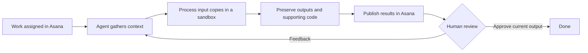

# Accounting & Finance Agent

> A general, human-supervised agent for accounting and finance work, with Asana as the planned work interface and sandboxed code execution for file processing.

**Status:** Early development. The current implementation is a Deep Agent with persistent conversation threads, a terminal interface, and optional LangSmith sandbox execution. The complete Asana-to-sandbox-to-review workflow is planned. Agent capabilities are being established before adding Asana.

## Demo

Video coming after the first complete task and revision path works.

## What this project aims to do

Build a reusable system that accepts different accounting and finance requests, gathers relevant context, follows task-specific skills, and produces work that a person can inspect and approve.

Asana will be the main place to assign work, review outputs, and request revisions. The agent loop will run outside a temporary sandbox, using general execution and file capabilities inside the sandbox. Approved business knowledge and reusable assets will guide the work.

The first platform task summarizes a CSV. Monthly bank reconciliation is the provisional first finance workflow; its skill and fictional company reference are now written, with end-to-end execution and evaluation still pending.

## Target workflow



This is the proposed workflow. Separate approval will be required before a proposed script, model, memory note, or skill change becomes an approved reusable asset.

## Implementation status

The inventory separates architectural building blocks from supporting behavior, controls, evaluation, and delivery work. An implemented entry means code is present; live verification is recorded separately below. These categories organize the build by purpose, rather than prescribing a separate module for every entry.

### 1. Agent and system components

| Component | Status | Current scope or remaining work |
| --- | --- | --- |
| Model and Deep Agents harness | Implemented | OpenAI model, built-in file tools, general-purpose subagent, compaction, and large-result offloading. |
| Todo middleware | Implemented | `TodoListMiddleware` and `write_todos`. |
| Memory middleware | Implemented | Loads short, owner-maintained guidance from local `memory/AGENTS.md`. |
| Skills middleware | Implemented | Discovers local CSV analysis, file-delivery validation and bank-reconciliation procedures. |
| Backend routing | Implemented | `CompositeBackend` with read-only local memory/skills routes and a sandbox or state default. |
| Execution environment | Implemented | Temporary LangSmith sandbox per prompt, with explicit 1 vCPU / 2 GiB RAM allocation and optional snapshot selection. |
| Working-file storage | Implemented | Separate persistent `workspace/threads/<thread-id>/` folders, copied to `/workspace` per run. |
| Checkpointer | Implemented | Local SQLite graph/conversation checkpoints and a thread directory outside the sandbox. |
| Tracing integration | Implemented | Optional LangSmith tracing through environment settings. |
| Runtime context | Implemented; basic live check passed | Current date/time/weekday, Toronto timezone, run/thread identity, workspace and trigger; task ID is optional until Asana is connected. |
| Finance workflow skills | Procedure added; live execution pending | Monthly bank reconciliation from source checks through matching, balance bridge, Excel/Word deliverables, draft entries and human review. First real task data and results are not yet evaluated. |
| Business references | Fictional demonstration profile added | Maple Harbour Services Ltd.: CAD, December year-end, one operating account, exact-amount matching and no automatic posting/write-offs. Real-company policy remains unset. |
| Sandbox environment releases | Implemented; first release built | `accounting-finance:v1` captured from a pinned default base and selected locally by immutable snapshot ID through `SANDBOX_SNAPSHOT_ID`. Default libraries are preserved. |
| Additional sandbox package installation | Implemented; live check pending | Build script supports installing pinned extra requirements before capture. The current requirements file has no extra packages, so this branch has not been exercised. Skills do not install libraries. |

### 2. Supporting behavior, controls, and quality

| Area | Status | Current scope or remaining work |
| --- | --- | --- |
| File transfer | Implemented | Upload working copies; download new or changed files to the same local paths. |
| File preservation | Implemented | Previous-version backups, conflict preservation, and no propagation of remote deletions. |
| Sandbox lifecycle | Implemented | Request deletion after preservation, with idle-stop/deletion fallback and retention on download failure. |
| Read-only reference policy | Implemented | Reject mutations to approved memory and skills; the owner maintains them. |
| File metadata compatibility | Implemented; live check pending | Supply filenames omitted from binary reads by the pinned library version. |
| Environment/configuration setup | Implemented | Private `.env`, locked dependencies, and reproducible local Python environment. |
| Sandbox release records and rollback | Implemented | Save base/snapshot IDs, build-input hashes, and Python/package inventory under `.state/snapshots/`. Select a previous immutable ID to roll back; rollback has not been exercised. |
| Basic engineering checks | 58 offline tests passed | Network-blocked suite covers transfers, lifecycle, context, limits, subagent budget sharing, persistence, references, review, validation and runner orchestration. Live service checks remain separate. |
| Operating limits | Implemented; live check pending | Shared agent call budgets, new-call deadline, response-token setting, model timeout/retries and bounded sandbox commands. Not a hard monetary cap; see operating guide. |
| Network destinations | Configured; enforcement unverified | PyPI and SEC hosts on port 443 by default; owner-configurable allowlist. Provider organization policy may replace these rules. |
| Artifact validation | Basic implementation; finance checks incomplete | Host structural checks on changed Office/CSV/JSON outputs plus a reusable validation skill. No host formula recalculation, rendering, or financial sign-off. |
| Dataset evaluations | Draft starter suite; not run | Two synthetic CSV cases, isolated real-agent runner, deterministic JSON/source-preservation checks; not a finance benchmark. |
| Durable work log | Implemented; basic live check passed | SQLite run outcomes, fingerprints, call events, transfer manifests, validation findings, and human review records. Live approval/rejection exercise remains pending. |
| Failure recovery | Basic implementation; live check pending | No automatic task/tool replay; bounded provider retries, per-thread local locks, failure records, and explicit retained-sandbox export. No distributed/exactly-once guarantee. |
| Task workspace separation | Implemented; basic live check passed | A new thread used its empty folder and preserved outputs there. Legacy shared files are untouched and must be copied to the intended thread. |
| Output review process | Local prototype implemented; live check pending | Approval/rejection of a particular successful run's file hashes; changed files show stale review. No enterprise identity or Asana review workflow yet. |

### 3. Interfaces, integrations, and delivery

| Area | Status | Current scope or remaining work |
| --- | --- | --- |
| Terminal interface | Implemented | Chat, create/list/switch threads, and resume the last selected conversation. |
| Live progress display | Implemented; tool display verified live | Tool start/end names and status plus todo updates; no raw tool-payload dump. Todo display remains unverified live. |
| State inspection | Implemented; live check pending | `:state`, `:workspace`, `:runs`, `:review`, `:approve`, and `:reject`. |
| Asana integration | Deferred until the agent foundation is ready | MCP/OAuth, intake/triggers, task-to-thread mapping, status/feedback updates, and duplicate/loop prevention. |
| API and deployment | Not implemented | Graph/API entry point, Studio configuration, and deployment instructions. |
| Automated environment builds | Workflow defined; GitHub setup/run pending | Manual Actions trigger, serialized builds, unique CI release tags, snapshot output and downloadable manifest. Requires pushing files and configuring a repository secret. |
| Portfolio presentation | In progress | Verified demo, example artifacts, video, repository cleanup, and final documentation. |

### Verification status

- The saved two-run smoke-test traces and local files demonstrated creation, reuse across runs, in-place revision, version backup, and a correct simple CSV total. A read-only API check confirmed no sandbox records remained at that check.
- Offline workspace/lifecycle checks passed before the later persistence, filename-adapter, and knowledge-routing additions. Those earlier results do not validate every subsequent change.
- The live transfer check demonstrated upload/download byte integrity. Its immediate deletion check exposed a timing issue, after which the corrected read-only check confirmed deletion.
- The agent generated a financial workbook from a filing during a user-run task. Its financial accuracy, formula recalculation, and visual presentation have not been independently verified here.
- The filename compatibility adapter still needs live binary-file verification. The CSV/JSON smoke run read two skills successfully; full procedure quality and finance skills remain unevaluated.
- A fresh default sandbox inventory confirmed Python 3.14.4 and preinstalled Excel, Word, and PowerPoint libraries without installing packages. Its deletion was confirmed by the API.
- The `accounting-finance:v1` snapshot build completed, recorded its inventory, and selected the resulting immutable ID in local `.env`. The temporary builder's deletion was confirmed by the API. The owner subsequently reported running the agent and observing faster startup; no timing comparison or trace assessment has established a performance improvement.
- Additional-package installation during a build, rollback, and automated environment builds have not been verified live. No model calls were made during the inventory or snapshot build.
- The expanded offline engineering suite passed all 58 tests with zero network connection attempts. Malformed-review-label validation and execute timeout handling gaps were fixed. The real compiled graph was exercised with fake model replies, including subagent budget sharing, checkpoint restoration and timeout capping before tool validation. See [engineering results](docs/engineering-checks.md).
- User-run smoke task `4b5fa1d2-5cda-4ce2-9af9-34cb75f008cf` preserved a CSV and JSON with three rows and a verified Decimal total of `14.24`, recorded the run for review, and left no pending nodes. Two initial execute calls were rejected for requesting 120000 seconds; the third succeeded. The subsequent fix passed offline regression checks. A read-only API check confirmed sandbox deletion. Live egress enforcement, recovery, evaluation trials and the CI workflow remain unverified.
- The bank-reconciliation skill and fictional-company defaults are owner-editable Markdown references. They have not been exercised on a reconciliation task or established as a verified finance capability. No transaction data or balances were invented to present a completed result.

See the [operating guide](docs/operating-guide.md) for settings, workspace transition, commands, review scope, and recovery limitations.

Run `uv run --locked python scripts/export_traces.py --sync` to sync the
`accounting-finance-agent` LangSmith project into Git-ignored `traces/` JSON files.
It adds new traces, refreshes changed traces and retains unchanged copies.
`--trace RUN_ID` and `--latest 10` are also available.
See [local trace copies](docs/operating-guide.md#local-trace-copies).

**Intentionally deferred:** agent-drafted memory/skill change proposals and automatic learning. The owner currently maintains both folders directly. A separate Store, custom compaction tuning, async execution plumbing, and a large-result demo tool are optional additions when a concrete need arises. Default subagents, compaction, and result offloading already come with the harness.

## Agent configuration

Both modes use the built-in Deep Agents harness with a SQLite checkpointer, a routed filesystem, and brief instructions about working and reference paths. In default mode, ordinary files are virtual and stored in thread state; only the approved memory and skills routes expose their local folders. In the pinned Deep Agents version, the `execute` tool schema is present even in this mode, but execution returns an unavailable error. Sandbox mode supplies the `LangSmithSandbox` default backend that enables execution. Each prompt starts another run within the selected conversation thread.

Both modes explicitly add [LangChain's to-do middleware](https://docs.langchain.com/oss/python/langchain/middleware/built-in#to-do-list). Its `write_todos` tool lets the agent keep a plan with `pending`, `in_progress`, and `completed` items. The list lives in graph state and is persisted with the selected thread. The model decides when a plan is useful; simple questions may not produce a todo list. Inspect `write_todos` calls in LangSmith to observe planning and progress. These internal todos are separate from the future Asana task board.

The pinned Deep Agents version omits filenames from some binary `read_file` content blocks. A small filesystem middleware adapter supplies the source basename before model requests, including restored thread history. Existing filenames are preserved; inline attachments without a known source path receive a MIME-based attachment name. This avoids LangChain's `LC_AUTOGENERATED` warning without suppressing warnings globally. The adapter retains the built-in filesystem behavior and is inherited by the default general-purpose subagent through its filesystem middleware slot.

## Approved memory and skills

```text
memory/
  AGENTS.md               # Short owner-approved guidance shared across conversations
skills/
  README.md               # How to add skills; this is not itself a skill
  csv-analysis/
    SKILL.md              # CSV inspection and decimal-based summaries
  file-delivery-validation/
    SKILL.md              # Source, structure, calculation, and presentation checks
  bank-reconciliation/
    SKILL.md              # First finance workflow; execution/evaluation pending
```

These folders are on the local host, outside the temporary sandbox and thread working folders. A `CompositeBackend` provides the following routes:

| Agent path | Storage | Access |
| --- | --- | --- |
| `/memories/` | Local `memory/` | Read-only to agent file tools |
| `/skills/` | Local `skills/` | Read-only to agent file tools |
| Other paths in sandbox mode | Remote sandbox; eligible `/workspace` changes copied back | Working-file tools and execution |
| Other paths in default mode | Current thread's virtual filesystem | File tools; no shell execution |

`MemoryMiddleware` loads `/memories/AGENTS.md` into the main agent's system context. A custom memory prompt describes these files as owner-maintained and read-only. `SkillsMiddleware` is registered through `skills=["/skills/"]`; it supplies skill names and descriptions, and the agent reads matching procedures through file tools. Starter CSV analysis and file-delivery validation skills are bundled; company-specific finance skills remain future work. See [memory](https://docs.langchain.com/oss/python/deepagents/memory) and [skills](https://docs.langchain.com/oss/python/deepagents/skills).

The routed backends reject write, edit, delete, and upload operations against approved files. The owner edits these files directly. Memory/skill change proposals and automatic learning are outside the current implementation.

These are virtual file-tool routes, not sandbox mounts. Use `read_file` for `/memories/...` and `/skills/...`; `execute` runs remotely and cannot open those local files. A script stored with a skill must be read and copied into the remote working directory before execution. The application does not automatically install libraries referenced by a skill or copy these folders into the sandbox.

The middleware caches loaded memory and skill metadata in thread state. After changing the approved files, restart the agent and use `:new` to observe a fresh load. You can always inspect a reference file explicitly through file tools. These folders are intended as public project content: keep secrets and private business data out of them. A separate LangGraph Store is not required for this file-based setup.

## Setup

Use Python 3.13 and [uv](https://docs.astral.sh/uv/). From the repository root:

```powershell
uv sync --locked
if (-not (Test-Path .env)) { Copy-Item .env.example .env }
```

Edit `.env` and enter your own credentials:

```dotenv
OPENAI_API_KEY=your-openai-key
LANGSMITH_TRACING=true
LANGSMITH_API_KEY=your-langsmith-key
LANGSMITH_PROJECT=accounting-finance-agent
```

Set `LANGSMITH_TRACING=false` to run without uploading traces. The OpenAI API key is required in either case. `.env.example` also documents the optional model and reasoning settings; the defaults follow the earlier learning prototype.

`.env`, the virtual environment, and local caches are ignored by Git. Keep real credentials out of tracked files. When tracing is enabled, prompts, model outputs, and tool data may be sent to LangSmith; use synthetic data for this prototype.

## Run

Start the terminal interface:

```powershell
uv run --locked finance-agent
```

Enter a prompt, read the response, and type `exit` to quit. Follow-up prompts continue the displayed thread. For example: "Explain the purpose of a bank reconciliation in three sentences."

### Persistent conversations

Conversation checkpoints and the thread directory are saved in `.state/checkpoints.sqlite`, outside `workspace/` and outside the sandbox. This private folder is ignored by Git and is not uploaded to the sandbox. On startup, the application resumes the last selected thread for the current execution mode, or creates one if none exists. The terminal prints its ID.

| Command | Purpose |
| --- | --- |
| `:new` | Start a fresh conversation with a new thread ID. |
| `:threads` | List saved IDs and their first-prompt titles for this mode. |
| `:thread` | Show the current thread ID. |
| `:thread ID` | Switch to an existing saved conversation. |
| `:workspace` | Show the current thread's local working folder. |
| `:state` | Inspect saved state keys, message count, pending nodes, and todos. |
| `:runs` / `:review` | List recent runs and human review status in this thread. |
| `:approve RUN_ID` | Record approval of a successful run's unchanged file manifest. |
| `:reject RUN_ID reason` | Record rejection; submit requested revisions as the next normal prompt. |
| `:help` | Show terminal commands. |
| `exit` | Close the session and its database connection. |

To select a saved sandbox conversation when launching:

```powershell
uv run --locked finance-agent --sandbox --thread YOUR_SAVED_THREAD_ID
```

Default virtual-filesystem threads and sandbox threads are tracked separately so their tool histories and filesystem backends stay compatible. Thread IDs must already exist to resume them; use `:new` to create another. Switching threads makes no model or sandbox calls.

Only the new user message is submitted on each turn. The checkpointer restores previous graph state for that thread, including conversation messages and the harness's context-management state. This is thread memory, not a cross-thread long-term memory store. The integration uses [LangGraph checkpointers](https://docs.langchain.com/oss/python/langgraph/persistence) and [SqliteSaver](https://reference.langchain.com/python/langgraph.checkpoint.sqlite/SqliteSaver).

**Files are separate by thread:** each sandbox conversation uses `workspace/threads/<thread-id>/`, mapped to `/workspace`. Use `:workspace` to locate it. Existing shared files at the root remain untouched; copy needed inputs into the selected thread folder. `:new` creates a separate empty folder. Per-thread local locks prevent overlapping runner executions; external exactly-once recovery is not guaranteed.

To try conversation persistence without allocating a sandbox, start `uv run --locked finance-agent`, say "For this task, the project code is MAPLE-42. Remember it in this conversation," then exit. Start the same command again and ask "What is the project code?" The displayed thread ID should be unchanged. Use `:new` to check that the next conversation starts separately. These prompts make model calls; no model call is made merely by starting the app or selecting a thread.

These commands make model API calls. Local Python execution does not mean that the model runs locally.

Alternatively, activate the environment and use the Python module:

```powershell
.\.venv\Scripts\Activate.ps1
python -m accounting_finance_agent
```

VS Code is configured to use `.venv`. If an interpreter was previously selected for the workspace, choose this project's environment through **Python: Select Interpreter**.

## Sandbox execution

Start sandbox mode with:

```powershell
uv run --locked finance-agent --sandbox
```

This mode requires a LangSmith account with sandbox access enabled and `LANGSMITH_API_KEY` in `.env`, even when tracing is disabled. The SDK uses `LANGSMITH_ENDPOINT` if your account needs another region's API endpoint.

Try this prompt:

```text
Use the execute tool to run python3 --version and then python3 -c "print(2 + 2)". Report the actual command outputs.
```

The terminal loop waits for input before creating a sandbox. Each submitted prompt creates one temporary sandbox, uploads local input copies, gives the agent execution and file tools, downloads outputs, and deletes the sandbox before displaying the final answer. The agent and model client run on your computer; the generated commands run in the remote sandbox. The application does not copy the local `.env` or inject its API keys into that sandbox.

### Versioned sandbox environment

Build and select a reusable snapshot independently of agent runs:

```powershell
uv run --locked python scripts/build_sandbox_snapshot.py --activate
```

The recipe in `environments/finance/` initially captures LangSmith's default
libraries without installing extras. The script uses one temporary builder with
1 vCPU and 2 GiB RAM, records package versions and the resolved base snapshot ID,
captures the release, and confirms builder deletion. Snapshot storage persists
separately. It does not upload task files or make model calls.

`--activate` selects the returned immutable ID in local `.env` as
`SANDBOX_SNAPSHOT_ID`; restart the agent to load it. Blank selects LangSmith's
default. Sandbox allocation and workspace preservation continue as before.
Future library additions go in the environment's pinned requirements file and
require a new build, not installation at every agent startup. See the
[environment release guide](environments/finance/README.md) for updates, rollback,
base pinning, and deployment configuration. A manual GitHub Actions workflow is defined; configure its repository secret after pushing the project. It has not been run.

### Local workspace

```text
workspace/
  threads/
    <thread-id>/
      sales.csv
      analysis.xlsx
      summary.txt
      scripts/             # The agent can organize working files as needed
      .versions/           # Previous file versions, created when needed
      .conflicts/          # Remote revisions that conflict with local edits
```

At the start of every sandbox run, ordinary files in the selected local `workspace/threads/<thread-id>/` folder are copied to the same relative paths under `/workspace` in the sandbox. There are no required input or output subfolders. Hidden files and folders, `__pycache__`, and the reserved `transfer-tests` folder are excluded. Linked files and directories are rejected. Project files outside `workspace/`, including the project's `.env`, are not uploaded.

The agent reads, creates, revises, and organizes files under `/workspace`. Before cleanup, file hashes identify new or changed remote files, which are downloaded back into the same paths inside the selected thread folder. Unchanged remote files are not downloaded. Binary files and subfolders are supported. These local files stay after the sandbox is deleted and are uploaded on the next run. Workspace data is ignored by Git; only the root folder placeholder is tracked.

Before replacing a working file, the application preserves its previous local bytes under `.versions/<sandbox-name>/<relative-path>`. If a local file also differs from the uploaded version when the merge checks it, the local version is kept and the remote version is saved under `.conflicts/<sandbox-name>/<relative-path>` for review. Both internal folders are excluded from transfers. Sandbox deletions are not applied locally; a remote rename or move can therefore leave both old and new local paths. This is a working-copy merge, not a fully bidirectional filesystem sync.

For example, use `:workspace`, place `sales.csv` directly in that thread folder, and ask:

```text
Read /workspace/sales.csv and summarize its contents in /workspace/summary.txt. Save any supporting script in /workspace/scripts too.
```

This is a copy at the start and end of a run, not a live mount or continuous sync. All eligible working files are uploaded to each fresh sandbox; only new or changed remote files are downloaded. The agent can reuse previous results directly from the same workspace on its next run. Files outside `/workspace` and excluded internal files are not downloaded. Empty folders are not synchronized.

If downloading outputs fails, the application reports the sandbox name and leaves it available for recovery rather than deliberately deleting the only remote copy. The idle-stop and automatic deletion timers still apply, so recover files promptly; local downloads may be incomplete and sandbox usage can continue until it stops. Input-upload failures trigger cleanup before the agent starts.

The request explicitly asks for **1 vCPU and 2 GiB RAM**, with storage determined by the service's default runtime image. The terminal reports the allocation returned by the service. These settings are in `src/accounting_finance_agent/sandbox.py`; they are not presented as the provider's minimum.

Normal completion, ordinary agent failures, and Ctrl+C during agent work trigger output download followed by explicit deletion. A failed download retains the sandbox for recovery, as described above. As a fallback, the request sets a **300-second idle stop** and deletion **600 seconds after stopping**. Idle activity resets the idle timer; this is not a hard run-duration or spending limit. Forcefully terminating the process can bypass its cleanup code. See the [SDK lifecycle documentation](https://docs.langchain.com/langsmith/sandbox-sdk#sandbox-lifetime-and-retention).

Submitted prompts incur model and sandbox usage. Waiting for the next terminal prompt keeps no sandbox open. This setup uses the provider's runtime image and does not install extra packages automatically. Custom network restrictions and hard operating limits remain future work.

**Current boundary:** only eligible files under `/workspace` are preserved in the selected thread folder. Files and conversation state survive restarts. Inspect tool progress in the terminal, run/review metadata through `:runs`, and generated commands in LangSmith when tracing is enabled.

The integration follows the [Deep Agents LangSmith sandbox backend](https://docs.langchain.com/oss/python/deepagents/sandboxes).

## Transfer and lifecycle checks

For a **live file-transfer check without the LLM**, run:

```powershell
uv run --locked python scripts/check_workspace_transfer.py
```

This creates one real sandbox with the same allocation and lifecycle as the agent, so it incurs sandbox usage. It generates small synthetic text, XLSX, and binary fixtures directly in an isolated shared `workspace/transfer-tests/<test-id>` folder, without input/output subfolders. It checks upload hashes, new-file download, in-place revision, previous-version preservation, concurrent local-edit protection, and the policy of keeping local files when remote files are deleted. It then queries the API to confirm deletion. Test artifacts remain locally for inspection; old test runs are excluded from normal agent uploads. No model calls or package installations are made. A failure exits with an error; a download failure retains the sandbox under the normal recovery policy.

The application prints `Sandbox deletion requested` when the delete API call succeeds. The live check then polls for up to 60 seconds for the status API to report the resource is absent; one immediate lookup can still return a record. A stopped record alone does not pass deletion verification. To recheck a previous run without allocating another sandbox:

```powershell
uv run --locked python scripts/check_workspace_transfer.py --check-deletion finance-REPLACE_WITH_NAME
```

The following lifecycle checks are offline:

```powershell
uv run --locked python -m unittest discover -s tests -v
```

These checks mock the cloud client and exercise deletion on success, execution failure, interrupted work, and provisioning failure. They also check that cleanup failures are visible and that exiting without a prompt allocates no sandbox. They make no model or sandbox API calls.

For the full engineering suite with an explicit network guard, fake credentials,
and a saved result report, use:

```powershell
uv run --locked python scripts/check_engineering.py
```

See [engineering coverage and limitations](docs/engineering-checks.md). The current
suite passed 58 tests; finance quality requires separate task evaluations.

## Project structure

```text
docs/
  agent-spec.md          # Proposed capabilities, boundaries, and success criteria
  architecture.md        # Proposed component diagram and storage boundaries
environments/finance/
  snapshot.json          # Snapshot name/tag and base environment
  requirements.txt       # Optional additional remote Python packages
  README.md              # Build, select, update, and roll back environments
scripts/
  build_sandbox_snapshot.py  # Prepare and capture a reusable cloud environment
src/accounting_finance_agent/
  __init__.py
  __main__.py            # Minimal terminal input/output loop
  agent.py               # Model and optional execution backend
  file_metadata.py       # Filename compatibility adapter for binary file reads
  knowledge.py           # Persistent read-only memory/skills routes
  config.py              # Environment loading and validation
  persistence.py         # SQLite checkpoints, thread directory, and active thread
  sandbox.py             # Temporary sandbox creation, preparation, and cleanup
  workspace.py           # Thread workspace transfer, versions, and conflicts
  runtime.py             # Current-time context and shared call/deadline controls
  worklog.py             # Run events, local leases, and artifact review records
  validation.py          # Limited structural checks on generated files
memory/
  AGENTS.md              # Approved shared guidance
  company-profile.md     # Provisional fictional company conventions
skills/
  README.md              # Skill authoring layout; procedures added separately
workspace/
  .gitkeep
  threads/<thread-id>/   # Task working files; data is ignored by Git
.state/
  checkpoints.sqlite     # Private conversation database, ignored by Git
  worklog.sqlite         # Run provenance, transfer events, and human reviews
tests/
  test_sandbox.py         # Offline lifecycle and entry-point checks
.env.example             # Configuration template without credentials
pyproject.toml           # Dependencies and finance-agent command
uv.lock                  # Locked dependency versions
```

This starting point keeps agent construction small so each additional capability can be introduced and explained separately.

## Development lifecycle and build order

- [Agent specification](docs/agent-spec.md)
- [Detailed architecture](docs/architecture.md)
- [Deep Agents quickstart](https://docs.langchain.com/oss/python/deepagents/quickstart)

The project follows a staged lifecycle: plan what to measure, release, and monitor; configure the agent and its evaluations; test against the planned gates; deploy in controlled stages; then use monitoring findings to improve the next version. The project-specific plans and current gaps are in the [evaluation plan](docs/agent-spec.md#9-evaluation-plan), [release plan](docs/agent-spec.md#10-release-plan), and [monitoring plan](docs/agent-spec.md#11-monitoring-plan). The current repository is still a local prototype, not a deployment-ready service.

The current build sequence is:

1. Define the staged evaluation, release, and monitoring plans for the foundation and first finance workflow.
2. Verify the local foundation and run the starter CSV evaluation as an explicitly authorized model/sandbox trial.
3. Prepare synthetic bank-reconciliation cases with independently calculated expected results; evaluate calculations, exceptions, source preservation, and Excel/Word deliverables.
4. Confirm deployment readiness, staged rollout, stop/rollback, and monitoring before connecting real work systems.
5. Add Asana intake, controlled updates, review, and revisions after the agent foundation and first finance workflow are ready.
6. Verify the end-to-end assignment, execution, review, revision, failure, restart, and duplicate-prevention paths.
7. Monitor outcomes and turn diagnosed failures into regression cases before releasing later changes.

## Boundaries and evaluation

The planned system excludes journal posting, payments, changes to authoritative ERP records, external communications, and edits to original shared files. Output review and approval of reusable assets are separate decisions.

The current CSV dataset is a narrow platform baseline: it checks two arithmetic outputs and source preservation. It does not establish finance quality, repeatability, or release readiness. The agent specification defines the planned evaluation gates, release stages, and monitoring responses. The eventual Asana workflow acceptance criteria include five consecutive tasks through review/revision, preserved outputs after sandbox cleanup, duplicate prevention, and clear handling of blocked work. Finance skills require independently known results and critical financial checks before testing.

## License

No license has been selected yet.
