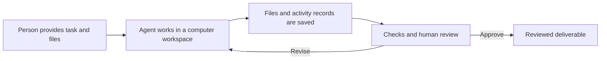

# Accounting & Finance Agent

## Summary

Give this AI agent an accounting assignment and financial data, and it can use a computer workspace to prepare an Excel working paper for review. This is a CPA portfolio project exploring practical, supervised AI use.

**Status:** Working terminal prototype, evaluated on fictional data with human review.

[See the example](#see-the-example) · [Project details](#project-details) · [Setup and documentation](#setup-and-documentation)

### See the example

**The assignment:** Prepare a two-month financial review for a fictional business.

- **Inputs:** Financial data and business notes explaining selected changes.
- **Output:** Excel income statements, monthly comparisons, margins, a breakdown of the profit change, and commentary tied to those notes.
- **Review:** Independent calculation checks, presentation and analysis review, and approval of the reviewed file version.

**Result:** All three trials in the v5 series passed numerical checks and independent spreadsheet recalculation. I reviewed and approved those output versions for this synthetic test.

[Read the results](docs/evaluations/excel-v5-results.md) · [View the assignment and inputs](evaluations/excel-v4/agent-inputs/) · [See the acceptance criteria](docs/evaluations/excel-benchmark.md)

A video walkthrough is planned. Test inputs, code, and result reports are public; trial workbooks and raw traces are kept out of Git.

---

## Project details

### Why build this instead of using ChatGPT, Claude, or Microsoft Copilot?

Ready-made AI assistants can already analyze data and create spreadsheets, often with much less setup. I built this prototype to explore **owning the accounting workflow: defining how work is done, checking the results, and managing changes over time.**

The custom **harness**—the software around the model—makes those decisions explicit:

| Consideration | Using a ready-made AI product | This project |
| --- | --- | --- |
| Control the workflow | Configure the tools, instructions, and settings the product supports. | Version procedures, tools, operating limits, and review rules in the repository. |
| Integrate with business systems | Use supported connectors and automation features, often with less setup. | Extend the code to tailor task intake, data access, file delivery, and review to the organization's workflow. Business connectors are future work. |
| Investigate problems | Inspect the activity and history the product exposes. | Record model/tool traces in LangSmith and file-transfer, recovery, and review events locally. |
| Check accounting results | Combine available product checks with your own review process. | Apply independent numerical checks, spreadsheet recalculation, and human approval tied to the reviewed file version. |
| Manage change | Work within the product's update and versioning policies. | Pin local dependencies, record settings, and evaluate model or workflow changes against repeatable cases. |

A possible extension would take an Asana assignment, retrieve SharePoint files, run the agent and checks, and return a draft for human review. Asana and SharePoint integrations are not implemented yet.

**The reusable asset is the accounting process:** its procedures, skills, controls, and evaluation cases remain in project files I can maintain as AI technology evolves.

Capabilities vary by product. A custom harness requires engineering and maintenance, and this one still depends on OpenAI, Deep Agents/LangGraph, and LangSmith. Hosted models and services can change; the project provides a defined way to assess the impact and adapt.

### How it works



The workspace is a temporary remote **sandbox** where the agent runs commands and edits files. Eligible files are saved locally for follow-up work. The agent can pause for essential clarifications through the terminal.

For the evaluated workflow, approved scripts build and recalculate the workbook; the agent prepares commentary. Checks and human review assess correctness. Traces explain what happened.

### What has been checked?

The latest published evidence is dated **November 5, 2026**:

| Area | Recorded result | Evidence |
| --- | --- | --- |
| Excel working paper | 3/3 trials passed numerical checks and independent recalculation; owner approval recorded for each output version. | [Workbook results](docs/evaluations/excel-v5-results.md) |
| Engineering | 150/150 offline checks passed for selected controls, files, persistence, recovery, and related behavior. | [Foundation report](docs/evaluations/foundation-v5-2026-11-05.md) |
| Live behavior and boundaries | 7/7 context cases passed; selected sandbox and file-preservation checks passed. | [Scope and limitations](docs/evaluations/foundation-v5-2026-11-05.md#limits-and-evidence) |

Evidence covers one fictional task and configuration; real business use requires separate evaluation and approval. Earlier failures and corrections remain in the [test history](docs/history/test-gate-followup-2026-10-25.md).

### My role and AI assistance

I developed this with AI coding assistance. I guided the accounting objectives, workflow, design decisions, evaluation criteria, and output review. The implementation and evaluation reports document that work.

### Current boundaries

- The prototype is not approved to post journals, make payments, or change authoritative financial records.
- Asana task intake, SharePoint file access, and a hosted user interface are future extensions.
- Experimental subagent features are outside the evaluated Excel profile.

---

## Setup and documentation

**Stack:** Python, LangChain Deep Agents / LangGraph, OpenAI, LangSmith tracing and sandboxes, SQLite, openpyxl, and LibreOffice for the evaluated spreadsheet workflow.

You need Python 3.13, `uv`, OpenAI API credentials, and LangSmith sandbox access. Follow the [setup guide](docs/technical-guide.md#setup), then start the terminal:

```sh
uv run --locked finance-agent
```

Runs use paid model and sandbox services. The default profile differs from the evaluated [Excel benchmark configuration](docs/operating-guide.md#versioned-excel-trial-profile).

| Read next | Contents |
| --- | --- |
| [Documentation and repository map](docs/README.md) | Where to find the code, cases, results, guides, and project history. |
| [Setup and technical guide](docs/technical-guide.md) | Installation, commands, threads, skills, file handling, and code map. |
| [Operating guide](docs/operating-guide.md) | Profiles, limits, benchmark execution, review, recovery, and trace exports. |
| [Specification and design](docs/agent-spec.md) | Intended capabilities, architecture, evaluation, deployment, and monitoring plans. |
| [Project task list](docs/task-list.md) | Build status, gates, and remaining work. |
| [Mental models](docs/mental-model/00-overview.md) | The agent anatomy and development lifecycle behind the design. |

## License

No license has been selected yet.
