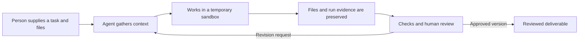

# Accounting & Finance Agent

A human-supervised AI agent prototype that turns supplied financial data into a reviewable Excel working paper.

**Demo video:** Coming soon.

**Demonstrated:** Three trials of a fictional two-month reporting task passed numerical checks and independent recalculation. The project owner reviewed and approved the resulting output versions.

**Approach:** The agent works with files in a sandbox, preserves its work, and records activity in LangSmith. A person reviews its outputs. This is a proof of concept and has not been approved for real business work.

[How it works](#how-the-prototype-works) · [Evaluation results](docs/evaluations/excel-v5-results.md) · [Setup](#setup)

## Why this project

Accounting work requires source data, calculations that can be checked, and an opportunity for human judgment. This project explores how an agent can assist with that work while preserving files and evidence for review.

The project was developed with AI coding assistance. The project owner guided the objectives, accounting workflow, design and evaluation decisions, and reviewed the trial outputs. Reports retain earlier failures and corrective work.

## Why build a custom agent harness?

The harness provides control over how the agent works: its tools, sandbox, file handling, operating limits, and review process can be configured for the task. Run records and LangSmith traces make model and tool activity visible, helping investigate failures and assess changes. Task-specific skills and evaluations let the project apply and check accounting requirements against concrete cases.

These controls and integrations also require ongoing implementation, testing, and maintenance. A trace helps explain what happened; it does not by itself establish that an output is correct.

## Demonstrated workflow

Given fictional financial data and business notes for two months, the agent creates an Excel working paper with income statements, variances, margins, a profit bridge, and commentary grounded in the supplied notes. The agent uses approved spreadsheet helpers and writes the commentary. [Task and rubric](docs/evaluations/excel-benchmark.md).

1. A person supplies the assignment and inputs through a terminal and a thread workspace.
2. The agent uses guidance and tools to work in a temporary sandbox.
3. The system preserves the output and records execution evidence; LangSmith traces show recorded model and tool activity.
4. Independent checks and human review assess the resulting workbook and its identified version.

Separate thread workspaces retain files for follow-up work. Run limits, file protections, recovery records, and human approval support the supervised workflow. These controls have defined scopes and are described in the [operating guide](docs/operating-guide.md).

## Evaluation results

The v5 series used three fresh threads with the same synthetic inputs and configuration:

- **3 of 3** outputs passed the numerical grader and independent recalculation. The assistant reviewed the narratives and rendered pages; the owner approved the three exact output manifests.
- **150 offline engineering tests** passed with network access blocked, covering selected controls, files, persistence, and recovery scenarios.
- **7 of 7** selected live context cases and **3 of 3** integrated offline recovery cases passed. Selected live sandbox boundary and file-preservation probes also passed.

These results are evidence for **one synthetic task and its tested configuration**. They do not establish general accounting reliability. Outputs require human review, and a release for real work is a separate decision. Read the [v5 results](docs/evaluations/excel-v5-results.md), [foundation checks and limitations](docs/evaluations/foundation-v5-2026-11-05.md), and [earlier test report](docs/evaluations/test-gate-followup-2026-10-25.md).

## How the prototype works



The current interface is a terminal. A future Asana integration could manage task assignment and feedback, but it is not part of the working prototype yet.

## Explore the project

- [Evaluation reports](docs/evaluations/excel-v5-results.md) — benchmark results, evidence and links to related checks.
- [Specification and design](docs/agent-spec.md) — capabilities, architecture, evaluation and release plans.
- [Operating guide](docs/operating-guide.md) — configuration, sandbox use, review and recovery.
- [Task list](docs/task-list.md) — implementation status and remaining work.
- [Setup](#setup) and [run instructions](#run) — try the terminal prototype.

The detailed technical inventory and setup instructions follow.

## Implementation status

<details>
<summary>Expand the detailed implementation and verification inventory</summary>

The inventory separates architectural building blocks from supporting behavior, controls, evaluation, and delivery work. An implemented entry means code is present; live verification is recorded separately below. These categories organize the build by purpose, rather than prescribing a separate module for every entry.

### 1. Agent and system components

| Component | Status | Current scope or remaining work |
| --- | --- | --- |
| Model and Deep Agents harness | Implemented | OpenAI model, file tools, compaction and large-result offloading; benchmark delegation is disabled. The local profile retains its default subagent. |
| Todo middleware | Implemented | `TodoListMiddleware` and `write_todos`. |
| Memory middleware | Implemented | Loads short, owner-maintained guidance from local `memory/AGENTS.md`. |
| Skills middleware | Implemented | Discovers local CSV analysis, file-delivery validation and bank-reconciliation procedures. |
| Backend routing | Implemented | `CompositeBackend` with read-only local memory/skills routes and a sandbox-backed working area. |
| Execution environment | Implemented | Temporary LangSmith sandbox per prompt, with explicit 1 vCPU / 2 GiB RAM allocation and optional snapshot selection. |
| Working-file storage | Implemented | Separate persistent `workspace/threads/<thread-id>/` folders, copied to `/workspace` per run. |
| Checkpointer | Implemented | Local SQLite graph/conversation checkpoints and a thread directory outside the sandbox. |
| Tracing integration | Implemented | LangSmith tracing; required on for the benchmark profile, configurable in the local profile. |
| Runtime context | Implemented; basic live check passed | Current date/time/weekday, Toronto timezone, run/thread identity, workspace and trigger; task ID is optional until Asana is connected. |
| Finance workflow skills | Procedure added; live execution pending | Monthly bank reconciliation from source checks through matching, balance bridge, Excel/Word deliverables, draft entries and human review. First real task data and results are not yet evaluated. |
| Business references | Fictional demonstration profile added | Maple Harbour Services Ltd.: CAD, December year-end, one operating account, exact-amount matching and no automatic posting/write-offs. Real-company policy remains unset. |
| Sandbox environment releases | Implemented; first release built | `accounting-finance:v1` captured from a pinned default base and selected locally by immutable snapshot ID through `SANDBOX_SNAPSHOT_ID`. Default libraries are preserved. |
| Additional sandbox package installation | Implemented; live check pending | Build script supports installing pinned extra requirements before capture. The current requirements file has no extra packages, so this branch has not been exercised. Skills do not install libraries. |

### 2. Supporting behavior, controls, and quality

| Area | Status | Current scope or remaining work |
| --- | --- | --- |
| File transfer | Implemented | Upload working copies; download new or changed files to the same local paths. |
| File preservation | Implemented | Previous-version backups, conflict preservation, and no propagation of remote deletions. |
| Sandbox lifecycle | Implemented | Request deletion after preservation, with idle-stop/deletion fallback and retention on download failure. |
| Read-only reference policy | Implemented | Reject mutations to approved memory and skills; the owner maintains them. |
| File metadata compatibility | Implemented; live check pending | Supply filenames omitted from binary reads by the pinned library version. |
| Environment/configuration setup | Implemented | Private `.env`, locked dependencies, and reproducible local Python environment. |
| Sandbox release records and rollback | Implemented | Save base/snapshot IDs, build-input hashes, and Python/package inventory under `.state/snapshots/`. Select a previous immutable ID to roll back; rollback has not been exercised. |
| Basic engineering checks | 150 passing offline tests in the November 5 run | Network-blocked suite covers selected lifecycle, context, limits, files, references, review, validation and recovery. Live model/sandbox checks are recorded separately. |
| Operating limits | Implemented; live check pending | The benchmark adds shared HTTP reservations, attempt/retry accounting and hard work/cleanup deadlines. The local profile retains its earlier admission bounds; see the operating guide. |
| Network destinations | Benchmark boundary checked | Benchmark execution uses an isolated network namespace; live DNS/direct-IP/re-entry checks passed. Local-profile provider allowlist enforcement remains separate. |
| Artifact validation | Selected benchmark validated | Structural checks, LibreOffice recalculation/caches, PDF/PNG evidence and independent grader were applied to the final three-trial series. |
| Dataset evaluations | Three synthetic Excel trials pass, with owner approval | Independent recalculation, source-grounded analysis, visual review, saved outputs and trace/provenance walks. Earlier failed trials are retained. |
| Durable work log | Implemented; basic live check passed | SQLite run outcomes, fingerprints, call events, transfer manifests, validation findings, and human review records. Three owner approvals are bound to saved manifests; stale/rejection checks are exercised separately. |
| Failure recovery | Basic implementation; live check pending | No automatic task/tool replay; bounded provider retries, per-thread local locks, failure records, and explicit retained-sandbox export. No distributed/exactly-once guarantee. |
| Task workspace separation | Implemented; basic live check passed | A new thread used its empty folder and preserved outputs there. Legacy shared files are untouched and must be copied to the intended thread. |
| Output review process | Local prototype implemented; owner approval recorded | Approval/rejection of a particular successful run's file hashes; changed files show stale review. No enterprise identity or Asana review workflow yet. |

### 3. Interfaces, integrations, and delivery

| Area | Status | Current scope or remaining work |
| --- | --- | --- |
| Terminal interface | Implemented | Chat, create/list/switch threads, and resume the last selected conversation. |
| Live progress display | Implemented; tool display verified live | Tool start/end names and status plus todo updates; no raw tool-payload dump. Todo display remains unverified live. |
| State inspection | Implemented; live check pending | `:state`, `:workspace`, `:runs`, `:review`, `:approve`, and `:reject`. |
| Asana integration | Deferred until the agent foundation is ready | MCP/OAuth, intake/triggers, task-to-thread mapping, status/feedback updates, and duplicate/loop prevention. |
| API and deployment | Not implemented | Graph/API entry point, Studio configuration, and deployment instructions. |
| Automated environment builds | Workflow defined; GitHub setup/run pending | Manual Actions trigger, serialized builds, unique CI release tags, snapshot output and downloadable manifest. Requires pushing files and configuring a repository secret. |
| Portfolio presentation | In progress | Verified demo, example artifacts, video, repository cleanup, and final documentation. |

### Verification status

- Final fixture v4 series `df3feccd-26d4-44e0-8c7c-5ae0adfd1edb` passes technical checks on three fresh threads. Earlier budget/tool stops and grounding failures remain in the [test-gate follow-up](docs/evaluations/test-gate-followup-2026-10-25.md). The owner approved all three exact output manifests; run outcomes and review decisions are stored separately.
- TEST-01/03/04/05/06 meet their selected scope: 7/7 live context cases (including two real compactions), 3/3 integrated offline recovery cases, and the recorded controls/file/provenance checks. TEST-02 also meets its completion criterion after owner approval of the exact three deliveries.
- The saved two-run smoke-test traces and local files demonstrated creation, reuse across runs, in-place revision, version backup, and a correct simple CSV total. A read-only API check confirmed no sandbox records remained at that check.
- Offline workspace/lifecycle checks passed before the later persistence, filename-adapter, and knowledge-routing additions. Those earlier results do not validate every subsequent change.
- The live transfer check demonstrated upload/download byte integrity. Its immediate deletion check exposed a timing issue, after which the corrected read-only check confirmed deletion.
- The agent generated a financial workbook from a filing during a user-run task. Its financial accuracy, formula recalculation, and visual presentation have not been independently verified here.
- The filename compatibility adapter still needs live binary-file verification. The CSV/JSON smoke run read two skills successfully; full procedure quality and finance skills remain unevaluated.
- A fresh default sandbox inventory confirmed Python 3.14.4 and preinstalled Excel, Word, and PowerPoint libraries without installing packages. Its deletion was confirmed by the API.
- The `accounting-finance:v1` snapshot build completed, recorded its inventory, and selected the resulting immutable ID in local `.env`. The temporary builder's deletion was confirmed by the API. The owner subsequently reported running the agent and observing faster startup; no timing comparison or trace assessment has established a performance improvement.
- Additional-package installation during a build, rollback, and automated environment builds have not been verified live. No model calls were made during the inventory or snapshot build.
- An earlier offline engineering suite passed all 58 tests with zero network connection attempts. Malformed-review-label validation and execute timeout handling gaps were fixed. The real compiled graph was exercised with fake model replies, including subagent budget sharing, checkpoint restoration and timeout capping before tool validation. See [engineering results](docs/engineering-checks.md).
- User-run smoke task `4b5fa1d2-5cda-4ce2-9af9-34cb75f008cf` preserved a CSV and JSON with three rows and a verified Decimal total of `14.24`, recorded the run for review, and left no pending nodes. Two initial execute calls were rejected for requesting 120000 seconds; the third succeeded. The subsequent fix passed offline regression checks. A read-only API check confirmed sandbox deletion. This historical smoke run did not verify live egress enforcement, recovery, evaluation trials or the CI workflow; later evaluation evidence is reported above.
- The bank-reconciliation skill and fictional-company defaults are owner-editable Markdown references. They have not been exercised on a reconciliation task or established as a verified finance capability. No transaction data or balances were invented to present a completed result.

See the [operating guide](docs/operating-guide.md) for settings, workspace transition, commands, review scope, and recovery limitations.

Run `uv run --locked python scripts/export_traces.py --sync` to sync the
`accounting-finance-agent` LangSmith project into Git-ignored `traces/` JSON files.
It adds new traces, refreshes changed traces and retains unchanged copies.
`--trace RUN_ID` and `--latest 10` are also available.
See [local trace copies](docs/operating-guide.md#local-trace-copies).

**Intentionally deferred:** agent-drafted memory/skill change proposals and automatic learning. The owner currently maintains both folders directly. A separate Store, custom compaction tuning, async execution plumbing, and a large-result demo tool are optional additions when a concrete need arises. Default subagents, compaction, and result offloading already come with the harness.

</details>

## Agent configuration

The terminal uses the built-in Deep Agents harness with a SQLite checkpointer, a routed filesystem, and a temporary `LangSmithSandbox` for each prompt. Ordinary working files are stored in the sandbox and preserved in the selected thread’s host workspace. Approved memory and skill routes expose their local folders to file tools. Each prompt starts another run within the selected conversation thread.

The agent explicitly adds [LangChain's to-do middleware](https://docs.langchain.com/oss/python/langchain/middleware/built-in#to-do-list). Its `write_todos` tool lets the agent keep a plan with `pending`, `in_progress`, and `completed` items. The list lives in graph state and is persisted with the selected thread. The model decides when a plan is useful; simple questions may not produce a todo list. Inspect `write_todos` calls in LangSmith to observe planning and progress. These internal todos are separate from the future Asana task board.

### Experimental dynamic subagents

For the local profile, set `AGENT_DYNAMIC_SUBAGENTS=true` before launching the agent to add the beta QuickJS interpreter. The agent can call `eval` with JavaScript that dispatches configured subagents through `task()`. Each `eval` starts with a fresh interpreter, and up to four subagent calls run concurrently. Programmatic access to other tools is disabled. The Excel benchmark profile does not enable this option.

Interpreter dispatches use the parent run's shared model-call controls, but the `task()` bridge calls do not pass through the parent tool middleware: each dispatch is not individually counted against the normal tool-call limit or separately subject to parent-level tool approval. The interpreter's concurrency setting is not a total dispatch limit. This option is exploratory; its use changes the local runtime and should be evaluated for the intended workload.

### Experimental reviewer messaging

`finance-agent --profile peer-collaboration-v1` adds two named reviewers that can exchange addressed messages during one run. The reviewers' `send_peer_message` and `receive_peer_messages` tools use a bounded, in-memory mailbox; messages are not durable across runs and do not wake a reviewer that has finished. Tool calls and message contents may appear in traces. The two reviewers have separate conversation contexts and access to the same sandbox-backed workspace. They share the parent run's model and tool limits. The main agent must delegate them concurrently when the work requires real-time communication. Each reviewer name has one inbox per run: multiple simultaneous invocations of the same reviewer would share that inbox, so use one invocation of each role in this prototype. This profile is experimental; it does not add external messaging, background agents, or stateful subagent sessions.

The pinned Deep Agents version omits filenames from some binary `read_file` content blocks. A small filesystem middleware adapter supplies the source basename before model requests, including restored thread history. Existing filenames are preserved; inline attachments without a known source path receive a MIME-based attachment name. This avoids LangChain's `LC_AUTOGENERATED` warning without suppressing warnings globally. The adapter retains the built-in filesystem behavior and is inherited by the default general-purpose subagent through its filesystem middleware slot.

## Approved memory and skills

```text
memory/
  AGENTS.md               # Short owner-approved guidance shared across conversations
skills/
  README.md               # How to add skills; this is not itself a skill
  csv-analysis/
    SKILL.md              # CSV inspection and decimal-based summaries
  file-delivery-validation/
    SKILL.md              # Source, structure, calculation, and presentation checks
  bank-reconciliation/
    SKILL.md              # First finance workflow; execution/evaluation pending
```

These folders are on the local host, outside the temporary sandbox and thread working folders. A `CompositeBackend` provides the following routes:

| Agent path | Storage | Access |
| --- | --- | --- |
| `/memories/` | Local `memory/` | Read-only to agent file tools |
| `/skills/` | Local `skills/` | Read-only to agent file tools |
| Other working paths | Remote sandbox; eligible `/workspace` changes copied back | Working-file tools and execution |

`MemoryMiddleware` loads `/memories/AGENTS.md` into the main agent's system context. A custom memory prompt describes these files as owner-maintained and read-only. `SkillsMiddleware` is registered through `skills=["/skills/"]`; it supplies skill names and descriptions, and the agent reads matching procedures through file tools. Starter CSV analysis and file-delivery validation skills are bundled; company-specific finance skills remain future work. See [memory](https://docs.langchain.com/oss/python/deepagents/memory) and [skills](https://docs.langchain.com/oss/python/deepagents/skills).

The routed backends reject write, edit, delete, and upload operations against approved files. The owner edits these files directly. Memory/skill change proposals and automatic learning are outside the current implementation.

These are virtual file-tool routes, not sandbox mounts. Use `read_file` for `/memories/...` and `/skills/...`; `execute` runs remotely and cannot open those local files. A script stored with a skill must be read and copied into the remote working directory before execution. The application does not automatically install libraries referenced by a skill or copy these folders into the sandbox.

The middleware caches loaded memory and skill metadata in thread state. After changing the approved files, restart the agent and use `:new` to observe a fresh load. You can always inspect a reference file explicitly through file tools. These folders are intended as public project content: keep secrets and private business data out of them. A separate LangGraph Store is not required for this file-based setup.

## Setup

Use Python 3.13 and [uv](https://docs.astral.sh/uv/). From the repository root:

```powershell
uv sync --locked
if (-not (Test-Path .env)) { Copy-Item .env.example .env }
```

Edit `.env` and enter your own credentials:

```dotenv
OPENAI_API_KEY=your-openai-key
LANGSMITH_TRACING=true
LANGSMITH_API_KEY=your-langsmith-key
LANGSMITH_PROJECT=accounting-finance-agent
```

Set `LANGSMITH_TRACING=false` to run without uploading traces. The OpenAI API key is required. The LangSmith API key is also required for the sandbox, even when tracing is disabled. `.env.example` also documents the optional model and reasoning settings; the defaults follow the earlier learning prototype.

`.env`, the virtual environment, and local caches are ignored by Git. Keep real credentials out of tracked files. When tracing is enabled, prompts, model outputs, and tool data may be sent to LangSmith; use synthetic data for this prototype.

## Run

Start the terminal interface:

```powershell
uv run --locked finance-agent
```

Enter a prompt, read the response, and type `exit` to quit. Follow-up prompts continue the displayed thread. For example: "Explain the purpose of a bank reconciliation in three sentences."

### Persistent conversations

Conversation checkpoints and the thread directory are saved in `.state/checkpoints.sqlite`, outside `workspace/` and outside the sandbox. This private folder is ignored by Git and is not uploaded to the sandbox. On startup, the application resumes the last selected sandbox thread, or creates one if none exists. The terminal prints its ID.

| Command | Purpose |
| --- | --- |
| `:new` | Start a fresh conversation with a new thread ID. |
| `:threads` | List saved sandbox thread IDs and their first-prompt titles. |
| `:thread` | Show the current thread ID. |
| `:thread ID` | Switch to an existing saved conversation. |
| `:workspace` | Show the current thread's local working folder. |
| `:state` | Inspect saved state keys, message count, pending nodes, and todos. |
| `:pending` | Show pending clarification requests and their IDs. |
| `:answer ID response` | Answer a pending clarification and resume its checkpoint in a new sandbox run. |
| `:runs` / `:review` | List recent runs and human review status in this thread. |
| `:recovery [RUN_ID]` | Inspect recorded failure, workspace, transfer and cleanup information; without an ID, show the latest failed, limited or running run. |
| `:approve RUN_ID` | Record approval of a successful run's unchanged file manifest. |
| `:reject RUN_ID reason` | Record rejection; submit requested revisions as the next normal prompt. |
| `:help` | Show terminal commands. |
| `exit` | Close the session and its database connection. |

To select a saved sandbox conversation when launching:

```powershell
uv run --locked finance-agent --thread YOUR_SAVED_THREAD_ID
```

Existing virtual-mode thread data remains in the checkpoint database, but the terminal selects only sandbox threads; it does not migrate virtual files or histories. Thread IDs must already exist to resume them; use `:new` to create another. Switching threads makes no model or sandbox calls.

For missing information, the agent can call `ask_clarification` to pause. The
question is checkpointed and the sandbox workspace is preserved before cleanup.
Use `:pending` and `:answer ID response` in the same thread; this starts a new
run and sandbox and resumes the checkpoint. A paused run is not a completed or
approved deliverable. Questions and answers may appear in checkpoints and traces.
The request format is independent of the terminal, but no Asana adapter exists.

Only the new user message is submitted on each turn. The checkpointer restores previous graph state for that thread, including conversation messages and the harness's context-management state. This is thread memory, not a cross-thread long-term memory store. The integration uses [LangGraph checkpointers](https://docs.langchain.com/oss/python/langgraph/persistence) and [SqliteSaver](https://reference.langchain.com/python/langgraph.checkpoint.sqlite/SqliteSaver).

**Files are separate by thread:** each sandbox conversation uses `workspace/threads/<thread-id>/`, mapped to `/workspace`. Use `:workspace` to locate it. Existing shared files at the root remain untouched; copy needed inputs into the selected thread folder. `:new` creates a separate empty folder. Per-thread local locks prevent overlapping runner executions; external exactly-once recovery is not guaranteed.

To try conversation persistence, start `uv run --locked finance-agent`, say "For this task, the project code is MAPLE-42. Remember it in this conversation," then exit. Start the same command again and ask "What is the project code?" The displayed thread ID should be unchanged. Use `:new` to check that the next conversation starts separately. Each prompt starts a sandbox and makes model calls; starting the app or selecting a thread alone does neither.

These commands make model API calls. Local Python execution does not mean that the model runs locally.

Alternatively, activate the environment and use the Python module:

```powershell
.\.venv\Scripts\Activate.ps1
python -m accounting_finance_agent
```

VS Code is configured to use `.venv`. If an interpreter was previously selected for the workspace, choose this project's environment through **Python: Select Interpreter**.

## Sandbox execution

Start the agent with:

```powershell
uv run --locked finance-agent
```

The agent requires a LangSmith account with sandbox access enabled and `LANGSMITH_API_KEY` in `.env`, even when tracing is disabled. The SDK uses `LANGSMITH_ENDPOINT` if your account needs another region's API endpoint.

Try this prompt:

```text
Use the execute tool to run python3 --version and then python3 -c "print(2 + 2)". Report the actual command outputs.
```

The terminal loop waits for input before creating a sandbox. Each submitted prompt creates one temporary sandbox, uploads local input copies, gives the agent execution and file tools, downloads outputs, and deletes the sandbox before displaying the final answer. The agent and model client run on your computer; the generated commands run in the remote sandbox. The application does not copy the local `.env` or inject its API keys into that sandbox.

### Versioned sandbox environment

Build and select a reusable snapshot independently of agent runs:

```powershell
uv run --locked python scripts/build_sandbox_snapshot.py --activate
```

The recipe in `environments/finance/` initially captures LangSmith's default
libraries without installing extras. The script uses one temporary builder with
1 vCPU and 2 GiB RAM, records package versions and the resolved base snapshot ID,
captures the release, and confirms builder deletion. Snapshot storage persists
separately. It does not upload task files or make model calls.

`--activate` selects the returned immutable ID in local `.env` as
`SANDBOX_SNAPSHOT_ID`; restart the agent to load it. Blank selects LangSmith's
default. Sandbox allocation and workspace preservation continue as before.
Future library additions go in the environment's pinned requirements file and
require a new build, not installation at every agent startup. See the
[environment release guide](environments/finance/README.md) for updates, rollback,
base pinning, and deployment configuration. A manual GitHub Actions workflow is defined; configure its repository secret after pushing the project. It has not been run.

### Local workspace

```text
workspace/
  threads/
    <thread-id>/
      sales.csv
      analysis.xlsx
      summary.txt
      scripts/             # The agent can organize working files as needed
      .versions/           # Previous file versions, created when needed
      .conflicts/          # Remote revisions that conflict with local edits
```

At the start of every sandbox run, ordinary files in the selected local `workspace/threads/<thread-id>/` folder are copied to the same relative paths under `/workspace` in the sandbox. There are no required input or output subfolders. Hidden files and folders, `__pycache__`, and the reserved `transfer-tests` folder are excluded. Linked files and directories are rejected. Project files outside `workspace/`, including the project's `.env`, are not uploaded.

The agent reads, creates, revises, and organizes files under `/workspace`. Before cleanup, file hashes identify new or changed remote files, which are downloaded back into the same paths inside the selected thread folder. Unchanged remote files are not downloaded. Binary files and subfolders are supported. These local files stay after the sandbox is deleted and are uploaded on the next run. Workspace data is ignored by Git; only the root folder placeholder is tracked.

Before replacing a working file, the application preserves its previous local bytes under `.versions/<sandbox-name>/<relative-path>`. If a local file also differs from the uploaded version when the merge checks it, the local version is kept and the remote version is saved under `.conflicts/<sandbox-name>/<relative-path>` for review. Both internal folders are excluded from transfers. Sandbox deletions are not applied locally; a remote rename or move can therefore leave both old and new local paths. This is a working-copy merge, not a fully bidirectional filesystem sync.

For example, use `:workspace`, place `sales.csv` directly in that thread folder, and ask:

```text
Read /workspace/sales.csv and summarize its contents in /workspace/summary.txt. Save any supporting script in /workspace/scripts too.
```

This is a copy at the start and end of a run, not a live mount or continuous sync. All eligible working files are uploaded to each fresh sandbox; only new or changed remote files are downloaded. The agent can reuse previous results directly from the same workspace on its next run. Files outside `/workspace` and excluded internal files are not downloaded. Empty folders are not synchronized.

If downloading outputs fails, the application reports the sandbox name and leaves it available for recovery rather than deliberately deleting the only remote copy. The idle-stop and automatic deletion timers still apply, so recover files promptly; local downloads may be incomplete and sandbox usage can continue until it stops. Input-upload failures trigger cleanup before the agent starts.

The request explicitly asks for **1 vCPU and 2 GiB RAM**, with storage determined by the service's default runtime image. The terminal reports the allocation returned by the service. These settings are in `src/accounting_finance_agent/sandbox.py`; they are not presented as the provider's minimum.

Normal completion, ordinary agent failures, and Ctrl+C during agent work trigger output download followed by explicit deletion. A failed download retains the sandbox for recovery, as described above. As a fallback, the request sets a **300-second idle stop** and deletion **600 seconds after stopping**. Idle activity resets the idle timer; this is not a hard run-duration or spending limit. Forcefully terminating the process can bypass its cleanup code. See the [SDK lifecycle documentation](https://docs.langchain.com/langsmith/sandbox-sdk#sandbox-lifetime-and-retention).

Submitted prompts incur model and sandbox usage. Waiting for the next terminal prompt keeps no sandbox open. This setup uses the provider's runtime image and does not install extra packages automatically. Custom network restrictions and hard operating limits remain future work.

**Current boundary:** only eligible files under `/workspace` are preserved in the selected thread folder. Files and conversation state survive restarts. Inspect tool progress in the terminal, run/review metadata through `:runs`, and generated commands in LangSmith when tracing is enabled.

The integration follows the [Deep Agents LangSmith sandbox backend](https://docs.langchain.com/oss/python/deepagents/sandboxes).

## Transfer and lifecycle checks

For a **live file-transfer check without the LLM**, run:

```powershell
uv run --locked python scripts/check_workspace_transfer.py
```

This creates one real sandbox with the same allocation and lifecycle as the agent, so it incurs sandbox usage. It generates small synthetic text, XLSX, and binary fixtures directly in an isolated shared `workspace/transfer-tests/<test-id>` folder, without input/output subfolders. It checks upload hashes, new-file download, in-place revision, previous-version preservation, concurrent local-edit protection, and the policy of keeping local files when remote files are deleted. It then queries the API to confirm deletion. Test artifacts remain locally for inspection; old test runs are excluded from normal agent uploads. No model calls or package installations are made. A failure exits with an error; a download failure retains the sandbox under the normal recovery policy.

The application prints `Sandbox deletion requested` when the delete API call succeeds. The live check then polls for up to 60 seconds for the status API to report the resource is absent; one immediate lookup can still return a record. A stopped record alone does not pass deletion verification. To recheck a previous run without allocating another sandbox:

```powershell
uv run --locked python scripts/check_workspace_transfer.py --check-deletion finance-REPLACE_WITH_NAME
```

The following lifecycle checks are offline:

```powershell
uv run --locked python -m unittest discover -s tests -v
```

These checks mock the cloud client and exercise deletion on success, execution failure, interrupted work, and provisioning failure. They also check that cleanup failures are visible and that exiting without a prompt allocates no sandbox. They make no model or sandbox API calls.

For the full engineering suite with an explicit network guard, fake credentials,
and a saved result report, use:

```powershell
uv run --locked python scripts/check_engineering.py
```

See [engineering coverage and limitations](docs/engineering-checks.md). The current
suite passed 58 tests; finance quality requires separate task evaluations.

## Project structure

```text
docs/
  agent-spec.md          # Specification and design: Build, Test, Deploy, Monitor
  task-list.md           # ADLC checklist with current project statuses and gates
  mental-model/
    00-overview.md       # Map of the anatomy and ADLC models
    01-anatomy.md        # Agent functions and implementation mechanisms
    02-adlc.md           # Build, test, deploy, and monitor lifecycle
environments/finance/
  snapshot.json          # Snapshot name/tag and base environment
  requirements.txt       # Optional additional remote Python packages
  README.md              # Build, select, update, and roll back environments
scripts/
  build_sandbox_snapshot.py  # Prepare and capture a reusable cloud environment
src/accounting_finance_agent/
  __init__.py
  __main__.py            # Minimal terminal input/output loop
  agent.py               # Model and optional execution backend
  file_metadata.py       # Filename compatibility adapter for binary file reads
  knowledge.py           # Persistent read-only memory/skills routes
  config.py              # Environment loading and validation
  persistence.py         # SQLite checkpoints, thread directory, and active thread
  sandbox.py             # Temporary sandbox creation, preparation, and cleanup
  workspace.py           # Thread workspace transfer, versions, and conflicts
  runtime.py             # Current-time context and shared call/deadline controls
  worklog.py             # Run events, local leases, and artifact review records
  validation.py          # Limited structural checks on generated files
memory/
  AGENTS.md              # Approved shared guidance
  company-profile.md     # Provisional fictional company conventions
skills/
  README.md              # Skill authoring layout; procedures added separately
workspace/
  .gitkeep
  threads/<thread-id>/   # Task working files; data is ignored by Git
.state/
  checkpoints.sqlite     # Private conversation database, ignored by Git
  worklog.sqlite         # Run provenance, transfer events, and human reviews
tests/
  test_sandbox.py         # Offline lifecycle and entry-point checks
.env.example             # Configuration template without credentials
pyproject.toml           # Dependencies and finance-agent command
uv.lock                  # Locked dependency versions
```

This starting point keeps agent construction small so each additional capability can be introduced and explained separately.

## Development lifecycle and build order

- [Mental model overview](docs/mental-model/00-overview.md), [agent anatomy](docs/mental-model/01-anatomy.md), and [ADLC](docs/mental-model/02-adlc.md)
- [Agent specification and design](docs/agent-spec.md)
- [Agent architecture](docs/agent-spec.md#24-agent-architecture) and [deployment boundaries](docs/agent-spec.md#42-deployment-architecture-and-trust-boundaries)
- [ADLC project task list](docs/task-list.md)
- [Deep Agents quickstart](https://docs.langchain.com/oss/python/deepagents/quickstart)

The mental models define shared vocabulary: the anatomy describes the agent's five functions and the mechanisms that implement them; the ADLC describes how people plan, configure, test, deploy, and monitor an instance. The combined specification and design applies both models through capabilities, architecture views, evaluations, release requirements and monitoring plans. The task list is the status-aware execution checklist. The current repository is still a local prototype, not a deployment-ready service.

The current build sequence is tracked in the [ADLC task list](docs/task-list.md). At a high level, the remaining order is:

1. Present the tested Excel workflow and its evidence as a supervised proof of concept.
2. For any real-work use, complete the scope-specific release, recovery, and monitoring review.
3. When a finance workflow such as bank reconciliation is selected, prepare known-answer cases and evaluate that workflow.
4. Evaluate an Asana task-to-review integration if it becomes part of the selected scope.
5. Use operating findings to guide changes and relevant regression checks.

## Boundaries and evaluation

The planned system excludes journal posting, payments, changes to authoritative ERP records, external communications, and edits to original shared files. Output review and approval of reusable assets are separate decisions.

The final Excel trials establish initial consistency for one supplied-data task. They do not establish general finance reliability or release readiness. Owner quality review is recorded; a scope-specific release decision remains. Asana and bank reconciliation have separate acceptance criteria.

## License

No license has been selected yet.
