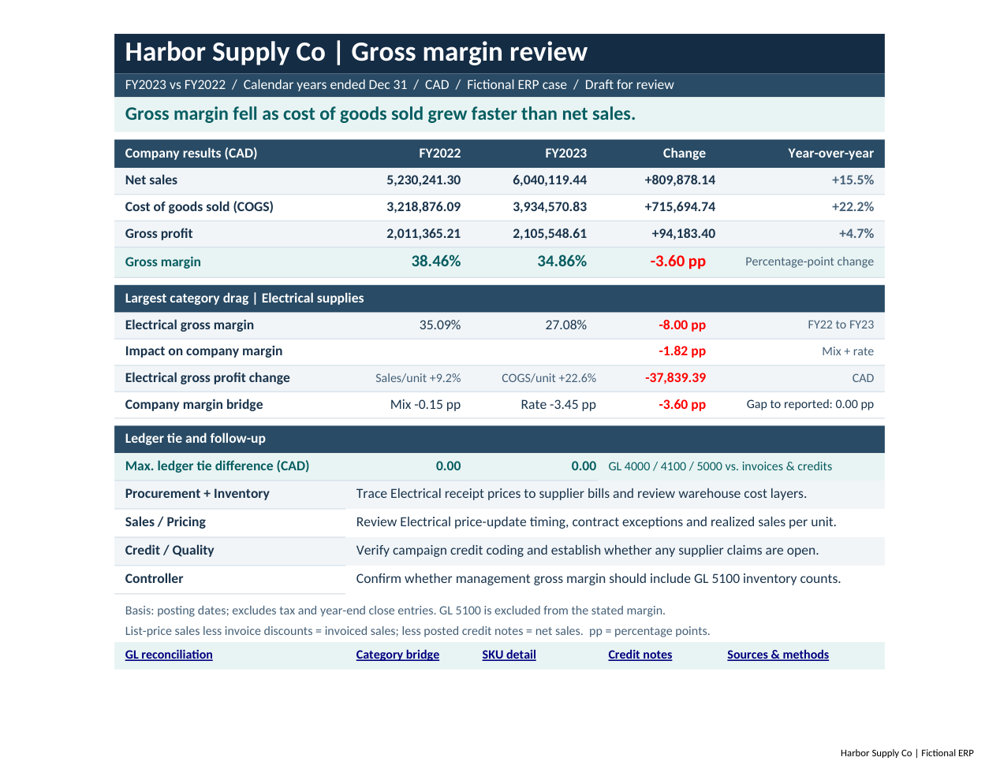
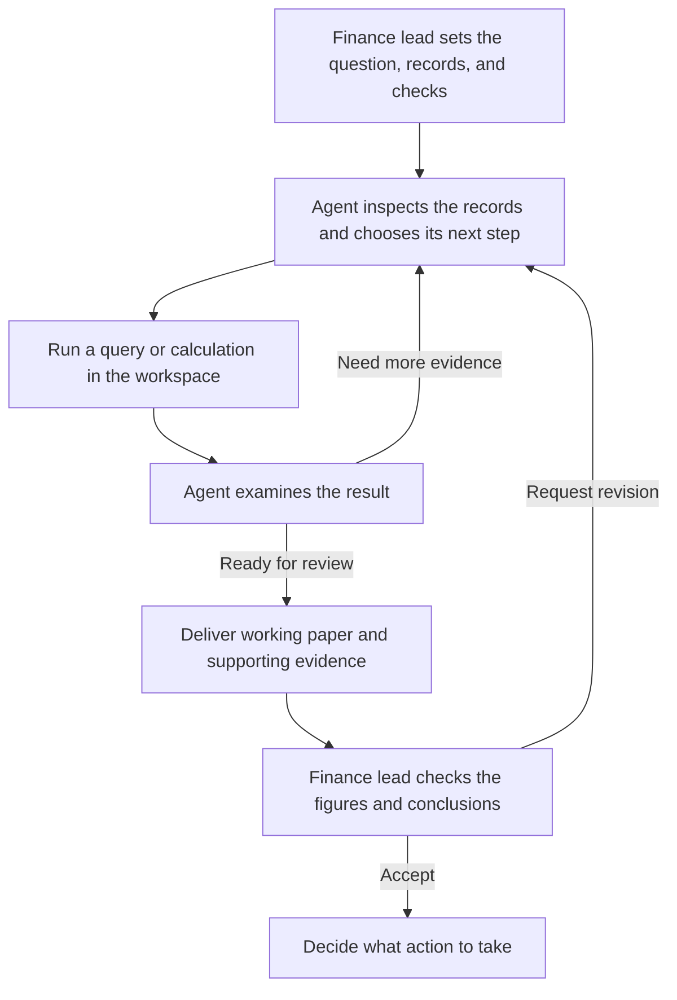

# Accounting & Finance Agent

I’m Neil Yee, a CPA. In my accounting work, I use ERP data, Excel, and Copilot to investigate financial questions. I built this prototype with AI coding assistance so I could show that approach using fictional records.

**Give the agent broad tools and a specific assignment.** I supply the business question, the records it may use, and the checks the answer must pass. The agent can write SQL, run Python, and build an Excel working paper. It chooses which transactions to inspect and what to calculate next. That lets me use the same agent for different investigations while keeping responsibility for the accounting judgment.

## Sales grew 15.5%. Why did gross margin fall?

Harbor Supply, a fictional wholesaler, earned **C$94,183 more gross profit** in FY2023. Yet it kept **C$3.60 less gross profit per C$100 of sales** than in FY2022. I gave the agent five years of ERP records and asked it to explain the decline and tie its figures to the general ledger.

**Electrical supplies accounted for about half the decline.** Its cost per unit sold rose 22.6%, while sales per unit rose 9.2%. Before recommending a price change, I’d ask Purchasing to verify the cost increases and Sales to identify customers still on earlier pricing.

[Read the management brief](docs/examples/harbor-margin/harbor_management_brief.md) · [Download the Excel working paper](https://raw.githubusercontent.com/neil-yee/accounting-finance-agent/main/docs/examples/harbor-margin/harbor_margin_review.xlsx) · [Inspect the SQL queries](docs/examples/harbor-margin/harbor_margin_queries.sql)

[](docs/examples/harbor-margin/summary.png)

### How I’d lead the margin review

**Where I’d focus.** Electrical’s own margin fell 8.00 percentage points. Its change in margin and its changing share of company sales together explain 1.82 points of the company-wide decline. That makes it the first category I’d investigate. I’d compare supplier bills and customer price changes for the affected products. If that supports a price adjustment, I’d track both realized margin and sales volume in the next monthly review.

**How I’d challenge the numbers.** Sales, credits, and cost of goods sold reconciled to the ledger in both years. Changing one input in a test copy produced the following result after recalculation.

| FY2023 control | Working paper | After adding C$100 to the invoice total |
| --- | ---: | ---: |
| Invoice-header total | C$6,064,092.60 | C$6,064,192.60 |
| Ledger sales less invoice-header total | C$0.00 | −C$100.00 |
| Largest absolute discrepancy on the summary | C$0.00 | **C$100.00** |

To reproduce the check, open a copy of the workbook, increase `GL Reconciliation!C3` by 100, and look at `Summary!D19`. The tie-out checks that the underlying financial figures agree. Supplier terms and customer pricing still require follow-up.

### What the agent contributed

The agent selected its queries, followed transactions from invoices and credits to product categories, and built the working paper. The initial run required recovery. A later run revised the workbook so the ledger checks update when an input changes.

### How the same agent could handle another assignment

The workspace, tools, run limits, and review process carry over. What changes is the question, the source data, and the check that makes the answer trustworthy. Here are two other assignments I could give it:

| Business question | Records I’d provide | What I’d check before using the result |
| --- | --- | --- |
| Which overdue customer balances should we follow up first? | Invoices, due dates, credits, and payments applied by the reporting date | The aging buckets sum to receivables in the ledger at that date, and each flagged balance traces to an open invoice. |
| Which departments drove the spending variance? | Approved budget and posted expenses by department and period | Actuals tie to the ledger, department variances add up to the total, and material drivers trace to transactions. |

For a recurring assignment, I can add a reusable procedure as a skill. Work that needs another system also needs an authorized connection. I’d evaluate each workflow against its own checks before relying on it.

## Project details

### What does a custom harness offer alongside existing AI products?

I use tools like Excel Copilot for financial analysis. Building the software around an AI model (the *harness*) let me explore what I’d want to control when an investigation becomes a repeatable finance process:

- **Review and recovery.** I can inspect which queries and tools ran, see which files survived an interruption, and tie a review decision to the exact workbook version.
- **Repeatability.** The procedures, limits, and test cases live in the repository. I can rerun the same cases after a model or workflow change and compare the results.
- **Integration.** The code determines how assignments and files enter the workspace and how deliverables come back for review. Connecting that process to Asana or SharePoint is a possible extension.

Existing products are quicker to adopt when their tools and controls fit the work. A custom harness takes maintenance. Building one helped me judge that trade-off and use the same ideas when supervising work in existing tools.

### How it works



The workspace is a temporary remote **sandbox** where the agent runs commands and edits files. Eligible files are saved locally for follow-up work. The agent can pause for essential clarifications through the terminal.

The tools are general-purpose. The checks depend on the assignment. In the Harbor review, the agent could choose how to investigate Electrical, while the ledger reconciliation had to tie to the cent. Recurring work can use a tested procedure. In the separate Excel benchmark, approved scripts build and recalculate the two-month income statement, the agent drafts commentary, and a person reviews the output.

### What has been checked?

The **November 5, 2026** benchmark reports cover the fixed Excel workflow and selected engineering controls. The Harbor investigation above is a separate portfolio case.

| Area | Recorded result | Evidence |
| --- | --- | --- |
| Excel working paper | 3/3 trials passed numerical checks and independent recalculation; owner approval recorded for each output version. | [Workbook results](docs/evaluations/excel-v5-results.md) |
| Engineering | 150/150 offline checks passed for selected controls, files, persistence, recovery, and related behavior. | [Foundation report](docs/evaluations/foundation-v5-2026-11-05.md) |
| Live behavior and boundaries | 7/7 context cases passed; selected sandbox and file-preservation checks passed. | [Scope and limitations](docs/evaluations/foundation-v5-2026-11-05.md#limits-and-evidence) |

The three workbook approvals apply to the benchmark task and configuration. Real business use requires its own evaluation and approval. Earlier failures and corrections remain in the [test history](docs/history/test-gate-followup-2026-10-25.md).

### My role and AI assistance

I developed this with AI coding assistance. I guided the accounting objectives, workflow, design decisions, evaluation criteria, and output review. The implementation and evaluation reports document that work.

**Understanding agents to use them better:** Working with Deep Agents and LangGraph gave me practical experience with the components of modern agent systems, including:

- **Sandboxes:** a computer workspace where an agent can run code and work with files.
- **Context compaction:** condensing earlier conversation so an agent can continue longer tasks, while checking that important information is retained.
- **Subagents:** delegating work with separate conversation context, including the trade-offs in cost and coordination. These experiments are separate from the evaluated Excel workflow.
- **Tracing and evaluation:** investigating what happened and checking whether the results meet defined requirements.

That understanding helps me recognize capabilities I might otherwise overlook, identify accounting use cases, provide clearer assignments, and decide where independent checks or human judgment are needed. It informs how I use existing AI products as well as when I would consider customization.

### Current boundaries

- The prototype is not approved to post journals, make payments, or change authoritative financial records.
- Asana task intake, SharePoint file access, and a hosted user interface are future extensions.
- Experimental subagent features are outside the evaluated Excel profile.

---

## Setup and documentation

**Stack:** Python, LangChain Deep Agents / LangGraph, OpenAI, LangSmith tracing and sandboxes, SQLite, openpyxl, and LibreOffice for the evaluated spreadsheet workflow.

You need Python 3.13, `uv`, OpenAI API credentials, and LangSmith sandbox access. Follow the [setup guide](docs/technical-guide.md#setup), then start the terminal:

```sh
uv run --locked finance-agent
```

Runs use paid model and sandbox services. The default profile differs from the evaluated [Excel benchmark configuration](docs/operating-guide.md#versioned-excel-trial-profile).

| Read next | Contents |
| --- | --- |
| [Documentation and repository map](docs/README.md) | Where to find the code, cases, results, guides, and project history. |
| [Setup and technical guide](docs/technical-guide.md) | Installation, commands, threads, skills, file handling, and code map. |
| [Operating guide](docs/operating-guide.md) | Profiles, limits, benchmark execution, review, recovery, and trace exports. |
| [Specification and design](docs/agent-spec.md) | Intended capabilities, architecture, evaluation, deployment, and monitoring plans. |
| [Project task list](docs/task-list.md) | Build status, gates, and remaining work. |
| [Mental models](docs/mental-model/00-overview.md) | The agent anatomy and development lifecycle behind the design. |

## License

No license has been selected yet.
