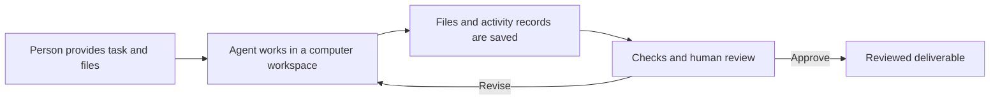

# Accounting & Finance Agent

I’m Neil Yee, a CPA. I built this prototype with AI coding assistance to explore how I’d delegate a financial investigation, check the working paper, and decide what to bring to management. The agent gets a question, financial records, and a computer workspace where it can write SQL and build Excel files.

**Sales grew 15.5%. Why did gross margin fall?** At Harbor Supply, a fictional wholesaler, gross profit rose C$94,183 while gross margin fell from 38.46% to 34.86%. I asked the agent to investigate using a five-year ERP database and reconcile its findings to the ledger.

[Preview the executive summary](docs/examples/harbor-margin/summary.png) · [Download the Excel working paper](https://raw.githubusercontent.com/neil-yee/accounting-finance-agent/main/docs/examples/harbor-margin/harbor_margin_review.xlsx) · [Read the management brief](docs/examples/harbor-margin/harbor_management_brief.md) · [Inspect the SQL](docs/examples/harbor-margin/harbor_margin_queries.sql)

### What I’d tell the controller

- **Start with Electrical.** Its margin fell 8.00 percentage points. Taking its margin and share of sales together, Electrical accounted for 1.82 points of the company’s 3.60-point decline. Electrical’s cost per unit sold rose 22.6%, while sales per unit rose 9.2%.
- **Check the evidence.** Sales, credits, and cost of goods sold tied to the ledger in both years. Try the control in a copy of the workbook. Add C$100 to the FY2023 invoice-header total in `GL Reconciliation!C3`. The discrepancy appears on the first sheet in `Summary!D19`.
- **Follow up before changing prices.** I’d ask Purchasing to trace receipt costs to supplier bills and Sales to check when customer prices were reset. Those answers would help explain the gap and guide a pricing decision.

The agent chose its queries and used general-purpose tools for the investigation. The initial run required recovery, and a later run refined the workbook for management review. The same setup could investigate overdue receivables, inventory movements, or budget variances with suitable records. Those are potential assignments. The Harbor example demonstrates the margin investigation.

[Why build the harness?](#what-does-a-custom-harness-offer-alongside-existing-ai-products) · [Test results](#what-has-been-checked) · [Setup and documentation](#setup-and-documentation)

---

## Project details

### What does a custom harness offer alongside existing AI products?

ChatGPT, Claude, and Microsoft Copilot can already analyze data and create spreadsheets, often with much less setup. This prototype explores **control over the accounting workflow: defining how work is done, checking the results, and managing changes over time.** The choice depends on the workflow, the features available in existing products, and the cost of maintaining a custom implementation.

The custom **harness**—the software around the model—makes those decisions explicit:

| Consideration | Using a ready-made AI product | This project |
| --- | --- | --- |
| Control the workflow | Configure the tools, instructions, and settings the product supports. | Version procedures, tools, operating limits, and review rules in the repository. |
| Integrate with business systems | Use supported connectors and automation features, often with less setup. | Extend the code to tailor task intake, data access, file delivery, and review to the organization's workflow. Business connectors are future work. |
| Investigate problems | Inspect the activity and history the product exposes. | Record model/tool traces in LangSmith and file-transfer, recovery, and review events locally. |
| Check accounting results | Combine available product checks with your own review process. | Apply independent numerical checks, spreadsheet recalculation, and human approval tied to the reviewed file version. |
| Manage change | Work within the product's update and versioning policies. | Pin local dependencies, record settings, and evaluate model or workflow changes against repeatable cases. |

A possible extension would take an Asana assignment, retrieve SharePoint files, run the agent and checks, and return a draft for human review. Asana and SharePoint integrations are not implemented yet.

**The reusable asset is the accounting process:** its procedures, skills, controls, and evaluation cases remain in project files I can maintain as AI technology evolves.

Capabilities vary by product. A custom harness requires engineering and maintenance, and this one still depends on OpenAI, Deep Agents/LangGraph, and LangSmith. Hosted models and services can change; the project provides a defined way to assess the impact and adapt.

### How it works



The workspace is a temporary remote **sandbox** where the agent runs commands and edits files. Eligible files are saved locally for follow-up work. The agent can pause for essential clarifications through the terminal.

In the separate, fixed Excel benchmark, approved scripts build and recalculate a two-month income statement from supplied data and business notes. The agent prepares commentary, independent checks verify the numbers, and a person reviews each output.

### What has been checked?

The **November 5, 2026** benchmark reports cover the fixed Excel workflow and selected engineering controls. The Harbor investigation above is a separate portfolio case.

| Area | Recorded result | Evidence |
| --- | --- | --- |
| Excel working paper | 3/3 trials passed numerical checks and independent recalculation; owner approval recorded for each output version. | [Workbook results](docs/evaluations/excel-v5-results.md) |
| Engineering | 150/150 offline checks passed for selected controls, files, persistence, recovery, and related behavior. | [Foundation report](docs/evaluations/foundation-v5-2026-11-05.md) |
| Live behavior and boundaries | 7/7 context cases passed; selected sandbox and file-preservation checks passed. | [Scope and limitations](docs/evaluations/foundation-v5-2026-11-05.md#limits-and-evidence) |

The three workbook approvals apply to the benchmark task and configuration. Real business use requires its own evaluation and approval. Earlier failures and corrections remain in the [test history](docs/history/test-gate-followup-2026-10-25.md).

### My role and AI assistance

I developed this with AI coding assistance. I guided the accounting objectives, workflow, design decisions, evaluation criteria, and output review. The implementation and evaluation reports document that work.

**Understanding agents to use them better:** Working with Deep Agents and LangGraph gave me practical experience with the components of modern agent systems, including:

- **Sandboxes:** a computer workspace where an agent can run code and work with files.
- **Context compaction:** condensing earlier conversation so an agent can continue longer tasks, while checking that important information is retained.
- **Subagents:** delegating work with separate conversation context, including the trade-offs in cost and coordination. These experiments are separate from the evaluated Excel workflow.
- **Tracing and evaluation:** investigating what happened and checking whether the results meet defined requirements.

That understanding helps me recognize capabilities I might otherwise overlook, identify accounting use cases, provide clearer assignments, and decide where independent checks or human judgment are needed. It informs how I use existing AI products as well as when I would consider customization.

### Current boundaries

- The prototype is not approved to post journals, make payments, or change authoritative financial records.
- Asana task intake, SharePoint file access, and a hosted user interface are future extensions.
- Experimental subagent features are outside the evaluated Excel profile.

---

## Setup and documentation

**Stack:** Python, LangChain Deep Agents / LangGraph, OpenAI, LangSmith tracing and sandboxes, SQLite, openpyxl, and LibreOffice for the evaluated spreadsheet workflow.

You need Python 3.13, `uv`, OpenAI API credentials, and LangSmith sandbox access. Follow the [setup guide](docs/technical-guide.md#setup), then start the terminal:

```sh
uv run --locked finance-agent
```

Runs use paid model and sandbox services. The default profile differs from the evaluated [Excel benchmark configuration](docs/operating-guide.md#versioned-excel-trial-profile).

| Read next | Contents |
| --- | --- |
| [Documentation and repository map](docs/README.md) | Where to find the code, cases, results, guides, and project history. |
| [Setup and technical guide](docs/technical-guide.md) | Installation, commands, threads, skills, file handling, and code map. |
| [Operating guide](docs/operating-guide.md) | Profiles, limits, benchmark execution, review, recovery, and trace exports. |
| [Specification and design](docs/agent-spec.md) | Intended capabilities, architecture, evaluation, deployment, and monitoring plans. |
| [Project task list](docs/task-list.md) | Build status, gates, and remaining work. |
| [Mental models](docs/mental-model/00-overview.md) | The agent anatomy and development lifecycle behind the design. |

## License

No license has been selected yet.
