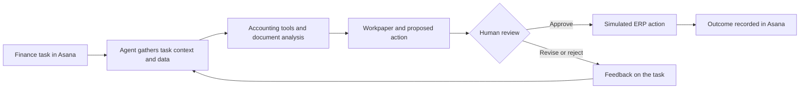

# Accounting & Finance Agent

> Exploring a reusable, human-supervised AI workflow system for accounting and finance work.

**Status:** Work in progress. The end-to-end finance workflow described below is planned.

## What this project aims to do

This project explores how to build an AI system that can support different accounting and finance workflows. The system brings together a work request, relevant business data and tools, task-specific guidance, human review, and run evaluation.

The goal is to make workflows adaptable to different tasks while keeping important decisions and financial changes reviewable. A month-end close support task will be the first end-to-end demonstration.

## First demonstration: month-end close support

The initial scenario will use synthetic accounting data for a fictional company. Given a close task and supporting records, the agent will:

- Review a trial balance and selected supporting data.
- Identify unusual balances or month-over-month changes.
- Prepare a reviewable workpaper and summary.
- Draft proposed adjusting entries when appropriate.
- Wait for human approval before making a simulated ERP change.
- Record the outcome on the Asana task.

This is a demonstration workflow, not an autonomous accounting system.

## Proposed workflow

This diagram describes the target workflow. Individual steps will be marked as implemented as the project develops.

## Why this project

Finance work involves more than generating an answer. A useful system must work with relevant data, follow the right process, explain its findings, and keep people involved when an action has financial consequences.

This project is intended to demonstrate how those pieces can fit together in a practical, inspectable workflow.

## Human review and safeguards

The planned demonstration will:

- Use fictional company data.
- Separate analysis and draft preparation from approval.
- Require human approval before simulated ERP writes.
- Use constrained business tools rather than unrestricted database access.
- Record the proposed action and its approval outcome.
- Evaluate the workflow on expected results and failure cases.

These controls are part of the design goal; they will be documented alongside the implemented behavior.

## Project status

This repository is being built from earlier learning prototypes. Those experiments have explored:

- Deep Agents and LangGraph for agent orchestration.
- An Asana MCP connection with read-only access.
- Excel, PDF, and Word task guidance.
- Sandboxed file processing.
- LangSmith tracing and dataset-based evaluations.

These components are not yet integrated into the end-to-end finance workflow described above. This README will be updated as the implementation is added and verified.

## Architecture

A simple workflow diagram is shown above. A more detailed architecture covering the agent, task manager, finance data, tools, skills, memory, sandbox, approvals, and observability will be added here.

## Evaluation

Evaluation cases and results will be published here once the finance workflow is implemented.

Planned evaluation areas:

- Accuracy of extracted and calculated values.
- Quality of explanations and workpapers.
- Correct use of tools.
- Appropriate handling of missing or conflicting information.
- Correct behavior at approval checkpoints.

## Demo

**Video:** Coming soon.

The video will show one synthetic month-end close task from Asana intake through analysis, human review, and the simulated outcome.

## Running the project

Setup and run instructions will be added after the first end-to-end version is ready.

## Limitations

- This is a prototype for learning and demonstration.
- The initial company data and ERP are simulated.
- The agent is not intended to provide professional accounting advice or make unreviewed financial decisions.
- The project does not yet implement the complete workflow described in this README.

## Roadmap

- [ ] Define the synthetic company data and first close scenario.
- [ ] Build constrained tools for reading the simulated finance data.
- [ ] Generate a reviewable close workpaper.
- [ ] Add an approval step for simulated ERP changes.
- [ ] Add limited Asana task updates.
- [ ] Evaluate normal cases, exceptions, and approval behavior.
- [ ] Record a short end-to-end demo.
- [ ] Publish setup instructions and detailed architecture.

## License

No license has been selected yet.
