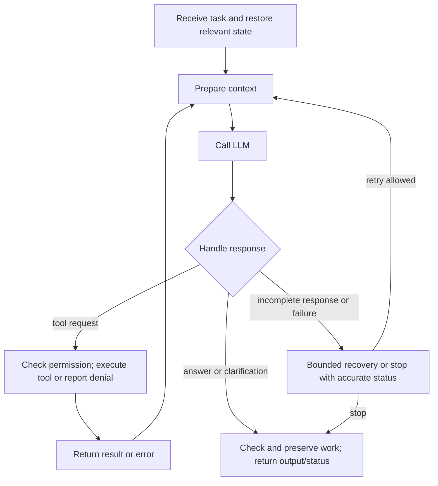
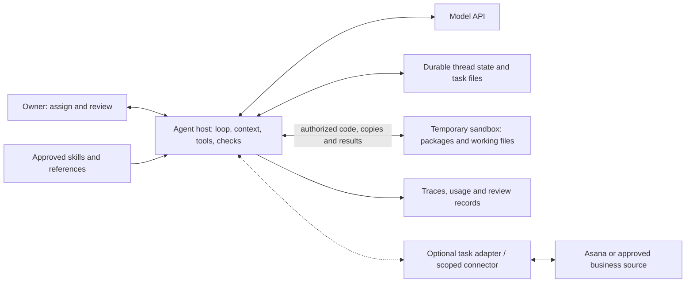
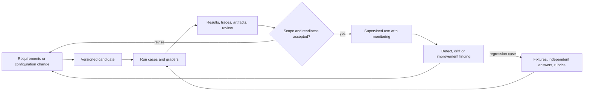

# Finance & Accounting Agent — Specification and Design

**Version:** v0.22 design draft · October 25, 2026 · **Owner:** Neil Yee

This document defines the intended agent, its proposed design, and the evidence needed to use it. It does **not** assert that the repository meets these requirements. Record implementation status, paths, gaps and results in the [task list](task-list.md).

**Reading path:** purpose → one agent system → supported work → components and settings → evaluation → deployment → monitoring and improvement.

- [Build: system, requirements and design](#2-build-requirements-and-design)
- [Configuration and customization](#27-runtime-configuration-and-customization)
- [Test: criteria, cases and graders](#3-test-requirements-and-evaluation-design)
- [Deploy: permitted use and recovery](#4-deploy-requirements-and-design)
- [Monitor and improve](#5-monitor-and-improve-requirements-and-design)
- [Decisions and next steps](#6-decisions-to-resolve)

Requirements describe what must hold; design describes how to provide or check it. The [overview](mental-model/00-overview.md), [anatomy](mental-model/01-anatomy.md) and [ADLC](mental-model/02-adlc.md) explain the underlying models.

## 1. Purpose and scope

Build a reusable, human-supervised agent for knowledge work, starting with accounting and finance files. It should understand a request, use approved tools, produce reviewable work and preserve enough context and evidence to continue or investigate it.

The shared foundation should support new tasks through skills, tools or connectors without requiring a separate agent design for every workflow.

### Proposed first trial

- One owner using the terminal, with one active execution per task/thread.
- Synthetic or explicitly approved inputs; file/code operations in a sandbox.
- Persistent conversations and task files on the host; tracing enabled.
- Start with one bounded Excel task, then add Word/PDF deliverables and other selected capabilities as their evaluations pass.
- Review each deliverable before business use. Exact formats, settings and budgets are decisions D1–D3.

These are proposed scope choices for a manageable trial, not findings about existing code.

### Extensions, selected when needed

- Bank reconciliation is a candidate finance workflow, not a prerequisite for proving general file work.
- Asana, read-only SQL, web search and Drive/SharePoint access require their own tool/access scope and cases.
- Specialized subagents, concurrent work, hosted/multi-user deployment and automatic memory updates need a demonstrated use case and relevant evaluation.
- Keep reusable memory owner-maintained if enabled. Record whether framework-provided delegation is enabled; do not assume it is absent.

### Boundaries

- No journal posting, payments or changes to authoritative ERP records.
- Protect original input files and shared references; work on task copies.
- No sending messages or publishing to business systems in the first trial. Model and tracing API calls are part of the approved execution design and data policy.
- Later Asana writes are limited to approved task statuses, summaries and output links.
- Approval of a deliverable does not authorize changes to shared instructions, skills, tools, memory policy or access.

## 2. Build: requirements and design

Start with the connected system, then define its expected behavior, supported work and operating requirements. Architecture, implementation inventory and configuration explain how to provide them.

### 2.1 Agent system and supported work

#### How the agent works

The LLM interprets the task and proposes the next step. The application supplies context, handles responses, executes permitted tool requests and returns results to the model. This repeats until the agent answers, needs human input or stops.

Limits, persistence and tracing apply throughout. Assignment outcomes and recovery rules are in §2.2; component connections are in §2.4.

The same loop supports many kinds of work. Skills supply guidance; tools supply executable operations. Understanding, planning and responding often emerge from the model using the supplied context and tools. They do not each require a separate module. Add specialized handling when an operating requirement or evaluation finding justifies it.

#### Anatomy: the responsibilities within the system

Functions describe responsibilities, not separate services or sequential stages. A component can support several functions.

| Function | Responsibility | Mechanisms | Proposed implementation |
|---|---|---|---|
| **Core** | Coordinate decisions, model calls, tool execution and stopping. | Model invocation, control loop, response handling. | Deep Agents / LangChain orchestration with a configured model. |
| **Context** | Supply relevant information for the next decision. | Instructions, history, skill loading, retrieval and compaction. | Framework messages/context middleware; approved reference and file tools. |
| **Actions** | Perform operations beyond generating a response. | Tools, code execution, connectors and optional delegation. | File tools, sandbox and selected libraries; MCP connections or subagents when needed. |
| **Controls** | Govern access, execution budgets and approvals. | Authorization, middleware/hooks, environment restrictions and human review. | Host-enforced limits, scoped permissions, sandbox boundaries and approval handling. |
| **Continuity** | Preserve work across steps, interruptions and runs. | State, checkpoints, durable storage and retrieval. | Thread checkpoints, persistent task folders and optional approved memory. |

**Example: creating an Excel working paper**

- **Context** supplies the request, source data and relevant instructions.
- **Core** coordinates model decisions and tool calls.
- **Actions** execute code that creates and checks the workbook.
- **Controls** restrict access and resource use and govern required review.
- **Continuity** preserves the files and state needed to resume or review the work.

#### Expected behavior of the agent

These are requirements for the system above. The model/tool loop supplies much of the behavior; evaluations establish whether it works reliably.

**References:** C1–C3 identify expected behavior, C4–C7 identify operating requirements, and C8–C12 identify work capabilities. These are requirement IDs, not separate modules. SC IDs refer to acceptance criteria in §3.1.

| Requirement / criteria | Expected behavior | What supplies it |
|---|---|---|
| **C1 — Understand work** · SC-1 | Interpret requests using relevant instructions, inputs, history and feedback; clarify ambiguity that materially affects the task. | Model + Context: instructions, conversation state and approved retrieval/file tools. Clarification is an ordinary reply; use interrupt/resume when a durable pause is required. |
| **C2 — Plan and execute** · SC-1, SC-7 | Choose steps, use tools and adapt to results, feedback and remaining budget; respond or stop appropriately. | Core + Context + Actions, bounded by Controls: model/tool loop, response/error handling and optional todo state or delegation. |
| **C3 — Deliver reviewable results** · SC-1, SC-3, SC-4 | Produce and check results against the request; explain assumptions, exceptions and limitations; obtain review before business use. | Model instructions, file/code and checking tools, human review and persisted approval of the identified output version. Core, Actions, Controls and Continuity work together. |

Supporting design: [context assembly](#context-assembly--c1-c2), [runtime and tool contracts](#runtime-and-tool-contracts--c2-c5), and [delivery requirements](#23-delivery-requirements).

#### Supported work capabilities

A work capability describes something the agent can accomplish using the shared system. Select supported formats and limits in D2; installing a library alone does not establish capability.

| Capability / scope | Required outcome | Enabling tools and checks |
|---|---|---|
| **C8 — Tabular data** · Reusable work | Read, transform and analyze data while preserving its meaning. | File/code tools and suitable CSV/table libraries; independent checks of schemas, types, encodings, missing values and calculations. |
| **C9 — Excel** · Reusable work | Read, create and revise workbooks within the supported feature set. | openpyxl or a suitable library; independent calculation checks and required recalculation/rendering. Writing a formula does not calculate its value. |
| **C10 — Word** · Reusable work | Read, create and revise structured documents with the requested content and presentation. | python-docx or a suitable library; content/structure checks and review of headings, tables and formatting. |
| **C11 — PDF** · Reusable work | Produce a readable PDF that preserves the intended source content. | Compatible conversion/generation tools; source-to-PDF content comparison and pagination/layout review. |
| **C12 — Bank reconciliation** · Task-specific work | Reconcile bank/ledger data and explain differences with supporting work. | Approved guidance and shared file/calculation tools; independent expected matches, exceptions and balance tie-outs, plus finance review. Proposed entries remain drafts. |

SC-1 applies to each selected work capability. C12 is the provisional first finance workflow; confirm it in D2. Valid files still require checks for business correctness.

For each selected capability, define:

- Supported inputs, outputs and feature limits.
- Tools, dependencies and permitted access.
- Relevant skills, instructions and references.
- Success criteria, evaluation cases and known limitations.

#### Requirements that apply throughout

These requirements support all selected work capabilities. They also apply when the model is waiting or execution fails.

| Requirement / criteria | What must hold | Supporting functions and mechanisms |
|---|---|---|
| **C7 — Usable workspace** · SC-2, SC-3 | Task files are locatable and scoped; source files stay protected; working copies, prior outputs and concurrent edits are handled deliberately. | Actions, Context, Controls and Continuity: file tools, workspace backend, scoped access and version/conflict handling. |
| **C4 — Preserved and resumable work** · SC-2, SC-7 | Preserve required state and files under an explicit checkpoint/export policy; disclose loss since the last durable save. Recovery accounts for completed effects. Optional reusable memory has approved scope, ownership, retention, correction and deletion rules. | Continuity, Context and Controls: checkpoints, durable storage, transfer, operation records and retrieval. Automatic memory updates need a later decision. |
| **C5 — Controlled execution and accurate failures** · SC-3, SC-7 | Permissions, budgets and approvals are enforced; blocked, partial and failed work is reported accurately; retries avoid repeating completed external effects. | Controls and Continuity: host/tool checks, sandbox restrictions, bounded retries and operation records. Retrieved instructions cannot grant authority. |
| **C6 — Review evidence** · SC-3, SC-4 | Reviewers can follow sources, actions, actual checks, effective configuration and output versions. Records have defined access and retention. | Context, Continuity and Controls: tracing callbacks, logs, versioned manifests and review records. |

Supporting design: [state, files and recovery](#state-files-and-recovery--c4-c7), [access and approvals](#access-and-approval-enforcement--c3-c5-c7), and [evidence](#evidence-and-configuration--c6).

Workspace access (C7) provides a place to work; persistence (C4) keeps that work available afterward. C3 describes the delivered result and review; C6 supplies the records needed to inspect it.

#### How the requirements connect

**Example:** Excel work (C9) uses the agent's task understanding and execution (C1–C2), file workspace (C7), preservation (C4), enforced limits (C5), and delivery/review evidence (C3, C6). All five anatomy functions contribute through shared components.

The [implementation inventory](#26-implementation-inventory) consolidates those components. [Runtime configuration](#27-runtime-configuration-and-customization) defines how they operate. The task list records implementation status and evidence.

**Work requirement → supporting functions and components → configuration → success criterion → evaluation → release and monitoring.**

When reusing this design, carry forward the applicable shared requirements, select work capabilities and adapt task objectives, boundaries and configuration. Re-evaluate the resulting system; prior evidence does not automatically transfer.

### 2.2 Assignment requirements

The same system handles new tasks, clarification and revisions.

| Step | Required behavior | Requirements |
|---|---|---|
| Receive | Select/create a thread and workspace; interpret the request and clarify material gaps. | C1, C4, C7 |
| Work | Load relevant context, execute permitted operations and adapt to results within the budget. | C1, C2, C5, C7 + selected C8–C12 |
| Check and preserve | Perform the required checks; save deliverables, supporting work and evidence before temporary resources are removed. | C3, C4, C6 |
| Return | Provide an answer, artifacts, a question, or an accurate partial/blocked/failed outcome. | C3, C5, C6 |
| Review and revise | Human reviews the identified output version; feedback continues the task. Revised outputs need a new review. | C1–C4, C6 |

Clarification can be a normal terminal reply. Use an application interrupt only when execution must pause and resume durably. A completed model call or trace does not establish a completed assignment.

**Failure rule:** preserve recoverable work, identify what completed and report what remains uncertain. Retry eligible transient failures within the budget. Reads and demonstrably idempotent operations may be retried safely; an uncertain external write needs reconciliation or an idempotency guarantee before retry. A checkpoint does not undo an external effect.

**Later Asana integration:** define task/thread mapping, eligibility, execution ownership, status transitions and version-specific review. Distinguish actionable feedback from informational or agent-generated updates; prevent duplicate dispatch and trigger loops. These requirements apply when that integration is selected (D6 / E-ASANA-1).

### 2.3 Delivery requirements

| Outcome | What to return |
|---|---|
| Answer | The requested answer, relevant sources/assumptions and material limitations. |
| Artifact task | Files or accessible links, a concise summary, checks actually performed and unresolved issues. Preserve useful supporting code and source references. |
| Needs input, partial, blocked or failed | A clear status, what completed, recoverable files if any, missing input or failure, and the next safe step. |

For financial outputs, identify period, currency, units, sources, assumptions, calculations and exceptions. For multi-file packages, verify that figures and narrative agree across files.

Report **file integrity, formula correctness, recalculated values and visual inspection** separately when relevant. Writing formulas does not calculate them. An unavailable required check blocks acceptance; optional unavailable checks are disclosed as limitations.

During supervised business use, the owner records approval of the specific output version. A simple review record is sufficient for the terminal trial; a separate approval service is unnecessary unless the workflow requires it.

### 2.4 Agent architecture

**Proposed design:** the host runs the agent loop and owns state, credentials and policy. The sandbox executes generated code on task copies. Tools and storage make the five functions concrete.

Solid arrows show the proposed first-trial flows; dotted arrows show optional extensions. Model and tracing credentials remain on the host. The sandbox receives only the data and access required for its work. Boundaries and deployment choices are in §4.2.

This is one host application with supporting services, not a requirement to build a service for every anatomy function. The loop in §2.1 explains execution; §2.2 defines outcomes and recovery.

### 2.5 Component design details

Use these contracts when assessing or configuring components. The inventory links them to implementation work; §2.7 records settings and customizations.

#### Context assembly — C1, C2

- Supply task instructions, relevant history, sources, tools and feedback. Let the model handle ordinary task interpretation; add custom context logic only for a requirement or demonstrated failure.
- Version skill/reference sources and retain their identity. Copy needed assets into the sandbox deliberately: a virtual file path does not establish that a runtime can read it.
- Evaluate retention of important constraints and corrections through compaction. Stored memory helps only when retrieved into usable context.

#### Runtime and tool contracts — C2, C5

- Handle answers, tool requests, refusals, incomplete responses and errors explicitly. Enforce finite call/time/retry budgets across parent, summarizer and delegated work.
- Define tool inputs, outputs/errors, permissions and side effects. Optional connectors use scoped identities; begin with read-only business access where it meets the task.
- Prefer framework features and ordinary model/tool behavior. Dedicated tools, middleware or subagents need a purpose and evaluation coverage.

#### State, files and recovery — C4, C7

- Identify threads, runs, source files and output versions. Keep checkpoints and task files outside the temporary sandbox. Define checkpoint/export milestones and acceptable unsaved work before the trial. Save eligible work before cleanup; after abrupt provider/sandbox loss, recover the last durable version and identify any unavailable work. Report transfer/cleanup failures separately.
- Preserve originals; specify transfer exclusions, size limits and conflict handling. Prevent simultaneous executions for the same task in the trial. Add locking and multi-user isolation when concurrency is selected.
- Use action/result records to reconcile interrupted effects. Define retention and deletion for files, state and optional memory; restore compatible versions during recovery.

#### Access and approval enforcement — C3, C5, C7

- Enforce file, network, identity and resource boundaries in the host/tools/environment. Instructions and summaries do not grant access; test restrictions against malicious or conflicting input.
- Keep shared guidance read-only to the agent. Separate permission to perform an action from review of its output and approval to change reusable assets.
- Bind review to the delivered version. A revised output does not inherit prior approval; retain the original version and decision. Reviewing an output afterward cannot prevent an unauthorized action beforehand.

#### Evidence and configuration — C6

- Link the run to inputs, effective configuration, tool outcomes, actual checks and delivered files. Record usage, elapsed time, failures and the review decision; minimize sensitive trace content.
- Use durable records for approvals and external effects. A trace is diagnostic evidence, not an independent correctness check or the only copy of recoverable work.

### 2.6 Implementation inventory

The anatomy and requirements in §2.1 describe the connected system. This inventory groups its shared building blocks for implementation planning and repository review. One building block may support several capabilities; one framework may supply several building blocks.

| Building block | Requirements supported | What to confirm in the repository | Work and evidence |
|---|---|---|---|
| Model and agent runtime | C1, C2 | Model configuration, agent creation, terminal entry point and model/tool loop. | [BUILD-01](task-list.md#2-configure-the-shared-foundation) |
| Instructions, context and skill loading | C1, C2; supports all work | Prompt/instruction sources, conversation input and approved file/reference/skill access. | [BUILD-02](task-list.md#2-configure-the-shared-foundation) |
| Thread state and checkpoints | C1, C4 | Thread identity, persistent conversation state and restore/resume path. | [BUILD-05](task-list.md#2-configure-the-shared-foundation) |
| Reusable memory, when enabled | C1, C4 | Approved guidance store, retrieval path, owner update process and retention/access settings. | [PLAN-05](task-list.md#1-plan), [CHANGE-02](task-list.md#8-later-changes) |
| Workspace and file transfer | C4, C7 | Scoped file tools, working copies, durable task folders and sandbox copy-in/copy-out. | [BUILD-03, BUILD-05](task-list.md#2-configure-the-shared-foundation) |
| Sandbox and code execution | C2, C5, C8–C11 | Execution tool, sandbox setup, package environment and enforced access boundaries. | [BUILD-03](task-list.md#2-configure-the-shared-foundation) |
| Tabular, Excel and Word libraries | C8–C10 | Libraries available through tools or sandbox code; declared supported features and read/write paths. | [BUILD-04](task-list.md#2-configure-the-shared-foundation) |
| Recalculation, conversion and rendering | C9–C11 | Available engines and invocation paths for required Excel calculations, PDF export and visual inspection. | [BUILD-04](task-list.md#2-configure-the-shared-foundation) |
| Permissions, budgets and approval gates | C3, C5, C7 | Program/environment enforcement, runtime limits and required human/owner approval handling. | [BUILD-06, BUILD-08](task-list.md#2-configure-the-shared-foundation) |
| Failure handling and recovery | C2, C4, C5 | Accurate outcomes, bounded retries, partial-work preservation and reconciliation of uncertain effects. | [BUILD-07](task-list.md#2-configure-the-shared-foundation) |
| Tracing and review records | C3, C6 | Trace capture plus source/configuration/output identities, actual-check reports and review decisions. | [BUILD-08](task-list.md#2-configure-the-shared-foundation) |
| Artifact checks and evaluation cases | C3, C8–C12; foundation criteria | Callable output checks, independent answers/rubrics, fixtures and cases linked to capabilities and criteria. | [BUILD-04, BUILD-09](task-list.md#2-configure-the-shared-foundation) |
| Finance skill and references | C12 | Selected reconciliation guidance, approved references and access to the shared file/code tools. | [FIN-02](task-list.md#4-define-and-evaluate-the-first-finance-workflow) |
| Operational monitoring | C5, C6; all selected capabilities | Outcome/usage signals, alerts or review routing, thresholds and operator response paths. | [BUILD-10](task-list.md#2-configure-the-shared-foundation) |

Follow the work links to record paths, scope, status, gaps and evidence in the task list. This inventory describes intended components; it does not duplicate their assessment. Evaluate behavior through §3. Assess optional components only when selected for the scope.

### 2.7 Runtime configuration and customization

Settings influence quality, cost, latency and reliability. Record a versioned baseline before comparing results. The following choices are **proposed or unresolved**, not observations of the current runtime.

| Configuration / requirements | Decisions to record | Starting approach |
|---|---|---|
| **CFG-1: model** · C2, C5 | Provider/model/version, reasoning level, output limit, supported sampling settings. | Exact values unresolved under D1. Choose for the selected task and budget; record how the provider counts reasoning/output tokens. |
| **CFG-2: context** · C1, C2 | Instructions, history/reference/skill loading, retrieval limits and large-result handling. | Use framework facilities and approved sources; record inherited defaults and prompt versions. |
| **CFG-3: compaction** · C1, C4 | Trigger, retained messages, summarizer model/budget, summary instructions, access to original history and failure behavior. | Evaluate the framework baseline before introducing a custom summary policy. |
| **CFG-4: execution** · C2, C5 | Call/token/time budgets, timeouts, retry attempts/delays, concurrency and delegated limits. | One active execution per task; finite values required under D1. Follow the retry rule in §2.2. |
| **CFG-5: tools and storage** · C4, C7–C11 | Sandbox image/packages, enabled tools, permissions, checkpoint/file backend and transfer rules. | Select only what the trial requires; proposed host files and local checkpoints. Resolve versions/limits in D1/D5. |
| **CFG-6: memory and observation** · C4, C6 | Memory sources/write policy; trace fields, access, sampling and retention. | Owner-maintained memory if used; tracing on for trials. Resolve retention/access in D4/D7. |

For each selected choice, record **value or asset/module reference → rationale → configuration source and override rules → supporting cases/results**. A pinned framework default can be the selected value; an undocumented default cannot explain a result reliably. Credentials are referenced by name, never stored in the spec or trace.

#### Compaction customization

A candidate summary instruction:

> Preserve the current objective, constraints, user corrections, decisions, source and artifact identifiers, completed actions with observed results, unresolved questions and remaining work. Distinguish verified results from assumptions and plans. Keep references to supporting files; do not invent missing facts or claim planned work is complete.

The instruction shapes the summary. Middleware determines the trigger, input and placement in context. Keep original evidence, approvals and action records outside the lossy summary. Evaluate repeated compaction, corrections, resume and summarizer failure—not just summary length.

#### Middleware customization

For each selected built-in, configured or custom middleware, record:

- Purpose and supported requirement.
- Component/version or custom code path; prompt/configuration references.
- Hook, order and parent/subagent scope; verify actual inheritance.
- State read/changed, side effects and error behavior.
- Cases covering its effect and interactions with checkpoints, limits and other middleware.

Examples include compaction, todo state, large-result offloading, approval interrupts and budget checks. Prefer configuration of an existing component when it meets the need; identify replacements so behavior is not applied twice.

#### Optional subagents

Record whether the framework's default subagent is enabled, configured, replaced or disabled. Add a specialized subagent when a role benefits from separate context or tools.

For each enabled subagent, define:

- Role and invocation rule: model-chosen delegation or application routing.
- Supplied context/instructions, model/settings, tools/skills and middleware.
- Permissions, workspace ownership, state lifetime and compaction policy.
- Shared run budget, child limits, nesting/concurrency and cancellation behavior.
- Returned result, evidence/files, uncertainty and failure handling; parent checks before delivery.

Separate context is not security isolation or independent verification. Evaluate quality, context transfer, shared budgets, file conflicts and failure propagation for the selected design.

#### Effective configuration and changes

Each run records effective values/overrides and the versions of code, dependencies, prompts, middleware and enabled subagents. Link input and memory versions separately. These records can be files alongside the run; no new configuration service is required for the trial.

Compare candidates on the same cases and agreed budgets, including compaction/delegation usage. Change one factor at a time when diagnosing a cause, then evaluate the combined configuration before release. Group monitoring results by configuration version.

Work: [PLAN-03/05](task-list.md#1-plan), [BUILD-01/02/03/05/06/08](task-list.md#2-configure-the-shared-foundation) and [TEST-01–06](task-list.md#3-evaluate-the-foundation). Unresolved choices: D1, D4, D5, D7.

### 2.8 Design review checklist

- [ ] Selected work and boundaries are clear; deferred features are identified.
- [ ] Requirements connect to components, configuration and acceptance evidence.
- [ ] Answers, clarification, refusal, partial work and failure have defined outcomes.
- [ ] Access, preservation, review and recovery rules cover the selected execution paths.
- [ ] Required decisions are resolved for the next trial; implementation gaps are in the task list.

## 3. Test: requirements and evaluation design

Evaluate both the shared foundation and its supported work. One case may provide evidence for several requirements; functions are coverage categories, not five mandatory standalone suites.

| Layer | Question | Evaluation groups |
|---|---|---|
| Shared foundation | Do context handling, execution, access, preservation and recovery work? | E-PLAT-1, E-FILE-1, E-CTRL-1, E-PROV-1, E-REC-1 |
| Reusable work | Can it correctly perform the selected CSV/Excel/Word/PDF operations? | E-PLAT-1 for tabular work; E-ART-1 for office files. |
| Task-specific work | Does the selected workflow achieve its business outcome? | E-FIN-1; E-ASANA-1 when task integration is selected. |

E-REL-1 assesses release readiness. Test the conditions that normal tasks do not exercise: a correct workbook does not prove blocked access or recovery after interruption. All results remain unassessed.

### 3.1 Success criteria

**Requirements:** the conditions the selected scope must satisfy.

Each criterion defines how to judge the capabilities and assignment behavior above. Its evaluation ID points to the checks in §3.3; monitoring in §5.2 tracks the same criterion during use. Give individual evaluation cases their own IDs and link them to the requirement and success criterion they check. For example, separate Excel cases can check formula correctness and recalculated values under C9 / SC-1.

| ID | Requirements / scope | Success means… | Evaluation |
|---|---|---|---|
| SC-1 | C1–C3, C8–C12; each declared work/task capability | Outputs meet independent expected results and presentation rubrics; material gaps are clarified or reported. | E-PLAT-1, E-ART-1, E-FIN-1 |
| SC-2 | C4, C7 | Task files are organized and isolated; sources stay unchanged; required state/files survive cleanup and restart within the declared recovery policy; versions, conflicts and any unsaved loss are traceable. | E-FILE-1 |
| SC-3 | C3, C5–C7; all capability scopes | Permissions and limits hold; approvals apply only to their defined scope and version. | E-CTRL-1, E-PROV-1 |
| SC-4 | C3, C6 | Reviewers can follow sources, assumptions, actions, checks, configuration, and approvals to the delivered version. | E-PROV-1 |
| SC-5 | All; release | The proposed scope meets evaluation, ownership, access, data, recovery, and monitoring requirements before use. | E-REL-1 |
| SC-6 | C1, C2, C4–C7; Asana | Intake, review, revision, and restart preserve work without duplicate dispatch or trigger loops. | E-ASANA-1 |
| SC-7 | C2, C4, C5, C7 | Interrupted or incomplete runs report accurate outcomes, preserve recoverable work, and retry without repeating completed external effects. | E-REC-1 |

**Example:** C4 requires durable work → SC-2 defines successful preservation → an E-FILE-1 case checks files after cleanup/restart → SC-2 monitoring detects missing files → a finding triggers recovery and an updated regression case.

### 3.2 Starter evaluation tasks

Build confidence in small steps. Select the next task by the capability being assessed; these are trial designs, not completed results.

| Trial | What it establishes | Follow-up coverage |
|---|---|---|
| Bounded Excel task with fixed synthetic inputs | Read/create/revise a workbook and preserve it; compare figures with independent expected answers. | Missing inputs, unsupported features, revision feedback, budget limits and restart. |
| CSV analysis or Word/PDF work, as selected | The specific operations and formats claimed under C8/C10/C11. | Types/encodings, document structure, conversion fidelity and presentation. |
| Composed financial file package | Excel working paper and Word/PDF analysis agree. | Seed mismatched ratios, wrong cell references and formatting defects; compare all outputs against the independent fixture. |
| Bank reconciliation, if selected | Matches, exceptions and balance bridges satisfy an independent reference answer. | Duplicates, missing records, ambiguities and finance review. |

Define inputs, supported features, required outputs, expected answers/rubric and thresholds before running a case. Include targeted foundation checks alongside work trials. A smoke test demonstrates a connected path; it is not evidence of broad reliability.

**Worked traceability example — Excel liquidity analysis**

| Link | Concrete meaning |
|---|---|
| Requirement | C9 + C1–C7: create a correct, reviewable and preserved working paper. |
| Design | Model/tool loop + source context + spreadsheet tools + protected workspace and checkpoints. |
| Configuration | Record model/output settings, libraries, compaction policy and run budget. |
| Criterion and case | SC-1 / E-ART-1: a fixed fixture distinguishes current liabilities from a non-current loan. Check formulas, independent expected ratios and agreement with any report. |
| Evidence and release | Save grader results, file versions and human layout review. Resolve material mismatches before accepting this scope; also meet the applicable foundation and release checks. |
| Monitoring and response | Record discrepancies or reviewer corrections, identify the affected configuration and add the failure as a regression case. |

### 3.3 Evaluation design

Each case record contains:

- **Links:** case ID, requirement/criterion IDs, layer and functions exercised.
- **Four dimensions:** what is checked, who grades, when/setting, and why.
- **Procedure:** inputs/setup, expected result or rubric, threshold, repetitions and reset/cleanup.
- **Evidence:** effective configuration, case/grader versions, results, trace/output links and limitations.

The evaluation groups below organize cases; they do not require a separate harness or service each. Apply cases to the selected scope: memory, delegation and connector cases become required when those features are enabled. Test rejection of overlapping execution for the same task in the initial trial; test concurrent coordination only when enabled. Include default framework delegation if it is active.

Use reference answers or checks prepared independently of the agent’s claimed result. Its own validation report is evidence of what it checked, not a substitute for the evaluator’s oracle. Offline means evaluation outside live business work; online means observation or checking during operation.

| Evaluation / criteria | What is checked | Who grades | When / setting | Why |
|---|---|---|---|---|
| E-PLAT-1 SC-1 | Output, context preservation, required trajectory, steps | Code + human rubric for meaning/clarification; calibrated LLM grader optional | Offline | Capability; retain as regression |
| E-ART-1 SC-1 | Artifacts, calculations, cross-file agreement | Code + human presentation review | Offline; applicable checks online | Capability and regression |
| E-FILE-1 SC-2 | Files, transfer, resume | Code | Offline; preservation checks online | Capability and regression |
| E-FIN-1 SC-1 | Financial results and required procedure | Code + finance reviewer | Offline; tie-outs/review online | Capability; retain as regression |
| E-CTRL-1 SC-3 | Permission boundaries and budgets | Code + access reviewer | Offline; boundary signals online | Capability and regression |
| E-PROV-1 SC-3, SC-4 | Evidence and review records | Code + human reviewer | Offline and online | Capability and regression |
| E-REC-1 SC-7 | Failure, partial progress, retry/resume | Code + operator review | Offline; failure signals online | Capability and regression |
| E-REL-1 SC-5 | Release step and readiness record | Owner | Before release or scope expansion | Release readiness |
| E-ASANA-1 SC-6 | Full assignment-to-review path | Code + human reviewer | Offline; lifecycle signals online | Capability; retain as regression |

**Grading guidance**

Choose the grader from the requirement, not its layer. Many foundation checks have precise expected results and should be code-graded. Model-dependent behavior can still need judgment.

| Function covered | Observable requirement example | Suitable grading |
|---|---|---|
| Core | Tool results return to the model; execution stops at the configured limit. | Code assertions on state/events and call counts. |
| Context | Required identifiers and user corrections survive compaction. | Code for exact facts; human rubric for preserved meaning, or a calibrated LLM grader. |
| Actions | A file tool performs the requested operation and reports failure accurately. | Code checks of actual files/results and deliberately induced errors. |
| Controls | Unauthorized access is blocked, including through delegated execution. | Code checks at the actual access boundary; inspect effects, not only refusal text. |
| Continuity | Required state and files survive interruption and resume. | Code comparisons before/after restart, including versions and task ownership. |

- Use code for precisely specified outcomes, whether the case concerns infrastructure or business work.
- Use human rubrics where meaning, ambiguity or presentation requires judgment; calibrate any LLM grader against human ratings.
- A deterministic grader does not make agent behavior deterministic. Repeat model-dependent trials to measure consistency.
- Reuse evidence only for the requirements and conditions actually exercised. Record gaps explicitly.
- Judge acceptable outcomes; wording and valid tool sequences may vary. Run offline checks after release when useful.

| Group | Cases to include | Acceptance evidence |
|---|---|---|
| E-PLAT-1 | Small work tasks, missing/conflicting inputs, long histories, corrections, repeated runs. | Correct results or appropriate clarification; retained constraints; valid revisions within budget. |
| E-ART-1 | Selected office operations; valid and defective workbooks/documents, conversion and composed packages. | Independent answers agree; required content/features, calculations and presentation pass; unsupported features disclosed. |
| E-FILE-1 | File lookup, task isolation, cleanup/restart, size exclusions, conflicts and transfer failure. | Correct files/versions survive; originals unchanged; partial preservation reported. |
| E-FIN-1 | Known bank/ledger matches, duplicates, exceptions and balance bridges. | Expected financial results and finance review pass; proposed entries remain drafts. |
| E-CTRL-1 | Allowed/denied access, injected instructions, secret/network/file boundaries, limits and enabled delegation. | No forbidden effects; configured limits and approved permissions hold. |
| E-PROV-1 | Input-to-output walkthrough, changed approved files, separate output/asset approvals. | Run/source/configuration/output identity and actual checks are recoverable; stale approval rejected. |
| E-REC-1 | Startup failure, timeout with uncertain effect, incomplete response, budget exhaustion, transfer/cleanup failure. | Accurate partial/failure status; bounded safe retry or escalation; recoverable work preserved. |
| E-REL-1 | Scope, evidence, identities, storage, monitoring and recovery readiness. | Owner accepts the defined scope and limitations against all applicable release conditions. |
| E-ASANA-1 | Normal/revision/duplicate/out-of-order events, feedback, triggers and restart; concurrency if enabled. | Correct routing and preserved review identity; no duplicate effects or trigger loops. |

Set thresholds and repetitions in D3 before judging a candidate. Critical financial, access or preservation errors cannot be averaged away. Report case coverage, failures and limitations; preserve independent answers and check that graders detect seeded defects. Passing one workflow does not establish general format support.

### 3.4 Evaluation and operation architecture

Use the same requirement and criterion IDs in cases, release evidence and monitoring. A later configuration change needs relevant re-evaluation; earlier results remain evidence only for the versions and conditions they exercised.

## 4. Deploy: requirements and design

Deployment means operating an identified configuration for an approved scope. Local supervised use is a valid deployment; hosted or multi-user operation is optional.

### 4.1 Release requirements

| Stage | Permitted use | Evidence needed |
|---|---|---|
| Controlled trial | Synthetic or explicitly approved inputs, restricted tools and budgets. | D1–D3/D5 choices needed for the trial, data handling and recoverable workspace. |
| Parallel operation | Approved real work alongside the normal process; outputs remain non-authoritative. | Relevant offline cases pass, owner accepts scope and E-REL-1 readiness evidence. |
| Supervised use | Reviewed deliverables may support business work; no posting/payments. | Representative trials meet agreed quality, reviewer-effort, time/cost and recovery criteria. |
| Scope expansion | Additional workload, connector, users or autonomy. | Evidence for the added scope, affected regressions and updated operating procedures. |

Release only selected capabilities. Bank reconciliation is required evidence for that workflow, not for an Excel-only release. Asana requires foundation evidence and cases for the work it will dispatch, plus its own integration checks. Supervised use may remain the endpoint.

### 4.2 Deployment architecture and trust boundaries

The host/sandbox/storage layout is shown in §2.4. Proposed first-trial choices are Deep Agents/LangChain, an OpenAI model, LangSmith sandbox/tracing, local checkpoints (SQLite is a candidate) and durable host task folders. Pin the chosen versions in D1; this is not an implementation audit.

| Boundary | Required setup |
|---|---|
| Host → model/tracing | Host credentials; approved transmitted data, trace access and retention. |
| Host → sandbox | Eligible task copies/assets; explicit filesystem/network/resource limits. Do not copy host secrets by default. |
| Sandbox → durable storage | Preserve outputs before cleanup; handle size exclusions, conflicts and incomplete transfer. |
| Agent → sources/shared guidance | Read-only originals/references; controlled working copies and owner-approved shared changes. |
| Task → other tasks/users | Scoped state and files. One active execution per task initially; locks/isolation for selected concurrent or multi-user use. |
| Optional connector → business system | Named identity and explicit operation scope; approved write behavior and retry/deduplication rules. |

An SDK, virtual path or sandbox label does not prove these boundaries. Verify their effective behavior. When hosting remotely, resolve storage durability, credential delivery, backups and restart behavior before release (D5).

### 4.3 Release and recovery design

Keep one release record with:

- Configuration/version, selected capabilities and accepted limitations.
- Evaluation evidence and owner decision.
- Runtime location, identities, storage, data/trace retention and budgets.
- Monitoring/review responsibility and cadence.
- Stop, recovery and rollback instructions, including compatible state/memory versions.

Rehearse stopping work, resuming after interruption, restoring a compatible version and repairing affected outputs. For the first trial, these may be documented terminal steps. Record unresolved preservation/cleanup failures. Reverting code does not reverse external actions or stored data.

## 5. Monitor and improve: requirements and design

Use operating evidence to decide what needs attention and whether a change helps.

### 5.1 Monitoring requirements

Before real-work use, assign an owner and review cadence. During the trial, Neil reviews each run's status, files, checks and usage. During supervised business use, every deliverable requires review. A run log and review record are sufficient initially; automated alerts are needed when the chosen operating model requires them.

### 5.2 Monitoring design

Collect signals against the same success criteria. Set thresholds and escalation rules in D4, group results by task and effective configuration, and minimize sensitive content.

| Criterion / requirements | Signals and evidence | Response to define |
|---|---|---|
| SC-1 — C1–C3, C8–C12: work quality | Wrong sources/skills, missed inputs or feedback, unsupported assumptions, artifact defects, financial discrepancies, acceptance/rejection, revisions, unresolved work and reviewer effort. | Inspect context, procedure, tools and validation; contain faulty outputs and add useful regression cases. |
| SC-2 — C4, C7: preserved work | Missing files, source changes, transfer conflicts, failed resumes and lost versions. | Preserve evidence; reconcile state and repair transfer or storage behavior. |
| SC-3 — C3, C5–C7: limits and approval | Denied requests, unauthorized effects, stale approvals, limit hits, calls, elapsed time and tokens/cost. | Stop or contain breaches; review enforcement, access, budgets and approval records. |
| SC-4 — C3, C6: review evidence | Missing source/configuration/output identities, unrecorded checks or decisions, difficulty tracing a result. | Repair evidence collection; identify affected deliverables and re-review them. |
| SC-5 — all: release readiness | Configuration/access drift, missing monitoring coverage, incompatible state/memory, workload beyond approved scope. | Reassess readiness; restrict or pause affected use until its release conditions hold. |
| SC-6 — C1, C2, C4–C7: task handling | Duplicate dispatch, trigger loops, lost feedback, incorrect statuses and broken revision links. | Pause affected triggers; reconcile task/thread state and correct routing. |
| SC-7 — C2, C4, C5, C7: recovery | Errors, timeouts, incomplete responses, unpreserved partial work, repeated effects and exhausted retries. | Establish completed effects and recoverable state; follow bounded recovery or escalate. |

Use monitoring signals to guide diagnosis. Establish the cause through investigation.

### 5.3 Response and improvement design

1. Record the finding, affected run/output, requirement and impact. Contain material incorrect outputs, access breaches or data loss.
2. Diagnose the cause using inputs, configuration, traces and actual effects. A trace shows events; it does not establish their correctness.
3. Link corrective work to the task list. Add a useful regression case and evaluate the affected behavior plus relevant regressions.
4. Record the release decision or accepted limitation, then monitor the result.

| Change | Evidence to revisit |
|---|---|
| Skill or business procedure | Relevant work cases, independent answers and affected regressions. |
| Model, reasoning or output settings | Representative quality/completion, latency and total usage. |
| Context, compaction or middleware | Information retention, corrections, ordering, checkpoint compatibility and failure behavior. |
| Tool, subagent or access | Task quality, permissions, shared budgets, state/file ownership, retries and failure propagation. |
| Memory or storage policy/schema | Empty/existing/stale/conflicting state, compatibility, migration or invalidation, deletion and rollback. |
| Purpose, users or authority | Revisit scope, architecture and all lifecycle plans. |

Automatic memory updates are deferred. If later enabled, define who owns each memory, permitted readers/writers, validation, retention/correction/deletion and promotion into trusted guidance. Test memory changes separately from code changes and record their versions together.

## 6. Decisions to resolve

Owner: Neil Yee, with specialist review where needed. Resolve choices for the next selected scope; do not wait for every optional feature. Record selected values and rationale here or link their versioned configuration; implementation findings remain in the task list.

| ID | Decision | Needed when |
|---|---|---|
| D1 | Exact model/framework/image versions; reasoning/output settings; finite budgets/timeouts/retries; context/middleware baseline; enabled delegation. | Before the first representative run. |
| D2 | Selected work, formats/features, input/output contract, required recalculation/conversion/rendering and independent expected answers. | Before claiming that work capability; choose one bounded trial first. |
| D3 | Case thresholds/rubrics, repetitions, critical failures and time/cost/reviewer-effort limits. | Before judging a candidate against acceptance criteria. |
| D4 | Review owner/cadence, signals, thresholds, trace access and retention. | Basic trace policy before the trial; operational response before real-work use. |
| D5 | Runtime/storage/identities, transfer limits, backups and stop/recovery; concurrency/isolation if selected. | Trial data/access/storage before execution; deployment-specific details before release. |
| D6 | Asana eligibility, task/thread identity, publication scope, status/feedback rules and deduplication. | Only when adding Asana. |
| D7 | Memory sources, ownership/scope, retention/correction/deletion and any later automatic-write policy. | When memory is enabled or its policy changes. |

**Next practical sequence**

1. Select one bounded task and write its expected result and checks (PLAN-01/02).
2. Resolve its settings and access/storage choices (PLAN-03/05); use the [inventory](#26-implementation-inventory) to assess existing code before adding work.
3. Run the selected work cases and targeted foundation cases. Record gaps and results in TEST-01–06.
4. Review whether the evidence supports the requested scope; use REL-01–03 for real-work release.
5. Review outcomes, add regressions and expand only the capability or integration needed next.

**Minimum artifacts:** this design; the task list; versioned configuration/prompts; cases/graders; run/evaluation records with output links; a release record for real-work use. Findings can be linked task items. These can be simple files—each artifact does not need its own service or management tool.

## 7. Change log

| Version | Date | Change |
|---|---|---|
| v0.22 | 2026-10-25 | Consolidated repeated design, separated first-trial scope from optional extensions, clarified delivery/retry rules, added a concrete evidence chain and practical decision sequence. No implementation assessment asserted. |
| v0.21 | 2026-10-25 | Introduced anatomy-first requirements and layered evaluation with requirement-based grading. |
| v0.20 | 2026-10-24 | Added runtime settings, middleware customization and subagent definitions. |
| Earlier versions | — | Full document and architecture history retained in Git. |
