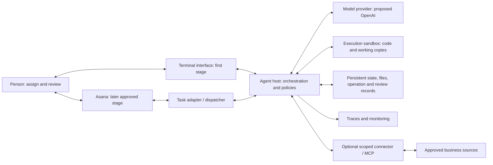
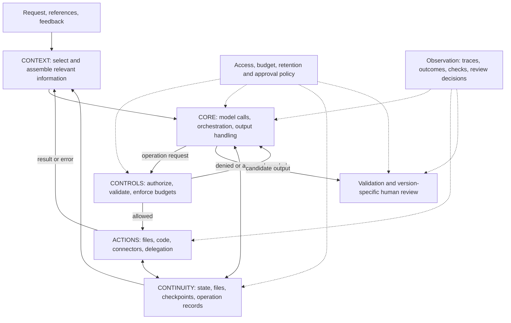
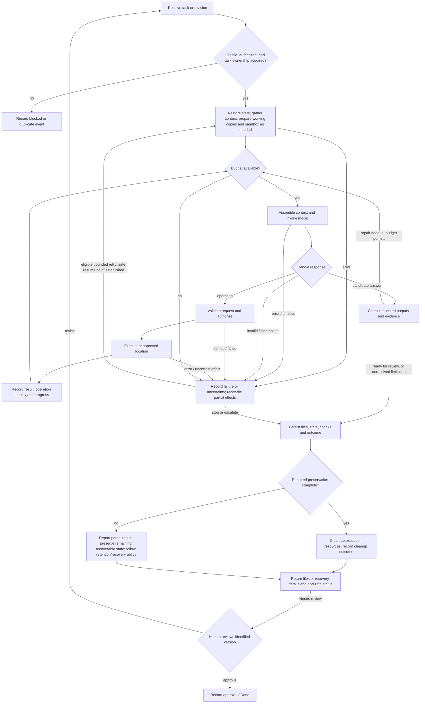
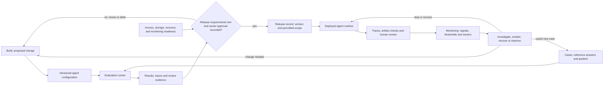
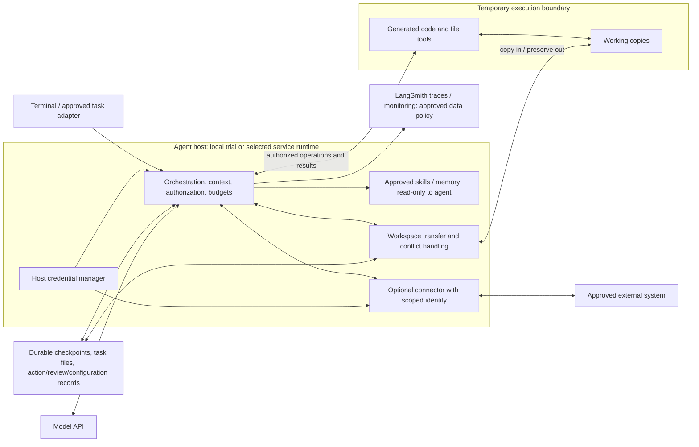

# Finance & Accounting Agent — Agent Specification and Design

| Field | Value |
|---|---|
| Version | v0.18 design draft · October 24, 2026 |
| Owner | Neil Yee |
| Purpose | Define requirements, proposed design and acceptance evidence across the agent lifecycle. |
| Implementation assessment | Not assessed in this revision. Record repository findings later in the [task list](task-list.md). |

**Reading order:** purpose → Build → Test → Deploy → Monitor and improve.

This document combines requirements and proposed design. **Requirements** state what must be true; **design** explains the components and methods intended to satisfy them. Plan all four lifecycle phases before relying on the agent. The [task list](task-list.md) tracks implementation work and assessment evidence.

- [Build: capabilities, architecture and implementation review](#2-build-requirements-and-design)
- [Test: success criteria and evaluations](#3-test-requirements-and-evaluation-design)
- [Deploy: release conditions and deployment design](#4-deploy-requirements-and-design)
- [Monitor: operating expectations and improvement](#5-monitor-and-improve-requirements-and-design)
- [Open decisions](#6-decisions-to-resolve)

This spec applies the [overview](mental-model/00-overview.md), [anatomy](mental-model/01-anatomy.md), and [ADLC](mental-model/02-adlc.md). All technology choices are proposals to validate.

## 1. Purpose and scope

Build a reusable, human-supervised accounting and finance agent that gathers context, performs work, and produces results people can inspect and approve. Add task-specific skills and tools without redesigning the shared foundation.

**First stage**

- Accept terminal requests.
- Maintain persistent task conversations.
- Perform sandboxed file/code work.
- Support human review.
- Use synthetic or explicitly approved data.

Introduce Asana after the foundation and first finance workflow meet their evaluation gates.

**Boundaries**

- No journal posting or payments.
- No changes to authoritative ERP records or original shared files.
- No external communication in the first stage.
- Later Asana publication is limited to approved task statuses, summaries and output links.
- Further access requires a separate scope and release decision.

Approval of an output does not authorize changes to reusable scripts, models, memory, skills, or permissions. Those require separate owner approval.

## 2. Build: requirements and design

Define the agent’s abilities and operating behavior, then connect them to a proposed architecture and an implementation inventory. The design starts with the shared model/tool loop; the capability tables do not prescribe a separate component for every behavior.

### 2.1 Capabilities: requirements and enabling design

**Requirements:** the capability and general-behavior fields. **Design:** the function, mechanism and proposed-implementation fields.

The purpose in §1 requires the reusable abilities below. Each row describes a general behavior and the building blocks that enable it: **behavior → functions → agent mechanisms → proposed implementation**.

- **Capability:** an ability the agent should provide, expressed through required behavior.
- **Functions:** the responsibilities that support that ability: Core, Context, Actions, Controls, and Continuity.
- **Agent mechanisms:** familiar building blocks such as prompts, tools, conversation state, checkpoints, middleware/hooks and storage.
- **Proposed implementation:** the framework, library, service, or component that would provide those mechanisms.

**Reuse scope**

- **Shared foundation:** supports many kinds of agents.
- **Reusable work:** handles a general kind of work.
- **Task-specific:** delivers a defined business outcome.

Scope describes reuse. All capabilities remain unassessed.

**Design approach**

- Let the model interpret requests, use context, plan work and choose tools within the task boundaries.
- Supply the information and execution capabilities it needs through prompts, state, tools, skills and storage.
- Enforce permissions, budgets, persistence and required approvals in the application or environment.
- Evaluate representative situations before adding a dedicated tool, hook or workflow for them. Add specialized handling when evidence or an explicit operating requirement justifies it.

A capability row does not imply a separate tool or code module. Several rows may be fulfilled by the same model/tool loop. Use **C1–C12** as the stable specification references; detailed scenarios and their IDs belong in the evaluation cases. The criteria beside each capability identify its main acceptance checks; release and integration criteria apply to the selected scope.

#### C1 — Understand work

**Scope:** Shared foundation. **Success criteria:** SC-1.

| General behavior | Supporting functions | Agent mechanisms | Proposed implementation |
|---|---|---|---|
| Understand the request using relevant instructions, inputs, conversation history and feedback. | Core, Context | Model instructions, conversation state, context assembly and retrieval tools | Deep Agents / LangChain messages and state, with approved file/reference tools. |
| Clarify missing or ambiguous information when it materially affects the work. | Core, Context | Conversational response; interrupt/resume when required | An ordinary clarification reply in the terminal; a framework interrupt only for workflows that need a persistent pause. |

[Supporting detail](#context-assembly--c1-c2)

#### C2 — Plan and execute

**Scope:** Shared foundation. **Success criteria:** SC-1, SC-7.

| General behavior | Supporting functions | Agent mechanisms | Proposed implementation |
|---|---|---|---|
| Decide how to carry out the task and use available tools to make progress. | Core, Context, Actions | Model/tool loop, tool calls and optional planning state | Deep Agents / LangChain with an OpenAI model and sandbox execution tools; todo middleware when useful. |
| Adapt the approach using tool results, feedback and the remaining budget. | Core, Context, Controls | Conversation state, model/tool loop and runtime limits | Framework response/error handling linked to C4 recovery and C5 limits; delegation is an optional tool choice. |

[Supporting detail](#runtime-and-tool-contracts--c2-c5)

#### C3 — Deliver reviewable results

**Scope:** Shared foundation. **Success criteria:** SC-1, SC-3, SC-4.

| General behavior | Supporting functions | Agent mechanisms | Proposed implementation |
|---|---|---|---|
| Produce and check results against the request, explaining assumptions, exceptions and limitations. | Core, Context, Actions | Model instructions, file/code tools and validation tools | Task context, sandbox libraries and independent checks appropriate to the output; report which checks were actually available. |
| Present results for human review and obtain approval before business use. | Controls, Continuity | Human review and persisted approval state | Delivery summary and approval record identifying the output reviewed; changed outputs require renewed approval. |

[Supporting detail](#23-delivery-requirements)

#### C4 — Preserve and resume work

**Scope:** Shared foundation. **Success criteria:** SC-2, SC-7.

| General behavior | Supporting functions | Agent mechanisms | Proposed implementation |
|---|---|---|---|
| Keep task history and files available so work can continue across conversations, revisions or interruptions. | Continuity, Context, Actions | Conversation state, checkpoints and durable file storage | Thread checkpoint store and durable workspace; preserve eligible work before sandbox cleanup. |
| Recover interrupted work with an accurate account of what completed. | Continuity, Controls | Checkpoints, tool-result records and bounded recovery | Framework resume/retry support plus file-transfer checks; reconcile uncertain external effects before repeating an operation. |
| Retain approved reusable guidance when memory is enabled. | Continuity, Context, Controls | Memory store, retrieval tools and storage permissions | Owner-maintained guidance with defined scope, retention, correction and deletion; automatic updates require a later decision. |

[Supporting detail](#state-files-and-recovery--c4-c7)

#### C5 — Respect limits and report failures

**Scope:** Shared foundation. **Success criteria:** SC-3, SC-7.

| General behavior | Supporting functions | Agent mechanisms | Proposed implementation |
|---|---|---|---|
| Keep actions and data access within approved permissions. | Controls | Tool authorization, scoped credentials and sandbox restrictions | Host and environment controls protecting secrets, original sources and task boundaries; retrieved content cannot grant permission. |
| Keep execution within agreed budgets and required approvals. | Controls, Core | Runtime middleware/hooks, call limits and approval gates | Host-enforced call, output, time and retry budgets covering delegated work; separate owner approval for changes to shared assets or access. |
| Handle failures transparently and prevent unsafe repetition of external effects. | Controls, Continuity | Exception handling, bounded retries and operation records | Explicit blocked/incomplete/partial outcomes; operation identity and concurrency controls for approved external writes. |

[Supporting detail](#access-and-approval-enforcement--c3-c5-c7)

#### C6 — Provide evidence for review

**Scope:** Shared foundation. **Success criteria:** SC-3, SC-4.

| General behavior | Supporting functions | Agent mechanisms | Proposed implementation |
|---|---|---|---|
| Make the work inspectable through sources, actions, outputs and checks. | Continuity, Context | Tracing callbacks, tool logs and artifact records | LangSmith traces plus task/run, configuration and file identities; capture usage, actual checks and review decisions. |
| Store review evidence under the approved data policy. | Controls, Continuity | Trace/storage permissions and retention settings | Access and retention configuration for logs, artifacts and approval records. |

[Supporting detail](#evidence-and-configuration--c6)

#### C7 — Manage a task workspace

**Scope:** Shared foundation. **Success criteria:** SC-2, SC-3.

| General behavior | Supporting functions | Agent mechanisms | Proposed implementation |
|---|---|---|---|
| Provide an organized workspace where the agent can find and work with task files. | Actions, Context | File tools and a workspace backend | Task folders and read/list/write tools; transfer working copies into and out of the sandbox, with C4 persistence. |
| Protect source files and preserve task boundaries while work changes. | Controls, Continuity | Storage permissions, working copies and version/conflict handling | Read-only sources/references and scoped task storage; retain prior outputs and conflicts, and control ownership when concurrent work is enabled. |

[Supporting detail](#state-files-and-recovery--c4-c7)

#### C8 — Work with tabular data

**Scope:** Reusable work. **Success criteria:** SC-1.

| General behavior | Supporting functions | Agent mechanisms | Proposed implementation |
|---|---|---|---|
| Read, transform and analyze tabular data while preserving its meaning. | Context, Actions | File tools and sandbox code execution | CSV/table libraries with supported schemas, encodings and data types. |
| Check data quality and the resulting calculations. | Actions, Controls | Code execution and validation tools | Independent expected-result checks covering types, missing values and transformations; C3 reports limitations. |

#### C9 — Work with Excel files

**Scope:** Reusable work. **Success criteria:** SC-1.

| General behavior | Supporting functions | Agent mechanisms | Proposed implementation |
|---|---|---|---|
| Read, create and revise Excel workbooks within the supported feature set. | Context, Actions | File tools and sandbox code execution | openpyxl or a suitable workbook library; the model selects operations from the task context. |
| Check workbook content, calculations and presentation as required by the task. | Actions, Controls | Validation code, recalculation/rendering tools and human review | Independent calculations plus compatible recalculation and rendering methods selected in D2. Writing formulas alone does not compute their values. |

#### C10 — Work with Word documents

**Scope:** Reusable work. **Success criteria:** SC-1.

| General behavior | Supporting functions | Agent mechanisms | Proposed implementation |
|---|---|---|---|
| Read, create and revise structured Word documents. | Context, Actions | File tools and sandbox code execution | python-docx or a suitable document library for supported features. |
| Check content, structure and presentation against the request. | Actions, Controls | Document inspection tools, code checks and human review | Content/structure checks and presentation review, including headings, tables and required formatting. |

#### C11 — Produce PDF deliverables

**Scope:** Reusable work. **Success criteria:** SC-1.

| General behavior | Supporting functions | Agent mechanisms | Proposed implementation |
|---|---|---|---|
| Produce a PDF from the intended source content. | Actions | File tools and document conversion | Compatible conversion engine selected in D2; use the relevant source-document capability when needed. |
| Check that the PDF preserves the content and is readable. | Actions, Controls | PDF extraction/rendering tools and human review | Source-to-PDF content comparison and pagination/layout review. |

#### C12 — Reconcile bank transactions

**Scope:** Task-specific. **Success criteria:** SC-1.

Provisional first finance workflow; confirm the scope in D2.

| General behavior | Supporting functions | Agent mechanisms | Proposed implementation |
|---|---|---|---|
| Reconcile bank and ledger data and explain differences with supporting work. | Core, Context, Actions | Task instructions/skill, file tools and code execution | Approved reconciliation guidance using C1–C7 and the relevant C8–C11 tools; the model chooses task steps within that guidance. |
| Check the reconciliation against independent financial expectations. | Actions, Controls | Validation code and human finance review | Known-answer cases, balance tie-outs and review of matches, exceptions and workpapers; proposed entries remain drafts. |

[Supporting detail](#32-starter-evaluation-tasks)

#### Using capabilities together

C8–C12 use C1–C7 as their foundation. For example, Excel work (C9) uses:

- **C7** to protect source files.
- **C4** to preserve progress.
- **C5** to enforce limits.
- **C3 and C6** to deliver reviewed, traceable results.

Those requirements belong to the referenced capabilities and apply whenever they are used.

Several capabilities may share functions, mechanisms or components. Exact implementation choices and limits are decisions in §6.

**Distinctions to keep in mind**

- **Workspace and persistence:** C7 provides the working area and file operations; C4 keeps work available across runs.
- **Excel validation:** formula writing, calculated values and visual layout need separate checks.
- **Financial validation:** valid files still need checks for financial correctness.

**Reusing the spec**

1. Carry forward the selected foundation and work capabilities, criteria and evaluation definitions.
2. Adapt task capabilities, boundaries, access and implementation choices.
3. Evaluate the new configuration. A prior passing result does not transfer automatically.

### 2.2 Assignment requirements

**Requirements:** how the capabilities cooperate during an assignment, including review, revision and failure handling.

**Assign → gather context → execute → check and preserve → review → approve or revise.**

| Step | Required behavior | Capabilities used |
|---|---|---|
| Assign | Receive the request; select or create its thread and workspace. | C1, C4, C7 |
| Gather context | Restore relevant history, inputs, references and feedback; clarify material gaps. | C1, C4 |
| Execute | Plan the work, prepare input copies and a sandbox when needed, and use the selected tools within approved limits. | C2, C5, C7 + relevant C8–C12 |
| Check and preserve | Validate outputs, save files and evidence before cleanup, then return results and limitations. | C3, C4, C6, C7 |
| Review and approve | Hold deliverables in Needs review until a reviewer approves that version or requests changes. Record the decision. | C3, C5, C6 |
| Revise | Continue the same task/thread using feedback and the identified prior version; return to context gathering. | C1–C4, C6, C7 |
| Block or recover | At any step, report missing inputs or failed/partial work, preserve recoverable progress, and reconcile possible effects before retrying. | C4–C7 |

C5 permissions and budgets, and C6 evidence collection, apply throughout. Steps may repeat as the task develops.

**Work interface:** start with terminal requests. A later Asana dispatcher may gather eligible task fields, comments, attachments, changes and feedback through the same assignment lifecycle.

Proposed Asana task statuses: **To do → Agent working → Needs review → Done**, or **Blocked**.

Before integration, define:

- Which tasks are eligible and how execution is locked.
- Which feedback triggers a revision.
- How approval is recorded and interpreted.
- How informational comments and agent-generated updates are prevented from triggering revisions or duplicate runs.

Technical run outcomes remain separate from task statuses.

### 2.3 Delivery requirements

This expands **C3** (reviewable results) and **C6** (evidence) into what accompanies each delivery.

**Every delivery includes:**

- The requested artifact.
- A concise summary and unresolved issues.
- Useful supporting code and provenance.

**Financial work also identifies:**

- Period, currency and units.
- Sources and assumptions.
- Calculations and tie-outs.
- Exceptions, checks performed and limitations.

**Report these checks separately:**

- File integrity.
- Formula correctness.
- Recalculation.
- Visual review.

State what was actually checked. An unavailable check must be visible and must block acceptance where that check is required.

### 2.4 Agent architecture

**Design:** these views show components, responsibilities and execution paths. All are proposed; arrows do not indicate implementation status. Solid arrows show calls/data flow; dotted arrows show policy or observation relationships.

#### System overview

The foundation should work through the terminal. Asana and other connectors require their own approved scope and evidence. Code execution should use a sandbox; model invocation, orchestration, authorization, and credential management should remain on the host.

#### Responsibilities and mechanisms

These are responsibilities, not necessarily separate services. Observation spans the functions. Approval after delivery cannot replace authorization before an external action.

| Component / concept | Functions served | Mechanisms / proposed implementation |
|---|---|---|
| Agent harness | Core, Context, Actions | Deep Agents / LangChain orchestration, model adapter, response handling, tool routing. |
| Task adapter | Context, Controls, Continuity | Request normalization, task/thread mapping, eligibility, deduplication, concurrency control. |
| Skills, references, todos | Context, Continuity | Discovery/retrieval, read-only reference routes, planning tool, stored task state; middleware where suitable. |
| Execution and connector tools | Actions, Controls | Host-side authorization; sandbox file/code operations; separately scoped connector identities. |
| Runtime policy | Controls, Core | Checks before calls/actions, shared budgets, output checks, approval and access validation. |
| Durable state and artifact store | Continuity, Context | Checkpoints, per-task files, versions/hashes, operation records and recovery metadata. |
| Review and evidence records | Controls, Continuity | Versioned manifests, decisions, configuration/source IDs, traces and monitoring signals. |

A separate sub-agent context does not imply separate security. If delegation is enabled, its permissions, persistence, and usage must remain within the parent task's approved scope.

#### Execution and failure paths

Retry from a verified safe point, not blindly from the beginning. A timeout may follow a completed external effect. Operation records and reconciliation must prevent repeated effects. Cleanup errors remain visible; do not claim complete preservation or success without the required evidence.

Review binds to a specific output version. Revised files require a new decision. The later Asana path must distinguish human feedback from informational comments and agent-generated updates.

### 2.5 Component design details

**Design:** use these details when configuring the shared building blocks. Exact technology choices and limits are resolved through the decisions in §6.

#### Context assembly — C1, C2

- Start with model instructions, conversation state and available tools. Let the model interpret requests and ordinary revision feedback from that context. Clarification can be a normal reply; use a framework interrupt when the workflow needs a durable pause. Add specialized context or revision middleware only when an operating requirement or evaluation evidence calls for it.
- Select the task, constraints, expected outputs, relevant history/tool results and revision feedback. Use the framework context-management facilities and evaluate whether material requirements, decisions and source identity survive compaction. Resolve ambiguous revision targets conversationally; explicit output identities remain necessary for formal approval records.
- Discover approved skills and load details when needed; `SkillsMiddleware` and read-only routes are candidates. Retrieve knowledge/memory with source, scope and version; label fictional trial references. Provider-retained context needs an understood scope and lifecycle. Stored information influences the model through supplied input or tool results.
- Copy required execution assets deliberately: virtual skill/memory paths are not necessarily mounted inside the sandbox. Skills provide procedures; host authorization controls access.

#### Runtime and tool contracts — C2, C5

- Validate Deep Agents / LangChain behavior and extension points. Configure and record model/version, reasoning, context/output limits, timeouts and bounded retries. Supply todo state, such as `TodoListMiddleware`, when useful.
- Route answers, tool requests, refusals, invalid/incomplete responses and failures to explicit outcomes. Support waiting, revision, stopping and recovery. Empty responses and exhausted budgets cannot count as success.
- Keep orchestration and model credentials on the host; execute generated code in the sandbox. Delegated tasks need explicit context, tools, scope and budgets shared with the parent. Separate context does not establish security isolation.
- Enforce call, output, time, retry and delegation limits across the whole run. Define cost policy and measurement limits. Retry only eligible failures after establishing possible effects.
- Add host-side connectors/MCP tools for approved needs. Define each operation's identity, permissions, returned data, errors and side effects. Prefer read-only business access initially.

#### State, files and recovery — C4, C7

- Define task/thread/run identity; use ownership locks when concurrent execution is enabled. Checkpoint required messages, results, plans and execution state; SQLite is an option for local trials. Keep files in durable storage beyond sandbox lifetime.
- Transfer working copies in and eligible outputs/supporting work out before cleanup. Define exclusions, size limits, version/conflict handling and transfer-failure behavior. Preserve recoverable work and report incomplete transfer or cleanup errors.
- Retain original inputs, prior output versions and concurrent edits. Remote deletion must not silently erase retained work. Cloud sync and live co-editing require separate design and evaluation.
- Use checkpoints and operation records to reconcile completed, missing or uncertain effects before retry. Checkpoints cannot undo external actions.
- Keep reusable guidance owner-maintained. Configure memory ownership, scope, source/version, retention, correction and deletion. Automatic writes require a later policy, compatibility review and evaluation decision; see [improvement design](#53-response-and-improvement-design).

#### Access and approval enforcement — C3, C5, C7

- Enforce source/reference read-only access and task boundaries outside the model, including against instructions embedded in inputs. Restrict and verify filesystem, process, network, resource and identity access; keep host secrets out of generated-code environments unless separately authorized.
- Deny out-of-scope actions. For approved writes, record intent/result and prevent duplicate effects across retries or concurrent workers.
- For formal review, bind output approval to a versioned manifest; modifications invalidate approval for the changed version. Initial human review occurs between runs. Separately approve and evaluate changes to shared scripts, models, skills, memory policy or access.
- Assess controls at their actual enforcement boundaries. Instructions, program checks, human review and environment restrictions provide different protections; verify effective behavior.

#### Evidence and configuration — C6

- Record outcomes, input/output fingerprints, relevant actions, actual checks, usage and approvals; link them to the task/run and delivered version. Use LangSmith tracing for evaluations and pilots under the approved data, access and retention policy.
- Identify code/dependencies, model/settings, instructions, skills/tools, access, environment and storage schema in the configuration manifest. Link input and memory versions separately.

### 2.6 Consolidated implementation review

The capability tables describe what the agent should do. This checklist groups the shared building blocks we can look for in the repository. One component may support several capabilities, and a framework may provide several components.

For each item, locate the code/configuration, confirm it is connected to the relevant execution path, and record its scope and limitations. An installed package alone does not establish that the capability is available.

| Building block | Capabilities supported | What to confirm in the repository | Assessment |
|---|---|---|---|
| Model and agent runtime | C1, C2 | Model configuration, agent creation, terminal entry point and model/tool loop. [BUILD-01](task-list.md#2-configure-the-shared-foundation) | Not assessed |
| Instructions, context and skill loading | C1, C2; supports all work | Prompt/instruction sources, conversation input and approved file/reference/skill access. [BUILD-02](task-list.md#2-configure-the-shared-foundation) | Not assessed |
| Thread state and checkpoints | C1, C4 | Thread identity, persistent conversation state and restore/resume path. [BUILD-05](task-list.md#2-configure-the-shared-foundation) | Not assessed |
| Reusable memory, when enabled | C1, C4 | Approved guidance store, retrieval path, owner update process and retention/access settings. [PLAN-05](task-list.md#1-plan), [CHANGE-02](task-list.md#8-later-changes) | Not assessed |
| Workspace and file transfer | C4, C7 | Scoped file tools, working copies, durable task folders and sandbox copy-in/copy-out. [BUILD-03, BUILD-05](task-list.md#2-configure-the-shared-foundation) | Not assessed |
| Sandbox and code execution | C2, C5, C8–C11 | Execution tool, sandbox setup, package environment and enforced access boundaries. [BUILD-03](task-list.md#2-configure-the-shared-foundation) | Not assessed |
| Tabular, Excel and Word libraries | C8–C10 | Libraries available through tools or sandbox code; declared supported features and read/write paths. [BUILD-04](task-list.md#2-configure-the-shared-foundation) | Not assessed |
| Recalculation, conversion and rendering | C9–C11 | Available engines and invocation paths for required Excel calculations, PDF export and visual inspection. [BUILD-04](task-list.md#2-configure-the-shared-foundation) | Not assessed |
| Permissions, budgets and approval gates | C3, C5, C7 | Program/environment enforcement, runtime limits and required human/owner approval handling. [BUILD-06, BUILD-08](task-list.md#2-configure-the-shared-foundation) | Not assessed |
| Failure handling and recovery | C2, C4, C5 | Accurate outcomes, bounded retries, partial-work preservation and reconciliation of uncertain effects. [BUILD-07](task-list.md#2-configure-the-shared-foundation) | Not assessed |
| Tracing and review records | C3, C6 | Trace capture plus source/configuration/output identities, actual-check reports and review decisions. [BUILD-08](task-list.md#2-configure-the-shared-foundation) | Not assessed |
| Artifact checks and evaluation cases | C3, C8–C12; foundation criteria | Callable output checks, independent answers/rubrics, fixtures and cases linked to capabilities and criteria. [BUILD-04, BUILD-09](task-list.md#2-configure-the-shared-foundation) | Not assessed |
| Finance skill and references | C12 | Selected reconciliation guidance, approved references and access to the shared file/code tools. [FIN-02](task-list.md#4-define-and-evaluate-the-first-finance-workflow) | Not assessed |
| Operational monitoring | C5, C6; all selected capabilities | Outcome/usage signals, alerts or review routing, thresholds and operator response paths. [BUILD-10](task-list.md#2-configure-the-shared-foundation) | Not assessed |

**How to use this checklist**

1. Record implementation paths, evidence and gaps in the linked task-list items.
2. Update this summary to **Missing**, **Partial**, or **Meets completion criterion** for the selected scope. Keep **Not assessed** until reviewed; it does not mean absent.
3. Where a row groups several components, record each finding in the task list and use **Partial** if any required component is incomplete.
4. Check behavioral reliability through the evaluations in §3. Implementation presence and evaluation results have separate evidence.

The task list holds the detailed assessment; this table is its implementation summary. Optional planning tools, delegation, memory and later connectors are assessed only when selected for the scope. Asana work is tracked in the [later integration tasks](task-list.md#7-add-the-asana-task-workflow).

### 2.7 Design review checklist

These checks describe acceptance of the design; no completion is asserted.

- [ ] Capabilities map to functions, mechanisms, components, criteria, and evaluations.
- [ ] Normal, denied, incomplete, failed, interrupted, and revised work have defined paths.
- [ ] Persistence and reconciliation cover partial effects and transfer/cleanup failure.
- [ ] Controls cover model calls, actions, state changes, and delivery at enforceable boundaries.
- [ ] Credentials, data flows, concurrency, and sandbox access are explicitly scoped.
- [ ] Review identifies output versions; task approval and reusable-asset approval stay distinct.
- [ ] Every required component has implementation and verification work in the task list.

## 3. Test: requirements and evaluation design

Use capability and operating requirements to define acceptable outcomes, then select cases and graders that provide evidence. All results remain unassessed.

### 3.1 Success criteria

**Requirements:** the conditions the selected scope must satisfy.

Each criterion defines how to judge the capabilities and assignment behavior above. Its evaluation ID points to the checks in §3.3; monitoring in §5.2 tracks the same criterion during use. Give individual evaluation cases their own IDs and link them to the capability and success criterion they check. For example, separate Excel cases can check formula correctness and recalculated values under C9 / SC-1.

| ID | Capabilities / scope | Success means… | Evaluation |
|---|---|---|---|
| SC-1 | C1–C3, C8–C12; each declared work/task capability | Outputs meet independent expected results and presentation rubrics; material gaps are clarified or reported. | E-PLAT-1, E-ART-1, E-FIN-1 |
| SC-2 | C4, C7 | Task files are organized and isolated; sources stay unchanged; required state/files survive cleanup and restart, with versions and conflicts traceable. | E-FILE-1 |
| SC-3 | C3, C5–C7; all capability scopes | Permissions and limits hold; approvals apply only to their defined scope and version. | E-CTRL-1, E-PROV-1 |
| SC-4 | C3, C6 | Reviewers can follow sources, assumptions, actions, checks, configuration, and approvals to the delivered version. | E-PROV-1 |
| SC-5 | All; release | The proposed scope meets evaluation, ownership, access, data, recovery, and monitoring requirements before use. | E-REL-1 |
| SC-6 | C1, C2, C4–C7; Asana | Intake, review, revision, and restart preserve work without duplicate dispatch or trigger loops. | E-ASANA-1 |
| SC-7 | C2, C4, C5, C7 | Interrupted or incomplete runs report accurate outcomes, preserve recoverable work, and retry without repeating completed external effects. | E-REC-1 |

**Example:** C4 requires durable work → SC-2 defines successful preservation → an E-FILE-1 case checks files after cleanup/restart → SC-2 monitoring detects missing files → a finding triggers recovery and an updated regression case.

### 3.2 Starter evaluation tasks

**Design:** representative assignments used to exercise the required capabilities.

These are the first assignments used to exercise the capabilities. They cover reusable file work and the proposed finance workflow; additional cases are needed for the full declared scope.

| Evaluation task | Capability composition | Objective | Evaluation |
|---|---|---|---|
| CSV summary | C1–C7 foundation + C8 tabular data | Produce a correct summary; clarify missing or ambiguous inputs. | E-PLAT-1 |
| Office-file package | C1–C7 foundation + C9 Excel + C10 Word + C11 PDF | Produce a working paper, analysis and PDF export from synthetic data; check calculations, presentation and cross-file agreement. | E-ART-1 |
| Monthly bank reconciliation | C1–C7 foundation + required C8–C11 work capabilities → C12 reconciliation | Match bank/ledger items and explain exceptions/balance bridges with reviewable supporting work. | E-FIN-1 |

For each task, define:

- Inputs and supported formats.
- Procedure and permitted access.
- Expected outputs.
- Independent reference answers or a grading rubric.
- Acceptance thresholds.

Keep detailed procedures in linked skill/workflow documents. Add later tasks using the same structure.

### 3.3 Evaluation design

For each individual check, specify:

- **Traceability:** case ID, capability ID(s) from §2 and the success criterion being checked.
- **Four dimensions:** what is checked, who grades, when/setting, and why.
- **Cases and grading:** inputs, reference answers or rubric, and acceptance threshold.
- **Trial design:** repetitions or sample size, setup and reset procedure.
- **Configuration:** the version being evaluated.

Scenarios such as interpreting revision feedback, preserving instructions through a long conversation, or recovering a failed transfer test the general capabilities. Start with the proposed shared mechanisms; use failures to determine whether instructions, context, tools or application handling need improvement.

The first table classifies each evaluation along the four dimensions and links it to its success criteria. The second defines cases and acceptance conditions. Results remain unassessed.

| Evaluation / criteria | What is checked | Who grades | When / setting | Why |
|---|---|---|---|---|
| E-PLAT-1 SC-1 | Output, required trajectory, steps | Code + human rubric for clarification | Offline | Capability; retain as regression |
| E-ART-1 SC-1 | Artifacts, calculations, cross-file agreement | Code + human presentation review | Offline; applicable checks online | Capability and regression |
| E-FILE-1 SC-2 | Files, transfer, resume | Code | Offline; preservation checks online | Capability and regression |
| E-FIN-1 SC-1 | Financial results and required procedure | Code + finance reviewer | Offline; tie-outs/review online | Capability; retain as regression |
| E-CTRL-1 SC-3 | Permission boundaries and budgets | Code + access reviewer | Offline; boundary signals online | Capability and regression |
| E-PROV-1 SC-3, SC-4 | Evidence and review records | Code + human reviewer | Offline and online | Capability and regression |
| E-REC-1 SC-7 | Failure, partial progress, retry/resume | Code + operator review | Offline; failure signals online | Capability and regression |
| E-REL-1 SC-5 | Release step and readiness record | Owner | Offline, before release or scope expansion | Capability and regression |
| E-ASANA-1 SC-6 | Full assignment-to-review path | Code + human reviewer | Offline; lifecycle signals online | Capability; retain as regression |

**Grading guidance**

- Use deterministic checks for exact answers and invariants.
- Use rubrics for judgment; calibrate any LLM judge against human ratings.
- Run offline checks after release when useful.
- Judge consistency by acceptable outcomes; wording and tool sequences may vary.

| Evaluation | Required cases / mechanisms | Acceptance condition |
|---|---|---|
| E-PLAT-1 | Model loop, context selection, skills, tools: representative CSV tasks, missing/conflicting inputs, long histories and feedback referring to earlier outputs, repeat trials. | Expected results match within declared tolerances; important constraints survive context shortening; revisions use the intended output or clarify ambiguity; unsupported assumptions are surfaced; budgets hold. |
| E-ART-1 | C9–C11 file tools, recalculation, conversion and inspection: reading/revision cases, valid and deliberately defective Excel/Word/PDF packages, and declared supported/unsupported features. | Required content/features are preserved on read/revision/export; critical formulas/figures and cross-file values agree; required recalculation/presentation checks pass; unsupported features are reported; graders detect seeded defects. |
| E-FILE-1 | Checkpoints, transfer, versions: text/XLSX/binary files, task isolation/file lookup, concurrent edits, exclusions, cleanup/restart and transfer failure. | Required files are locatable and scoped to the right task/run; sources preserved; state/files recoverable; conflicts retained; incomplete preservation reported. |
| E-FIN-1 | Skill and calculations: bank/ledger matches, duplicates, exceptions, balance bridges, proposed entries and artifacts. | Independent expected results and all critical finance checks pass; reviewer accepts representative work. Proposed entries remain drafts. |
| E-CTRL-1 | Policy/runtime/environment checks: authorized/denied requests, injected instructions, secrets, filesystem/network, budgets and delegation. | Forbidden effects are blocked; configured limits enforced; effective access matches the approved policy. |
| E-PROV-1 | Manifest, work log, trace, review: follow input to output; modify an approved artifact; test separate approval scopes. | Evidence identifies the run/configuration/source/output versions; changed artifacts cannot inherit stale approval. |
| E-REC-1 | Error handling and operation records: startup failure, timeout after a possible effect, incomplete response, exhausted budget, transfer/cleanup failure, restart. | Accurate partial/failure status; bounded retries; no repeated completed effects; recovery or escalation follows the documented procedure. |
| E-REL-1 | Release record, identities, monitoring, recovery rehearsal and representative memory/state compatibility. | All mandatory readiness conditions pass for the proposed stage; limitations and accountable owner recorded. |
| E-ASANA-1 | Dispatcher, task/thread mapping, approvals: normal work, actionable/informational feedback, duplicate/out-of-order events, concurrent workers, failure/restart. | Eligible work follows the defined path; duplicates/loops prevented; context, files, and approval identity retained. |

**Before accepting evaluation results**

- Define sample sizes, tolerances, budgets and thresholds in D3 before judging a release candidate.
- Treat critical boundary or financial errors as failures; do not average them away.
- Retain case/grader versions, results, variation and limitations.
- Include task, component and integration evidence.
- Cover the required behaviors of each selected capability; identify untested situations and limits explicitly.
- Assess C8–C11 separately and in composed tasks. Passing one workflow does not establish general file-format support.

Coverage alone does not establish reliability.

### 3.4 Evaluation and operation architecture

**Design:** a versioned configuration is evaluated against cases and graders. The resulting evidence supports a release decision; the deployed version produces monitoring evidence that informs the next change.

Evaluation and monitoring use the same capability and success-criterion IDs. Deployment must identify the version and scope actually approved; a change returns through relevant evaluation and release checks. This view describes the development and operation process; §2.4 describes execution inside an assignment.

## 4. Deploy: requirements and design

Release only the scope supported by evaluation evidence and operational readiness. Plan the deployment before starting real-work trials.

### 4.1 Release requirements

Use the evaluation evidence to decide which scope of use is ready. **SC-5 / E-REL-1** governs the release decision, including required capability results and operational readiness.

| Stage | Authorized use | Evidence to enter / expand |
|---|---|---|
| 0. Controlled trial | Synthetic or explicitly approved cases with restricted access. | Trial scope, identities, limits, and data handling agreed. |
| 1. Parallel operation | Approved real tasks alongside the normal process; outputs non-authoritative and consequential writes suppressed. | Required offline evaluations and readiness review pass. |
| 2. Supervised use | Every deliverable reviewed before business use; no posting/payments. | Reviewed representative trials meet agreed quality, cost/time, and recovery criteria. |
| 3. Broader use, if justified | Specifically approved workload/access expansion. | Evidence for added scope, relevant regressions, monitoring and recovery readiness. |

**Scope expansion**

- Supervised use may remain the endpoint.
- Asana requires its own gate after foundation and finance evaluation.
- Another connector or automatic memory writes require a separate scope decision.

### 4.2 Deployment architecture and trust boundaries

**Design:** execution locations, persistent storage, identities and permitted data flows.

| Boundary | Required design |
|---|---|
| Host → model / tracing | Use host credentials and approved data handling. Record model/configuration identity; minimize sensitive trace content. |
| Host → sandbox | Transfer only eligible task data/assets. Do not copy host secrets by default. Restrict and verify filesystem, process, network, and resource access. |
| Sandbox → persistent storage | Preserve outputs and operation evidence before destructive cleanup. Version conflicts; report incomplete transfer. |
| Host → external system | Use a named, scoped connector identity. Initial business access is read-only; Asana task updates require their explicit publication scope. |
| Agent → shared references | Enforce read-only access; owner-approved changes follow the release process. |
| Work item → other tasks/users | Scope state, files, retrieved memory, credentials, and review records. Define ownership/locking for concurrent execution. |

Proposed choices: Deep Agents orchestration, OpenAI model, LangSmith sandbox/tracing, SQLite for local checkpoints, and per-task durable files. Hosted storage, exact versions, retention, identities, and concurrency behavior are decisions D1, D4, D5, and D7 in the spec. A virtual path or provider name alone does not prove isolation.

### 4.3 Release and recovery design

**Design:** record the selected configuration and prepare the procedures needed to operate, stop and recover it.

**Release record**

- Configuration and input/memory compatibility.
- Scope, stage and operational owner.
- Identities and data/trace retention.
- Budgets and deployment/storage choices.
- Monitoring thresholds and accepted limitations.

**Recovery rehearsals**

| Action | What to rehearse |
|---|---|
| Stop | Stop new and active work. |
| Recover | Reconcile completed or partial effects before retrying. |
| Rollback | Restore a compatible configuration and state. |
| Repair | Re-review outputs and correct external effects. |

Reverting code does not necessarily reverse actions or stored data.

## 5. Monitor and improve: requirements and design

Carry the success criteria into operation and use findings to guide changes. Configure monitoring before deployment.

### 5.1 Monitoring requirements

**Requirements:** maintain evidence and accountable review for the approved scope.

- Retain appropriate records for each run.
- Perform applicable automatic checks before delivery.
- Review every output during supervised use.
- Set sample/trend review cadence, thresholds and the responsible owner in D4.
- Minimize sensitive trace content; define access and retention.

### 5.2 Monitoring design

**Design:** collect the following signals and define thresholds, ownership and response routing in D4.

Monitor the same success criteria used for evaluation, using run records, artifact checks and human review.

| Criterion / capabilities | Signals and evidence | Response to define |
|---|---|---|
| SC-1 — C1–C3, C8–C12: work quality | Wrong sources/skills, missed inputs or feedback, unsupported assumptions, artifact defects, financial discrepancies, acceptance/rejection, revisions, unresolved work and reviewer effort. | Inspect context, procedure, tools and validation; contain faulty outputs and add useful regression cases. |
| SC-2 — C4, C7: preserved work | Missing files, source changes, transfer conflicts, failed resumes and lost versions. | Preserve evidence; reconcile state and repair transfer or storage behavior. |
| SC-3 — C3, C5–C7: limits and approval | Denied requests, unauthorized effects, stale approvals, limit hits, calls, elapsed time and tokens/cost. | Stop or contain breaches; review enforcement, access, budgets and approval records. |
| SC-4 — C3, C6: review evidence | Missing source/configuration/output identities, unrecorded checks or decisions, difficulty tracing a result. | Repair evidence collection; identify affected deliverables and re-review them. |
| SC-5 — all: release readiness | Configuration/access drift, missing monitoring coverage, incompatible state/memory, workload beyond approved scope. | Reassess readiness; restrict or pause affected use until its release conditions hold. |
| SC-6 — C1, C2, C4–C7: task handling | Duplicate dispatch, trigger loops, lost feedback, incorrect statuses and broken revision links. | Pause affected triggers; reconcile task/thread state and correct routing. |
| SC-7 — C2, C4, C5, C7: recovery | Errors, timeouts, incomplete responses, unpreserved partial work, repeated effects and exhausted retries. | Establish completed effects and recoverable state; follow bounded recovery or escalate. |

Use monitoring signals to guide diagnosis. Establish the cause through investigation.

### 5.3 Response and improvement design

**Requirements:** material findings need an accountable response; changes must meet relevant acceptance criteria before release.

**Design:** use the following response process and evaluation coverage.

**Response sequence**

1. Stop and investigate material incorrect results, boundary breaches or data loss.
2. Link the finding to its capability and success criterion; diagnose the cause and add useful regression cases.
3. Update affected requirements, design and task-list items; verify the change against relevant evaluations before release.
4. Record accepted limitations with an owner and rationale.

**Match evaluation to the change**

| Change | Evaluation needed |
|---|---|
| New skill | Capability cases and relevant regressions. |
| New tool or access | Boundary and retry checks. |
| Model or orchestration | Broad representative coverage. |
| Purpose or authority | Revisit all plans. |

**Memory changes**

Begin with owner-maintained guidance. Before enabling automatic updates or changing memory policy/schema:

- Define scope, validation, correction, expiry and deletion.
- Define compatibility with software changes.
- Evaluate empty, existing, stale and conflicting memory.
- Plan migration or invalidation, plus rollback.

## 6. Decisions to resolve

These are design decisions, not findings about repository implementation. Owner: Neil Yee, with specialist review where required.

| ID | Decision | Resolve before |
|---|---|---|
| D1 | Exact model/framework versions, settings, dependencies, execution provider/image, and runtime budget enforcement. | Configuration baseline |
| D2 | Selected work capabilities, supported format features and limits, recalculation/conversion/rendering methods, first finance workflow and independent reference answers. | Task evaluation design |
| D3 | Cases, graders, tolerances, repetitions/sample sizes, critical failures, cost/time/call/retry/revision thresholds. | Evaluation and release decisions |
| D4 | Operational owner, signal sources, alert/review cadence, thresholds, trace data/access/retention. | Real-work pilot |
| D5 | Host/storage, identity/access policy, concurrency model, backups, transfer limits, stop/recovery/rollback and state compatibility. | Deployment readiness |
| D6 | Asana eligibility, trigger/status mapping, actionable feedback, publication/approval scope, deduplication and locking. | Asana configuration |
| D7 | Memory ownership/scope, approved references, retention/correction/deletion, and any later automatic-write policy. | Memory use or policy expansion |

## 7. Change log

| Version | Date | Change |
|---|---|---|
| v0.18 | 2026-10-24 | Combined specification and architecture under Build, Test, Deploy and Monitor; distinguished requirements from design, added the evaluation/operation view, and consolidated repository links. Architecture history remains in Git. |
| v0.17 | 2026-10-24 | Added a consolidated implementation review checklist linking shared building blocks, capabilities and task-list evidence; all findings remain unassessed. |
| v0.16 | 2026-10-24 | Generalized all capability tables, used familiar agent mechanisms and moved scenario detail to evaluations. Retired Cx.y specification IDs in favor of stable C1–C12 references and evaluation case IDs. |
| v0.15 | 2026-10-24 | Split the capability catalog into focused behavior tables with stable IDs and explicit function/mechanism/implementation mappings; linked evaluation cases to behavior IDs. |
| v0.14 | 2026-10-24 | Connected assignment steps to capability IDs and evaluations/monitoring to success criteria; clarified section purposes and reduced repeated explanations. |
| v0.13 | 2026-10-24 | Reordered operating flow before delivery and moved starter tasks alongside evaluation design. |
| v0.12 | 2026-10-24 | Reformatted dense prose into labeled lists, numbered steps and compact tables; separated requirements within capability cells for easier scanning. |
| v0.11 | 2026-10-24 | Moved essential rules into their capability rows, removed the shared-rules section, and relocated technical detail to the architecture. |
| v0.10 | 2026-10-23 | Combined capability, function, mechanism and implementation mappings in one table; consolidated shared requirements and aligned document references. |
| v0.9 | 2026-10-23 | Classified capabilities by reuse scope; made workspace and CSV/Excel/Word/PDF capabilities explicit; connected task composition, design, criteria and evaluation coverage. |
| v0.8 | 2026-10-23 | Recast as intended requirements/design; removed implementation and pass/fail claims. Added explicit artifact and recovery evaluations, decision IDs, and revised lifecycle guidance. |
| v0.7 | 2026-10-23 | Connected capabilities, design, success criteria, evaluations, and monitoring. |
| v0.6 and earlier | 2026-10-22 | Earlier document structures retained in Git history. |
