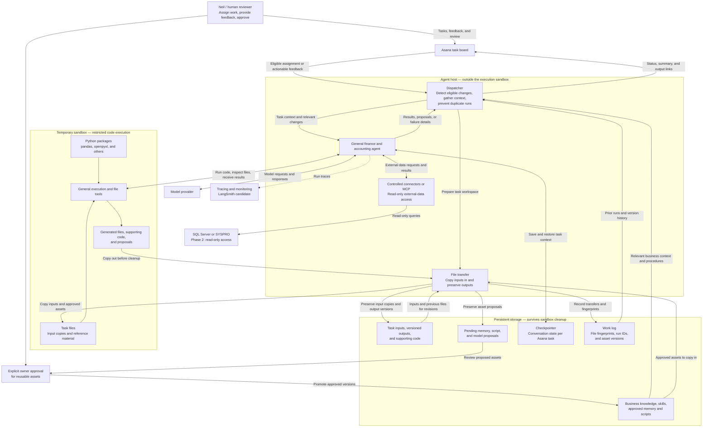

# Finance & Accounting Agent — Architecture

**Status:** Proposed design, October 15, 2026.  
**Source:** Recreated in editable Mermaid from the architecture image supplied by Neil Yee. This is not a copy of the original image file.  
**Related document:** [Agent specification](agent-spec.md).

GitHub renders the Mermaid block below as a diagram. Edit the block to update the architecture alongside the code.

## Reading the diagram

Asana is the main work interface. The dispatcher identifies eligible assignments and feedback, gathers context, and starts the agent. The agent uses the model provider and controlled external-data connectors from the host. Code execution and task-file manipulation happen inside the temporary sandbox.

The file-transfer component prepares the workspace and preserves outputs before sandbox cleanup. Persistent storage holds task artifacts, checkpoints, factual work logs, pending proposals, and approved reusable assets.

Human review of a task output happens through Asana. Approval of memory or reusable scripts and models follows a separate owner decision before promotion to the approved library.

## Boundaries and unresolved choices

- The diagram expresses logical components. It does not require a separate service or process for every box.
- The dispatcher and agent initially run on a local host. The sandbox may be hosted or a restricted local container; the provider is undecided.
- External-system credentials stay outside the execution sandbox. Network and filesystem restrictions require actual environment controls.
- The diagram's read-only connector applies to external business data. The dispatcher has separately controlled Asana write access for statuses, summaries, and output links.
- SQL Server or SYSPRO access is a Phase 2 capability. Posting entries, payments, and changes to authoritative ERP records are excluded initially.
- One Asana task defines the initial thread scope. Revisions restore that task's state and use preserved output versions.
- Business knowledge is human-maintained. Memory, scripts, models, and skill changes require separate approval; approving a task output does not promote them.
- Polling versus webhooks, task eligibility, feedback rules, storage location, and operating limits remain open decisions in the [agent specification](agent-spec.md#open-decisions).
- Monitoring captures runs; the transfer log records copy-in and copy-out activity. Neither is assumed to record every internal sandbox file operation.

## First implementation milestone

An Asana task with an attached CSV triggers one agent run. The agent processes an input copy in a sandbox, produces a reviewable artifact, and preserves it before cleanup. The dispatcher publishes a summary and output link in Asana. Human feedback starts a revision on the same task thread.

The first finance skill follows after this complete path works. Bank reconciliation is the current candidate.
