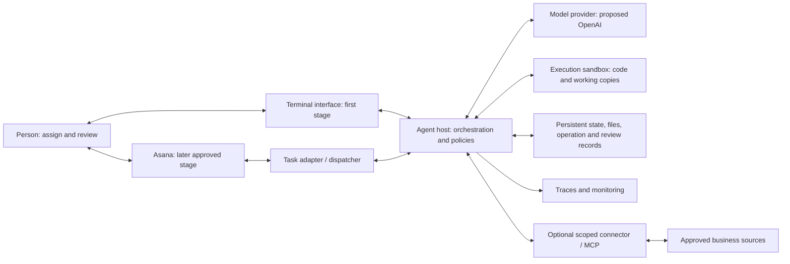
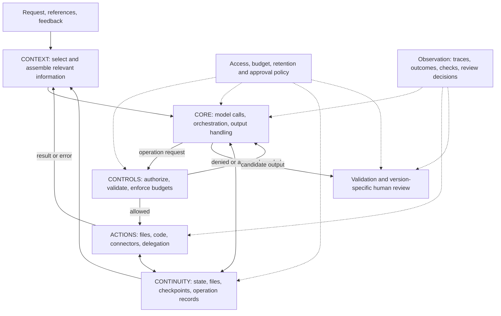
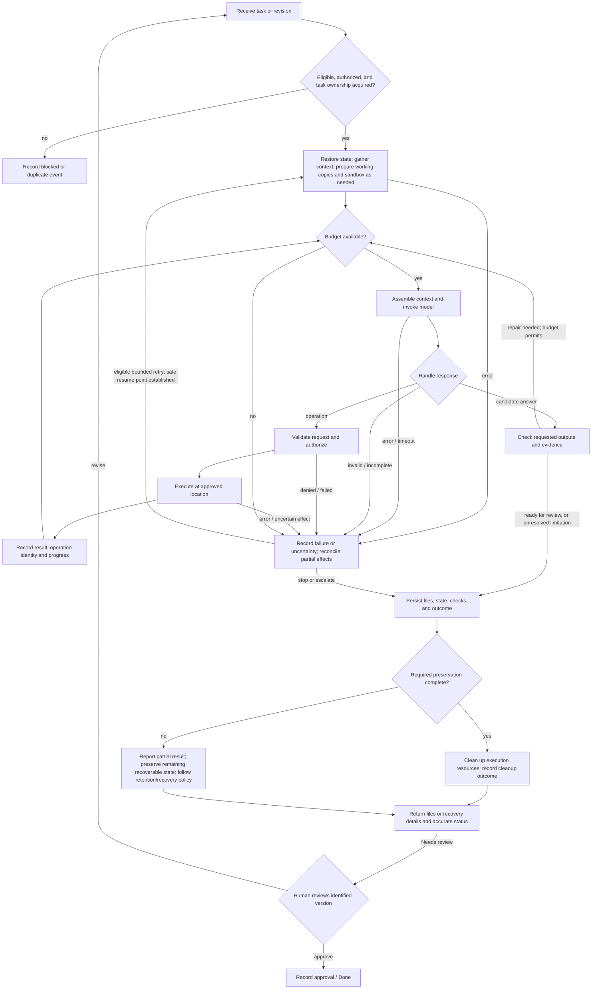
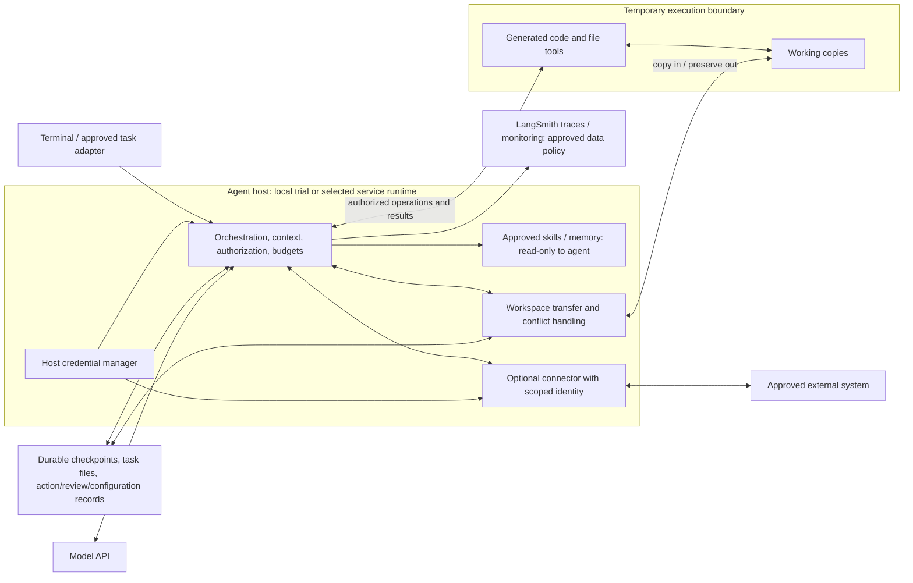

# Finance & Accounting Agent — Target Architecture

| Field | Value |
|---|---|
| Version | v0.9 design draft · October 23, 2026 |
| Owner | Neil Yee |
| Specification | [Agent specification](agent-spec.md) v0.9 |
| Implementation assessment | Not assessed. Every component and path below describes intended behavior. |

The four views explain system boundaries, responsibilities, execution, and deployment. They apply the [anatomy](mental-model/01-anatomy.md) and link to the spec and evaluations. Solid arrows show calls/data flow; dotted arrows show oversight or policy influence. Line style does not indicate implementation status.

## 1. System overview

The foundation should work through the terminal. Asana and other connectors require their own approved scope and evidence. Code execution should use a sandbox; model invocation, orchestration, authorization, and credential management should remain on the host.

## 2. Anatomy view: responsibilities and mechanisms

These are responsibilities, not necessarily separate services. Observation spans the functions. Approval after delivery cannot replace authorization before an external action.

| Component / concept | Functions served | Mechanisms / proposed implementation |
|---|---|---|
| Agent harness | Core, Context, Actions | Deep Agents / LangChain orchestration, model adapter, response handling, tool routing. |
| Task adapter | Context, Controls, Continuity | Request normalization, task/thread mapping, eligibility, deduplication, concurrency control. |
| Skills, references, todos | Context, Continuity | Discovery/retrieval, read-only reference routes, planning tool, stored task state; middleware where suitable. |
| Execution and connector tools | Actions, Controls | Host-side authorization; sandbox file/code operations; separately scoped connector identities. |
| Runtime policy | Controls, Core | Checks before calls/actions, shared budgets, output checks, approval and access validation. |
| Durable state and artifact store | Continuity, Context | Checkpoints, per-task files, versions/hashes, operation records and recovery metadata. |
| Review and evidence records | Controls, Continuity | Versioned manifests, decisions, configuration/source IDs, traces and monitoring signals. |

A separate sub-agent context does not imply separate security. If delegation is enabled, its permissions, persistence, and usage must remain within the parent task's approved scope.

## 3. Run view: normal work and failure paths

Retry from a verified safe point, not blindly from the beginning. A timeout may follow a completed external effect. Operation records and reconciliation must prevent repeated effects. Cleanup errors remain visible; do not claim complete preservation or success without the required evidence.

Review binds to a specific output version. Revised files require a new decision. The later Asana path must distinguish human feedback from informational comments and agent-generated updates.

## 4. Deployment and trust boundaries

| Boundary | Required design |
|---|---|
| Host → model / tracing | Use host credentials and approved data handling. Record model/configuration identity; minimize sensitive trace content. |
| Host → sandbox | Transfer only eligible task data/assets. Do not copy host secrets by default. Restrict and verify filesystem, process, network, and resource access. |
| Sandbox → persistent storage | Preserve outputs and operation evidence before destructive cleanup. Version conflicts; report incomplete transfer. |
| Host → external system | Use a named, scoped connector identity. Initial business access is read-only; Asana task updates require their explicit publication scope. |
| Agent → shared references | Enforce read-only access; owner-approved changes follow the release process. |
| Work item → other tasks/users | Scope state, files, retrieved memory, credentials, and review records. Define ownership/locking for concurrent execution. |

Proposed choices: Deep Agents orchestration, OpenAI model, LangSmith sandbox/tracing, SQLite for local checkpoints, and per-task durable files. Hosted storage, exact versions, retention, identities, and concurrency behavior are decisions D1, D4, D5, and D7 in the spec. A virtual path or provider name alone does not prove isolation.

## 5. Traceability and evidence to seek

The spec classifies capabilities as shared foundation (C1–C7), reusable work capabilities (C8–C11), and task-specific capability (C12). These share the same components; the classification does not require separate services.

| Architecture responsibility | Spec | Evaluation | Evidence required during repository review |
|---|---|---|---|
| Model, loop, context and planning | [3.1 Core](agent-spec.md#31-core), [3.2 Context](agent-spec.md#32-context) | E-PLAT-1, E-REC-1 | Configuration, routing and state handling; representative runs and incomplete-response cases. |
| File/code work and validation | [3.3 Actions](agent-spec.md#33-actions), [4.3 Output standard](agent-spec.md#43-output-standard) | E-ART-1, E-FIN-1 | Execution/validation paths and independent artifact/cross-file checks. |
| Permissions, budgets, identity and approval | [3.4 Controls](agent-spec.md#34-controls) | E-CTRL-1, E-PROV-1 | Enforcement points, access policy, boundary cases and version-specific decisions. |
| Persistence, transfer and recovery | [3.5 Continuity](agent-spec.md#35-continuity) | E-FILE-1, E-REC-1 | Checkpoint/file/action records and interruption/conflict/retry evidence. |
| Task intake, publication and revision | [4.2 Work lifecycle](agent-spec.md#42-work-lifecycle-and-interface) | E-ASANA-1 | Scope, mapping, trigger/locking rules and integration cases. |
| Release, observation and response | [6.2 Release](agent-spec.md#62-release-plan), [6.3 Monitoring](agent-spec.md#63-monitoring-plan) | E-REL-1, E-PROV-1 | Configuration/release record, monitoring owners/thresholds, recovery rehearsal. |

## 6. Design review checklist

These checks describe acceptance of the design; no completion is asserted.

- [ ] Capabilities map to functions, mechanisms, components, criteria, and evaluations.
- [ ] Normal, denied, incomplete, failed, interrupted, and revised work have defined paths.
- [ ] Persistence and reconciliation cover partial effects and transfer/cleanup failure.
- [ ] Controls cover model calls, actions, state changes, and delivery at enforceable boundaries.
- [ ] Credentials, data flows, concurrency, and sandbox access are explicitly scoped.
- [ ] Review identifies output versions; task approval and reusable-asset approval stay distinct.
- [ ] Every required component has implementation and verification work in the task list.

## 7. Change log

| Version | Date | Change |
|---|---|---|
| v0.9 | 2026-10-23 | Aligned the spec reference and capability-scope mapping. |
| v0.8 | 2026-10-23 | Recast all views as target design; removed implementation labels; expanded outcome, recovery, control and evidence mappings. |
| v0.7 and earlier | 2026-10-23 | Earlier architecture versions retained in Git history. |
