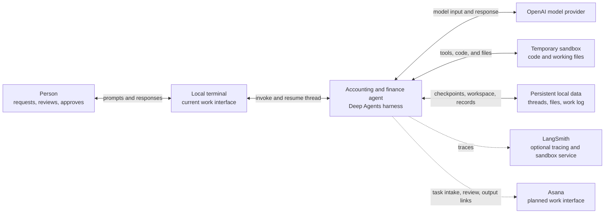
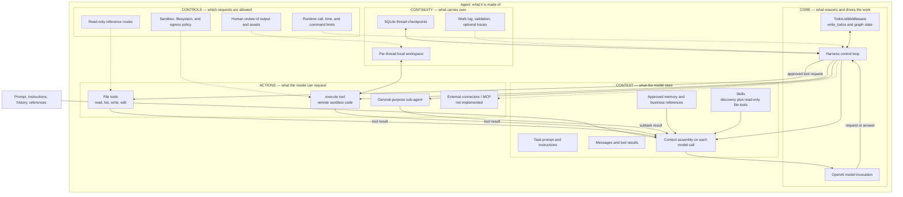
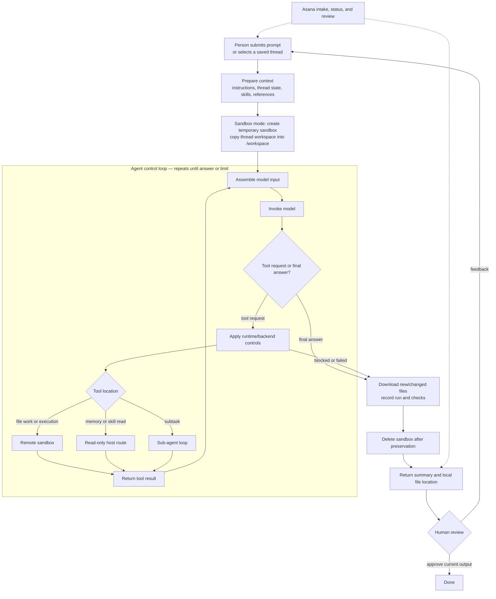
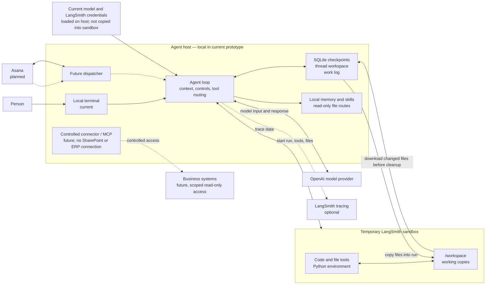

# Finance & Accounting Agent — Architecture

| Document field | Value |
|---|---|
| Version | v0.5 working draft |
| Owner | Neil Yee |
| Specification | [Agent specification](agent-spec.md) v0.6 |
| Status | Current prototype with proposed Asana and external-system integrations. |

This architecture applies the [00 overview](mental-model/00-overview.md) and [01 anatomy](mental-model/01-anatomy.md) to the project. The anatomy view shows what the agent is made of; the run view shows how requests move through it; the deployment view shows where components run and what they can reach. Solid nodes and edges describe the current prototype. Dashed edges are proposed future integrations or release paths.

## 1. Overview

## 2. Anatomy view: functions and mechanisms

## 3. Run view: how one task flows

## 4. Deployment view: where it runs and what it can reach

**Trust boundary:** the agent loop and model client run on the host. The temporary sandbox executes generated commands and receives eligible workspace files. The application does not copy its local `.env` or API keys into the sandbox. Network egress is owner-configurable, but effective isolation has not been verified. A future external connector would run outside the sandbox and would need a separately defined identity and access scope. Do not infer that an integration or control exists just because it appears as a proposed component.

## 5. Traceability: architecture to specification

| Architecture element | View | Spec section | Current state |
|---|---|---|---|
| Core: loop, model, planning, limits | 2, 3, 4 | [2.1 Core](agent-spec.md#21-core-what-reasons-and-drives-the-work) | Implemented; some live limit checks pending |
| Context: task, instructions, history, skills, knowledge | 2, 3 | [2.2 Context](agent-spec.md#22-context-what-the-model-sees) | Implemented locally; Asana task gathering planned |
| Actions: file tools, execute, sub-agent | 2, 3, 4 | [2.3 Actions](agent-spec.md#23-actions-what-the-model-can-request) | Implemented |
| Controls: routes, runtime limits, sandbox, review | 2, 3, 4 | [2.4 Controls](agent-spec.md#24-controls-which-requests-are-allowed) | Partial; see README verification inventory |
| Continuity: checkpoint, workspace, work log, traces | 2, 3, 4 | [2.5 Continuity](agent-spec.md#25-continuity-what-carries-over) | Implemented locally; recovery and provenance gaps remain |
| Asana dispatcher and review path | 2.7, 3, 4 | [2.7 Work lifecycle and interface](agent-spec.md#27-work-lifecycle-and-interface), [3.1 E-ASANA-1](agent-spec.md#31-evaluation-plan) | Proposed, not implemented |
| External connector or MCP | 2, 4 | [2.3 Actions](agent-spec.md#23-actions--what-the-model-can-request), [2.4 Controls](agent-spec.md#24-controls--which-requests-are-allowed) | No external business-system integration |
| Model provider and LangSmith | 1, 4 | [2.1 Core](agent-spec.md#21-core--what-reasons-and-drives-the-work), [3.3 Monitoring](agent-spec.md#33-monitoring-plan) | Model call and optional tracing implemented |

## 6. Completeness and review checklist

- [ ] Every anatomy function has a project decision and named implementation mechanism in Section 2 of the spec.
- [ ] Every spec function appears in the anatomy view; every box maps to a spec section above.
- [ ] Each proposed or implemented path is labeled accurately; placeholders are not presented as running services.
- [ ] Each control is shown at its actual strength: instruction, program hook, human decision, or environment.
- [ ] Credentials and network routes match the real execution boundary.
- [ ] Every success criterion maps through a function and mechanism to at least one evaluation in the spec.
- [ ] Run flow identifies persistence, cleanup, human review, and failure handling.

## 7. Change log

| Version | Date | Change |
|---|---|---|
| v0.6 | 2026-10-22 | Updated the spec cross-reference for its revised section order. |
| v0.5 | 2026-10-22 | Adapted the four-view architecture template to the current prototype and the five-function anatomy; added spec traceability and current/future labels. |
| v0.4 | 2026-10-15 | Prior project-specific architecture diagram. |
