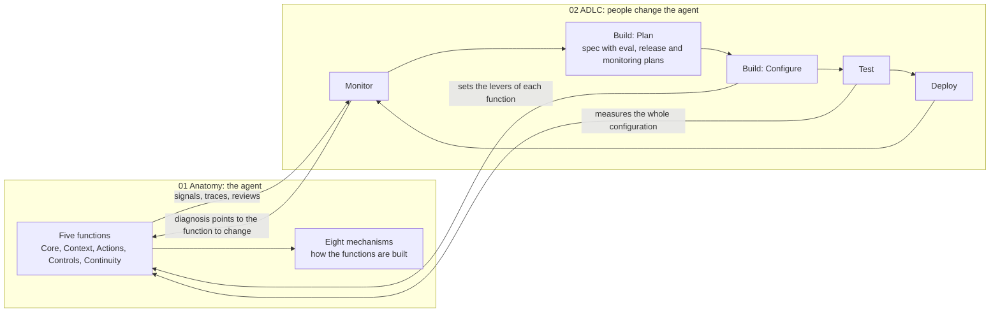

# Agent Mental Model: 00 Overview

> **Purpose:** the entry point to the mental model. It says what each part covers, how the parts connect, and where any concept belongs.
> Details live in the numbered files. This page only maps them.

**Version:** v1.0 · **Owner:** Neil Yee

---

## Goal

Every agent concept has one clear place, so I can **explain** any agent, **design** one, and **run** one, and so any new term fits somewhere obvious.

---

## The two models

| File | Model | Question it answers | Describes |
|---|---|---|---|
| `01-anatomy.md` | **Anatomy** | What is an agent made of, and how does one run work? | **The agent** |
| `02-adlc.md` | **ADLC** | How do people build an instance of the anatomy and improve it over time? | **How people change the agent** |

Both are conceptual. They hold for any agent and any framework.

---

## How they connect

The **five functions** are the shared vocabulary of both models:

| In the Anatomy | In the ADLC |
|---|---|
| What the agent is made of | **Levers:** what people can change |
| How each function can fail | **Eval design:** what to check |
| What each function produces at runtime | **Monitoring signals:** what to watch |
| Which function caused a problem | **Diagnosis:** which lever to change |

---

## Who changes what

| Who | Changes | Covered in |
|---|---|---|
| **The agent, during runs** | Memory only, with approval | Anatomy (Continuity, Controls) |
| **The agent, as drafts** | Proposed tools, scripts, skill edits. These have no effect until released | ADLC |
| **People** | Everything else: model, instructions, skills, knowledge, tools, access, controls, plans | ADLC |

---

## Each model in one sentence

- **Anatomy:** *a stateless model that only turns tokens into tokens, placed in a control loop where the program builds its input, interprets its output as requests, and decides which requests to carry out.*
- **ADLC:** *because behaviour comes from the whole configuration, varies from run to run, and meets a changing world, people plan, configure, test, deploy and monitor the agent in a loop, deciding upfront how it will be measured, released and watched.*

---

## Placing a new concept

1. **Which model?** Part of what the agent *is* (Anatomy), or part of how people *change* it (ADLC)?
2. **Where inside it?**
   - Anatomy: which **function** does it serve, and which **mechanisms** build it?
   - ADLC: which **phase** does it belong to, and which **lever** or **plan** does it touch?
3. **Concept or implementation?** Framework names (middleware, backend, LangGraph, LangSmith) go only in the implementation and tooling sections.

| Example | Model | Where |
|---|---|---|
| Skill | Anatomy | Context, built from a hook, a tool and storage |
| Checkpointer | Anatomy | Continuity, built from storage |
| Eval case | ADLC | Designed in Plan, created in Configure, run in Test |
| Parallel run | ADLC | Deploy, rollout stage 1 |
| Middleware | Implementation | A container for hooks, tools and state fields |

---

## Not in this model

Project-specific choices belong to each agent, not here:

| Choice | Lives in |
|---|---|
| Task tracker and dispatcher (for example Asana) | That agent's `SPEC.md` and architecture diagram |
| Sandbox provider, storage, model provider | That agent's `SPEC.md` |
| Its eval, release and monitoring plans | That agent's `SPEC.md` |
| Dates, owners, tasks | That agent's project plan |

---

## Files

| File | Contains |
|---|---|
| `00-overview.md` | This page: the map |
| `01-anatomy.md` | Three facts, five functions, eight mechanisms, concept mapping, run and anatomy diagrams, implementation layer |
| `02-adlc.md` | Three premises, phases, levers, evals, deployment and monitoring design, changes after release, diagnosis, playbook |

---

## Change log

| Version | Date | Change |
|---|---|---|
| v1.0 | 2026-10-15 | First version: goal, two models, how they connect, who changes what, placing new concepts, scope boundaries |