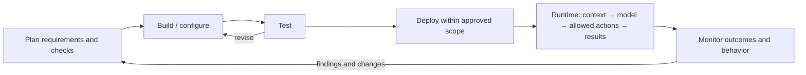

# Agent Mental Model: 00 Overview

**Purpose:** a practical map for designing, understanding, and improving software agents built around language models.

**Version:** v1.3 · **Owner:** Neil Yee · **Updated:** October 24, 2026

## 1. Two connected views

| View | Question | Read it to… |
|---|---|---|
| [Anatomy](01-anatomy.md) | How does the agent work? | Connect capabilities to functions, mechanisms, and implementation. |
| [ADLC](02-adlc.md) | How do we build, evaluate, release, and improve it? | Turn requirements into evidence and controlled changes. |

This overview connects the two. The categories are thinking aids: a component can serve several functions, and a check can be used in several lifecycle phases. Start with the work the agent should accomplish; choose components to support it.

## 2. From purpose to evidence

| Level | Question | Example: continuing work after interruption |
|---|---|---|
| **Objective** | What outcome matters to the user? | Complete assigned work without losing progress. |
| **Capability** | What must the agent be able to do? | Resume an interrupted task. |
| **Function** | Which responsibilities support that capability? | Continuity keeps state; Context restores relevant information; Controls prevent duplicate effects. |
| **Mechanism** | How are those responsibilities carried out? | Checkpoints, durable files, context assembly, and retry/deduplication checks. |
| **Implementation** | Which code or service provides them? | A graph checkpointer, file store, and operation IDs in a database. |
| **Success criterion** | What observable result counts as acceptable? | After restart, required work remains available and completed external actions are not repeated. |
| **Evaluation** | How will we check that claim? | Interrupt at defined points, resume, and compare state, files, and external records. |
| **Monitoring and response** | How will we detect and handle failures in use? | Track resume failures and duplicate actions; investigate and add regression cases. |

A **concept** is a useful name such as “skill,” “memory,” or “thread.” Map it to its functions and mechanisms; it is not another required layer in this chain. Success criteria define the requirement even when the implementation changes.

## 3. Two loops at different scales

The **runtime loop** performs work under the current configuration. The **development lifecycle** changes that configuration and the evidence supporting its use. People remain accountable; software and agents may assist or automate either loop within defined authority.

Runtime state can change too: messages, files, task status, and permitted memory writes. Stored memory can influence future behavior, so it needs ownership and update rules. A change to a reusable skill, tool, model, or permission needs the release process appropriate to its impact.

## 4. Applying the models to a project

Start with two linked planning artifacts:

- **Specification and design:** purpose, scope and capabilities, followed by requirements and proposed design across Build, Test, Deploy and Monitor. Include architecture views, success criteria, evaluation/release/monitoring plans and open decisions.
- **Task list:** work to implement and verify the plan, with dependencies, owners, status and evidence links.

Architecture belongs within the design: show agent components and execution under Build, evaluation-to-operation connections alongside Test, and hosting/data/access boundaries under Deploy. Split material into separate documents when ownership or detail warrants it.

An implementation inventory in the specification and design document can summarize intended shared building blocks and link to task-list items. Keep implementation status and findings in the task list. Actual implementation lives in code and configuration; evaluation and release records provide evidence for its use. The [ADLC artifact guide](02-adlc.md#21-minimum-working-artifacts) explains how these pieces connect.

Use stable IDs to follow **capability → design → criterion → check → result → monitoring response**. One relationship may have several links. A status such as “implemented” should remain distinct from “evaluated” or “approved for use.”

Keep project choices—providers, frameworks, skills, access, thresholds, owners—in those artifacts. The reference models supply questions and distinctions; the project supplies the answers.

## Change log

| Version | Date | Change |
|---|---|---|
| v1.3 | 2026-10-24 | Distinguished the implementation inventory from the task list that owns status and findings. |
| v1.2 | 2026-10-24 | Aligned project artifacts with a combined specification/design document, embedded architecture views and a linked task list. |
| v1.1 | 2026-10-23 | Replaced rigid classification with connected views; added the purpose-to-evidence chain and clarified runtime changes versus release changes. |
| v1.0 | 2026-10-15 | Initial overview. |
