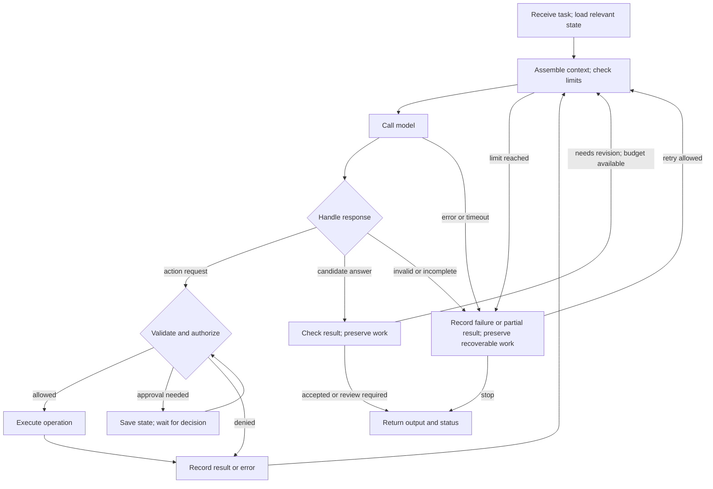

# Agent Mental Model: 01 Anatomy

**Purpose:** explain how a language-model agent performs work, independently of a particular framework.

**Version:** v1.1 · **Owner:** Neil Yee · **Updated:** October 23, 2026

## 1. Start with the system

An agent combines a model with software that supplies context, executes permitted actions, and manages progress toward a task. The model can help choose what happens next; the surrounding system determines what can actually happen.

Three facts guide the design:

| Fact | Design consequence |
|---|---|
| **The model works from the information available to a call.** Inputs may include instructions, messages, tool definitions, and text, image, or audio representations. Roles and input structure matter. | Select and assemble relevant context within the model's limits. Access to a file does not mean its contents were read. |
| **Ordinary inference does not update model weights or guarantee durable task memory.** Applications and providers may retain conversation state. | Make retention and retrieval explicit. History, cached context, stored memory, and training are different things. |
| **External effects require executing software.** A model-generated tool call or program has an effect when a tool handler, service, or runtime executes it. | Define execution authority, validate requests, and inspect results. This also applies when execution is hosted by the model provider. |

These facts explain why the model alone is insufficient. They do not require every agent to use the same loop, storage, tools, or approval process.

## 2. Five functions

Functions describe responsibilities. They are not separate services or a fixed execution order.

| Function | Question | Responsibility |
|---|---|---|
| **Core** | What chooses and coordinates the next step? | Model calls and orchestration: continue, delegate, wait, stop, or fail. |
| **Context** | What information is available for this decision? | Task, instructions, sources, history, tool definitions/results, retrieved knowledge, and relevant memory. |
| **Actions** | What operations can the system perform? | Read or change files, calculate, call services, interact with interfaces, or delegate work. |
| **Controls** | Under what conditions may it proceed? | Permissions, validation, approvals, limits, and checks on inputs, actions, outputs, and state changes. |
| **Continuity** | What survives, and how is it recovered? | Working state, conversation, files, checkpoints, and reusable memory, with defined scope and lifetime. |

A capability usually spans functions. “Create a reliable spreadsheet” needs Context for requirements, Core for coordination, Actions for generation, Controls for checks, and Continuity for preserving the result.

## 3. Mechanisms

Mechanisms explain how the functions are carried out. These eight are a useful checklist; a small program can combine several, and implementations may use different names.

| Mechanism | What it does | Main functions served |
|---|---|---|
| **Control loop / orchestration** | Chooses and sequences steps, including branches, parallel work, waits, and stopping. | Core; coordinates all functions |
| **Model invocation** | Calls a model with input, settings, and limits; handles its response or failure. | Core |
| **Context assembly** | Selects, retrieves, and formats information for a call; may trim or summarize history. | Context, Continuity |
| **Output handling** | Interprets responses, validates their structure, and routes tool requests, answers, refusals, or incomplete responses. | Core, Actions, Controls |
| **Tools** | Execute defined operations and return results or errors. Calls may come from the model or orchestration code. | Actions; may also read context or save state |
| **Hooks / policy checks** | Run at defined points around calls, actions, or state transitions—for example to enforce a budget or record an event. | Controls, Context, Continuity |
| **State and storage** | Keep current progress and persist selected data for later use or recovery. | Continuity, Context |
| **Execution environment** | Provides runtime, packages, filesystem, network, and identities; constrains reachable resources. | Actions, Controls, Continuity |

**Tools and hooks:** a tool performs a requested operation; a hook runs because execution reaches its configured point. Hooks are one implementation technique; ordinary application code can perform the same checks.

**Information and retention:** what a remembered fact says belongs to Context; storing it, scoping it, and retrieving it later involve Continuity. Saving data does not guarantee the model will retrieve or use it correctly.

## 4. One run

A **run** is one execution attempt toward a task; it can span several model/tool steps and pauses. A **thread** groups related conversation or work across runs. These terms vary by framework, so define their project meaning.

This is a common pattern, not a required graph. Persistence and observation can occur throughout; controls also apply before model calls, at storage boundaries, and before delivery. Relevant context may be assembled by the application or retained by a provider; it need not be retransmitted from scratch.

Stopping is not proof of success. A run may end with an accepted result, a review request, an unresolved limitation, a refusal, or a failure. Keep these outcomes distinguishable.

## 5. Mapping familiar concepts

These are common implementations, not definitions that every framework must follow.

| Concept | Functions | Typical mechanisms |
|---|---|---|
| **Conversation history / thread** | Context, Continuity | Messages stored under an ID; selected history restored into context. |
| **Checkpoint** | Continuity | Saved execution state used to resume. External systems may need separate reconciliation. |
| **Skill** | Context; Actions if it bundles executable tools | Procedure/instructions loaded into context, sometimes with scripts or references. It does not grant access by itself. |
| **Knowledge / retrieval** | Context, Continuity | Search or load sources, select relevant content, retain source identity. Retrieval can be a tool or an automatic step. |
| **Memory** | Continuity, Context, Controls | Store selected information for future tasks; retrieve it under scope, update, expiry, and deletion rules. |
| **Summary / todo plan** | Context, Continuity | Compressed history or explicit plan held in state. A plan guides work; marking it complete does not verify the result. |
| **MCP** | Context, Actions | A connection protocol for tools, resources, and prompts. The host chooses what to expose; permissions depend on the integration. |
| **Sub-agent** | Actions, Core; often Context | Another agent execution with assigned context and tools. Separate context does not automatically mean isolated credentials or permissions. |
| **Human approval** | Controls, Continuity | Record a decision about a specific action or output version; pause/resume if needed. Recheck approval if its scope changes. |
| **Trace** | Supports observation and diagnosis across functions | Recorded calls, inputs/outputs, tool events, timing, and usage. Coverage depends on instrumentation; it is neither a full record of private reasoning nor proof of correctness. |

## 6. Controls and recovery

### Enforcement depends on the actual boundary

| Control | What it provides | Limitation |
|---|---|---|
| **Instructions** | Tell the model the intended behavior and rules. | Compliance is not an access guarantee. Untrusted content can influence behavior. |
| **Program checks** | Validate schemas, permissions, destinations, budgets, and approvals. | Must cover every relevant execution path and handle errors correctly. |
| **Environment restrictions** | Restrict filesystem, network, process, or identity access. | Only protect what is actually restricted; a sandbox may still have broad network or credential access. |
| **Human review** | Judges ambiguous outcomes or authorizes consequential actions. | Depends on evidence and timing. Review after an action cannot prevent that action. |

Use controls together. Their effectiveness depends on what they enforce and whether they can be bypassed; there is no universal ranking by label. Treat retrieved content as data, preserve its source, and enforce permissions outside the model to limit prompt-injection consequences.

### Recovery is part of the design

A timeout means the caller did not receive a timely result; an external action might already have completed. Before retrying, determine what happened. Use operation IDs, deduplication, or idempotent actions where possible, and bound attempts and total cost/time.

A checkpoint restores recorded state; it cannot undo a payment, message, or file write. Define how to reconcile partial actions, preserve files before cleanup, and resume or stop safely. Test interruptions at those boundaries.

Memory updates change future context, not model weights. Decide what may be stored, for whom, from which source, and how it is corrected or removed. Human approval is one policy; automatic writes may be appropriate within tested rules. Changes to reusable behavior or access follow the [ADLC](02-adlc.md#6-changes-after-release).

## 7. Implementation examples: Deep Agents / LangChain

Use these as mappings to check against the installed version.

| Mechanism | Example implementation |
|---|---|
| Orchestration and model invocation | LangGraph execution and chat-model/provider adapters. |
| Context and output handling | Messages, system instructions, tool schemas, middleware, and structured tool-call responses. |
| Tools and policy checks | Registered tools, MCP adapters, file/execution/delegation tools, and middleware hooks. |
| State and storage | Graph state, checkpointers, thread identifiers, stores, and filesystem backends. |
| Execution environment | Host process or sandbox, packages, OS permissions, network policy, and service identities. |

Middleware packages can supply hooks, tools, or state fields. A backend routes storage or execution operations; its name or virtual root alone does not establish an isolation boundary. Skills and plugins bundle capabilities that must still be mapped to these mechanisms and access rules.

## Change log

| Version | Date | Change |
|---|---|---|
| v1.1 | 2026-10-23 | Qualified model/state assumptions; clarified overlapping functions, mechanisms, controls, MCP, memory, and recovery; consolidated diagrams and concept mappings. |
| v1.0 | 2026-10-15 | Initial anatomy model. |
