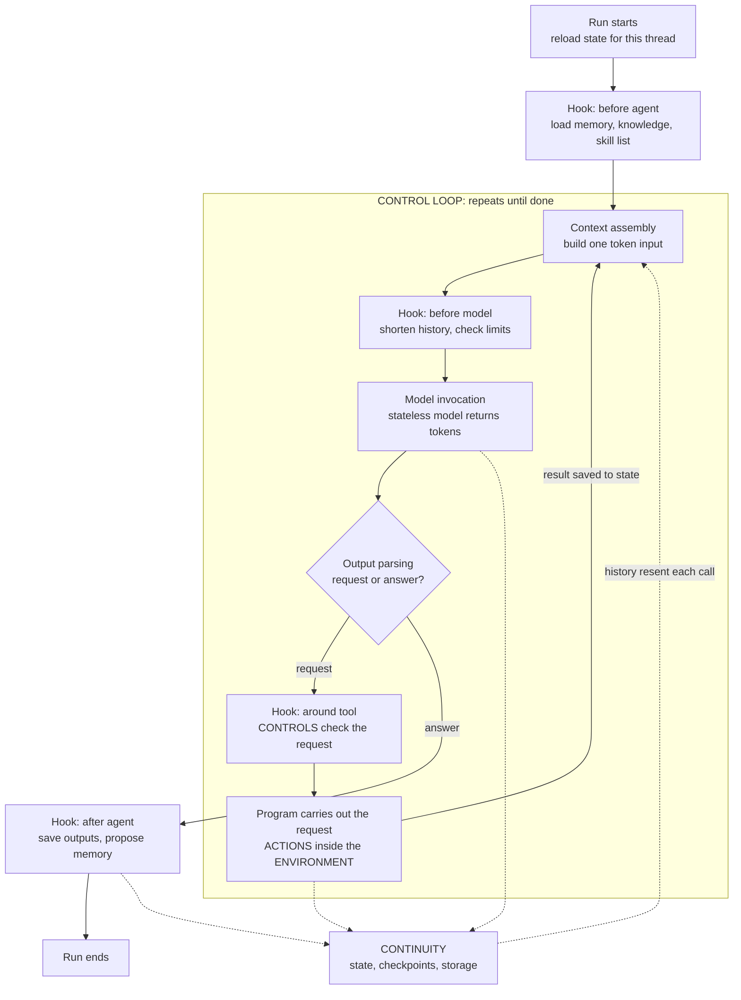
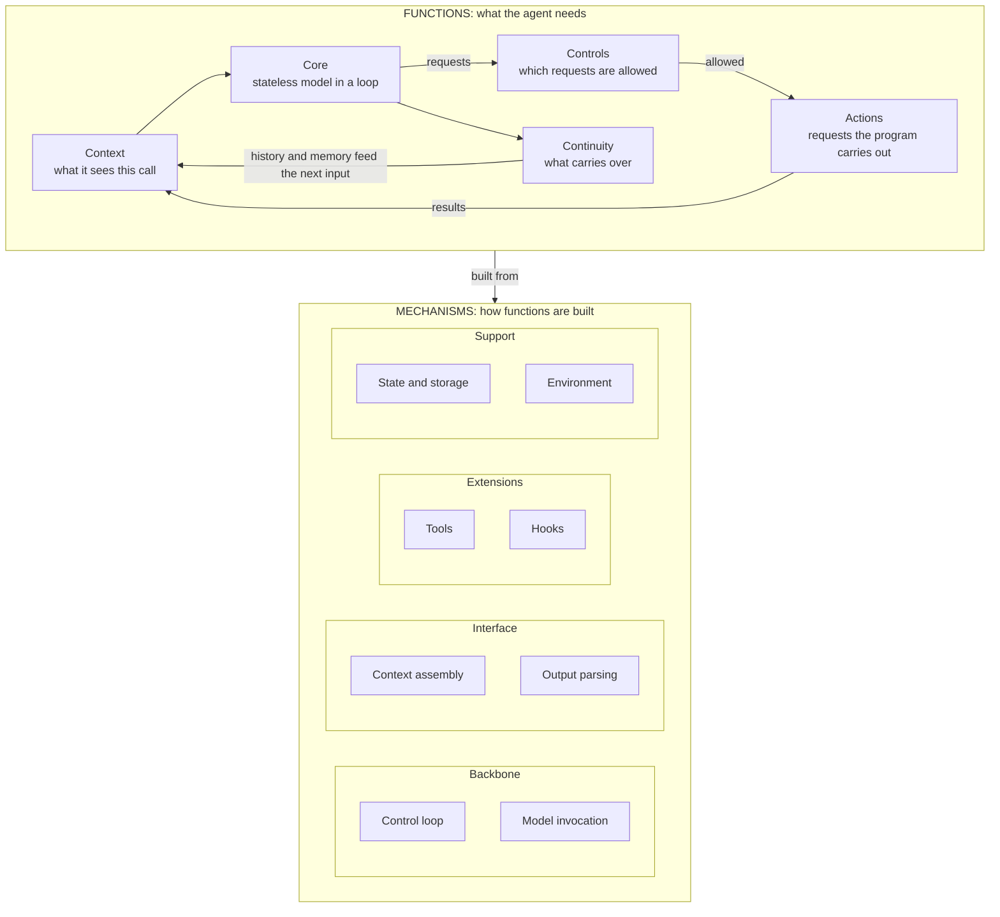

# Agent Mental Model: 01 Anatomy

> **Purpose:** what an agent is made of and how one run works. This holds for any agent framework.
> Framework-specific names appear only in Section 6 (Implementation layer).

**Version:** v1.0 · **Owner:** Neil Yee

---

## 0. Three facts everything rests on

| # | Fact | What it means |
|---|---|---|
| **1** | **Tokens in, tokens out.** | Everything the model receives becomes one sequence of tokens: text, and in many models also images, audio or file contents. What it produces is also tokens, usually text. System prompt, messages, tool definitions and skills are labels the program uses while it builds that one input. |
| **2** | **The model is stateless.** | It remembers nothing between calls. Anything that seems remembered was put back into its input. |
| **3** | **The model cannot act.** | Its output is only a request. Anything that happens outside the model happens because the **program** reads that output and carries it out. |

Fact 3 covers every way an agent appears to "do" something:

| What it looks like | What the model actually produces | What the program does |
|---|---|---|
| Calling a tool | Structured text naming the tool and its inputs | Parses it and runs the function |
| Running code | Code written as text | Executes it in the sandbox |
| Using a screen | Text describing a click or keystroke | Performs the click |
| Answering | Plain text | Shows or saves it |

The model only turns tokens into tokens. Everything else is the program deciding **what goes in**, **what to do with what comes out**, and **what to keep**.

---

## 1. Functions: what the agent needs

| Function | Question it answers | Includes |
|---|---|---|
| **Core** | What reasons and drives the work? | A stateless model run inside a loop: produce a request, get the result, repeat until done |
| **Context** | What does the model see on this call? | Instructions, the task, history, tool definitions and results, skills, knowledge, memory, all kept within the model's limit |
| **Actions** | What can it request that the program will carry out? | Work with files, run code, reach outside systems, hand work to a sub-agent |
| **Controls** | Which requests are allowed? | Approvals, permissions, limits, guardrails |
| **Continuity** | What carries over, given the model remembers nothing? | **Within a run:** history, plans, files. **Across runs:** threads, checkpoints, long-term memory |

How each function connects to the facts:

- **Context** exists because of Fact 1. The input is the only way to influence the model.
- **Continuity** exists because of Fact 2. Anything that needs to carry over has to be stored and put back into the input.
- **Actions and Controls** exist because of Fact 3. The model only asks, so the program decides what actually happens.

---

## 2. Mechanisms: how functions are built

| Group | Mechanism | What it does |
|---|---|---|
| **Backbone** (builds the Core) | **Control loop** | Runs the steps in order, routes requests, and decides whether to repeat or stop |
| | **Model invocation** | Sends the input to the model with its settings and gets tokens back |
| **Interface** (the only way in and out) | **Context assembly** | Builds one input from all sources, fresh on every call |
| | **Output parsing** | Reads the output as either a request or a final answer. **This is the boundary between thinking and acting** |
| **Extensions** (attach to the loop) | **Tools** | Requests the program is willing to carry out. The definition goes in the input, the request comes in the output, and the result goes into the next input |
| | **Hooks** | Code the program runs at fixed points: before or after the agent, before or after the model, around tool calls |
| **Support** (outside the loop) | **State and storage** | What the program keeps so it can rebuild the next input |
| | **Environment** | What the program can physically reach when it carries out requests: sandbox, network, credentials |

### Key distinctions

- **Tools vs hooks:** the model decides when to request a tool. A hook runs whenever its point in the loop is reached, whether the model asks or not.
- **Three strengths of control:**
  1. **Instruction in the input**: weakest. It only *asks* the model, and other text (for example a prompt injection) can override it.
  2. **Hook**: stronger. The program checks the request and refuses it.
  3. **Environment**: strongest. Even the program cannot reach the resource.
- **Content vs keeping:** what history or memory *says* is Context. *Keeping* it so it can be resent is Continuity.

---

## 3. How each concept is built

| Concept | Function | Mechanisms |
|---|---|---|
| **Conversation history** | Context + Continuity | **State:** kept between calls. **Context assembly:** resent on every call |
| **Thread** | Continuity | **Storage:** the ID that groups saved history |
| **Checkpointer** | Continuity | **Storage:** saves state after each step so a run can resume |
| **Skills** | Context (know-how) | **Hook:** adds the skill list to the input. **Tool:** reads the full `SKILL.md` when needed. **Storage:** holds the files |
| **Knowledge** | Context | **Context assembly or hook:** loads a summary. **Tool:** reads details on demand. **Storage** |
| **Memory: reading** | Context | **Hook:** loads approved memory into the input. **Storage** |
| **Memory: writing** | Context, through Controls | **Tool:** the model proposes a note. **Hook or human approval:** decides whether it is kept. **Storage** |
| **Summarization** | Context (stay within the limit) | **Hook:** shortens old history before the model call. **State** |
| **To Do** | Context (its own plan) | **Tool:** `write_todos`. **State:** `todos` |
| **Tool definitions** | Context | **Context assembly:** text describing what can be requested |
| **File tools, `execute`** | Actions | **Tools.** **Environment:** where the program carries them out |
| **MCP** | Actions | **Tools:** each MCP function appears as a requestable tool. **Environment:** the server and its access |
| **Sub-agent** | Actions (delegation) | **Tool:** starts another control loop with its own separate input |
| **Human approval** | Controls | **Hook:** pauses a request before it is carried out. **Storage:** a checkpoint so the run can resume |
| **Call, cost and time limits** | Controls | **Hook:** counts and forces the loop to stop |
| **Permissions** | Controls | **Hook** (check and refuse) or **Environment** (no access at all) |
| **Stopping** | Core | **Control loop:** stops when the model answers instead of making a request, or when a limit hook forces it |

Most functions use several mechanisms. Skills are the clearest example: a hook announces them, a tool loads them, and storage holds them (progressive disclosure).

---

## 4. One run

- **Above output parsing, the model is only reasoning. Below it, the program is acting.** Every effect on the outside world passes through the program, which is why Controls sit there.
- **Each pass rebuilds the input from scratch.** That rebuilt input is the only reason the model appears to remember.

---

## 5. The anatomy in one diagram

Requests pass through Controls before they become Actions. That reflects Fact 3: the model only asks, and the program decides.

---

## 6. Implementation layer: Deep Agents / LangChain

Framework names belong here, separate from the concepts.

| Mechanism | Deep Agents / LangChain implementation |
|---|---|
| Control loop | The compiled LangGraph graph: model step, tool step, and the branch between them. Middleware hooks run inside this graph |
| Model invocation | The chat model and provider API (`model=`) |
| Context assembly | `system_prompt`, message history, tool schemas, and middleware that adds to them |
| Output parsing | Tool calls on the model's response message |
| Tools | `tools=`, MCP adapters, built-in file tools, `execute`, `task` |
| Hooks | Middleware hooks: before/after agent, before/after model, wrap model call, wrap tool call |
| State and storage | LangGraph state, checkpointer, thread ID, Store, backends |
| Environment | Backend choice: state, filesystem, local shell, sandbox |

**Middleware** is a package that bundles hooks, tools and extra state fields (for example, the To Do middleware adds the `write_todos` tool and a `todos` state field). It is a container for mechanisms, not a mechanism itself.

---

## 7. Placing any new concept

Ask three questions:

1. **Which function does it serve?** Core, Context, Actions, Controls or Continuity.
2. **Which mechanisms build it?** Usually more than one.
3. **What is it called in the framework?** That answer goes in the implementation layer only.

| Concept | Function | Mechanisms | Implementation |
|---|---|---|---|
| Plugin | Context + Actions | Bundles skills (hook, tool, storage) and MCP (tools) | Plugin package |
| Backend | Continuity + Environment | State and storage, environment | `StateBackend`, `FilesystemBackend`, sandbox |
| `root_dir` / virtual mode | Environment | Environment | Backend setting |
| Dynamic sub-agents | Actions | A tool that starts another control loop | `task` tool |
| Computer use | Actions | Requests for clicks and keystrokes, carried out by the program | Computer-use tool |
| Prompt injection | A risk to Context | Hostile text enters the single input stream (Fact 1) | Defended by hooks and the environment, not by instructions |

---

## 8. Inside and outside the anatomy

- **Inside:** agent evolution through memory. During runs, the agent proposes changes to Continuity, and Controls decide what is kept.
- **Outside:** every other change (model, skills, tools, rules) is made by people through the **ADLC** (`02-adlc.md`).

---

## The anatomy in one sentence

*A stateless model that only turns tokens into tokens, placed in a control loop where the program builds its input, interprets its output as requests, and decides which requests to carry out. Context shapes what it sees, Actions set what it can request, Controls decide what is allowed, and Continuity carries forward what matters.*

---

## Change log

| Version | Date | Change |
|---|---|---|
| v1.0 | 2026-10-15 | First version: three facts, five functions, eight mechanisms, concept mapping, run and anatomy diagrams, implementation layer |