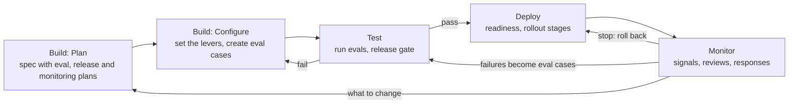
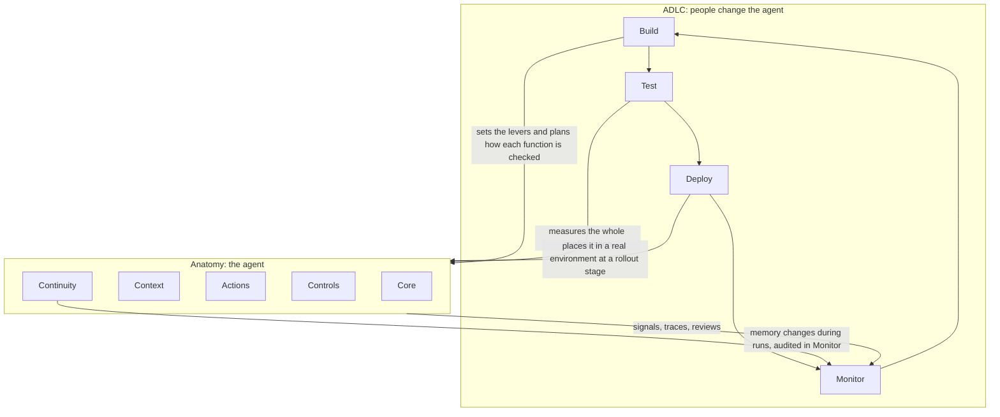

# Agent Mental Model: 02 ADLC (Agent Development Lifecycle)

> **Purpose:** how people create and improve an instance of the anatomy (`01-anatomy.md`).
> The anatomy describes **the agent**. The ADLC describes **how people change the agent**.
> Project-specific choices (task tracker, sandbox provider, dates, owners) belong in each agent's `SPEC.md` and project plan, not here.

**Version:** v0.3 (draft) · **Owner:** Neil Yee

---

## 0. Three premises everything rests on

| # | Premise | What it means |
|---|---|---|
| **1** | **Behaviour comes from the whole configuration.** | What the agent does depends on every part of the anatomy together: model, context, actions, controls and continuity. Changing any one part can change behaviour anywhere. |
| **2** | **Quality is measured, not proven.** | The model's output varies and depends on its input, so you can't prove the agent is correct by reading its code. You can only measure it on examples and on live work. |
| **3** | **The real world keeps changing.** | Inputs, data, processes and models change after release. So the lifecycle is a loop, not a line: what you learn in operation feeds the next build. |

How each premise shapes the ADLC:

- **Premise 1:** Build sets every part of the anatomy deliberately, and every result is tied to a configuration version.
- **Premise 2:** you decide **in Plan** how the agent will be measured, released and watched, then follow those plans in Test, Deploy and Monitor.
- **Premise 3:** Monitor feeds back into Build, and failures become new eval cases.

---

## 1. Phases

```text
Build (Plan, then Configure)  ->  Test  ->  Deploy  ->  Monitor  ->  back to Build
```

| Phase | Question it answers | Acts on (anatomy) | Produces | Gate to move on |
|---|---|---|---|---|
| **Build: Plan** | What are we building, within what limits, and how will we measure, release and watch it? | All five functions, on paper | Spec with the **eval plan**, **release plan** and **monitoring plan**; architecture diagram; project task list | The spec answers each anatomy question, every success criterion has a planned check, and rollout, stop and monitoring are defined |
| **Build: Configure** | Does it work at all? | Each function, one at a time | Code, configuration, skills, tools, eval cases and graders, monitoring checks | It completes one representative task end to end, and the eval cases are ready |
| **Test** | Is this configuration good enough to release? | The whole configured agent | Eval results tied to a configuration version | It passes the release gate |
| **Deploy** | Is it safe to use on real work, and at what level of trust? | Environment and Controls: real access, real limits | Readiness check, rollout stage, change log entry | Readiness confirmed, then each rollout stage's criteria met before moving up |
| **Monitor** | Is it still working, and what should change? | The running agent, through signals, traces and reviews | Findings, responses, new eval cases, change requests | Each finding is stopped, fixed through Build, or accepted |

Planning is not a separate phase. It is the first step of Build.

### Three plans made in Plan

| Plan | Decides | Used in | Spec section |
|---|---|---|---|
| **Eval plan** | What to check, graders, cases, pass thresholds | Test (and Monitor checks) | Success criteria |
| **Release plan** | Environment, access, rollout stages, stop and rollback, readiness | Deploy | Deployment |
| **Monitoring plan** | Signals, review tiers, thresholds, responses | Monitor | Monitoring |

### Eval work across the phases

| Phase | Eval work |
|---|---|
| **Plan** | **Design:** decide what to check, who grades it, which cases to use, and what counts as passing |
| **Configure** | **Create:** collect the cases and write the graders, alongside the skills |
| **Test** | **Run:** run them as the release gate |
| **Monitor** | **Extend:** turn live failures into new cases |

---

## 2. Levers: what people can change

Every lever belongs to one function of the anatomy.

| Function | Levers |
|---|---|
| **Core** | Model choice, model settings, loop limits |
| **Context** | System instructions, skills, knowledge, tool descriptions, how history is managed |
| **Actions** | Tools, MCP connections, packages, the execution environment |
| **Controls** | Approvals, permissions, limits, guardrails |
| **Continuity** | Storage, checkpointing, memory policy (what can be written and who approves it) |

**Configuration version:** a record of every lever's setting at a point in time. Every eval result, release and live run should be tied to one, otherwise "it passed" or "roll it back" has no meaning.

---

## 3. Evals

### 3.1 Designing evals (done in Plan)

Evals are designed before building, not invented at Test. Each check comes from a promise in the spec or a way the anatomy can fail.

**Step 1: Success criteria.** Each criterion in the spec becomes an output check.

**Step 2: Walk the anatomy.** For each function, ask how it could fail:

| Function | How it could fail | Check |
|---|---|---|
| **Core** | Different answers to the same input, too slow, too costly | Consistency, cost and time |
| **Context** | Wrong skill, misread business terms, guessing when information is missing | Right skill used, edge cases with missing input |
| **Actions** | Wrong calculation, wrong output location, broken files | Results match expected, files in the right place, no formula errors |
| **Controls** | Exceeds limits, follows instructions hidden in inputs | Boundary tests, prompt-injection tests |
| **Continuity** | Loses work after a restart, revisions forget earlier feedback | Resume test, revision test |

**Step 3: Walk the run path.** Check every step of a run once: trigger, context gathering, execution, output, review, revision, failure. These are the integration checks.

**Step 4: Specify each check.**

| Field | Decide |
|---|---|
| **What is checked** | Final output, trajectory (the path taken), or a single step |
| **Grader** | Code, LLM judge, or a person |
| **Cases** | Normal, edge, or adversarial |
| **Pass threshold** | What result counts as passing |

**Where cases come from:** past real work with known correct answers. Make edge cases by changing one thing in a known case, such as removing a file, adding a duplicate, or hiding an instruction in an input.

### 3.2 Four dimensions of an eval

| Dimension | Options |
|---|---|
| **What is checked** | Final output, trajectory, or a single step |
| **Who grades** | Code, an LLM judge, or a person |
| **When it runs** | Offline (before release, known answers) or online (live work) |
| **Why it exists** | Capability (can it do something new?) or regression (did something break?) |

Rules of thumb:

- Use **code grading** wherever a right answer exists. Use an **LLM judge** for written explanations, checked against human grades. Keep a **person** as the final grader on anything important.
- A **capability** case that passes reliably moves into the **regression** set.

### 3.3 Test vs Monitor

| | Test (offline) | Monitor (online) |
|---|---|---|
| **Data** | Fixed cases with known answers | Live runs, usually without a known answer |
| **Question** | Is this version good enough to release? | Is it still working on real work? |
| **Result** | Pass or fail gate | Signals, plus new test cases |

Some checks run in both because they need no known answer: tie-outs, formula errors, writes only to allowed locations.

### 3.4 Release gate (typical first deployment)

| Eval | Shows |
|---|---|
| Correctness on a test set | It gets known answers right |
| Edge cases | It flags problems instead of guessing |
| Boundaries and safety | It stays within its limits, including against instructions hidden in inputs |
| Consistency | The same input gives the same result across runs |
| End-to-end integration | The whole path works, not just the agent |
| Failure handling | Errors are visible and recoverable |
| Cost and speed | It stays within its limits |
| Human review of samples | Outputs are actually usable |

The parallel run is part of Deploy (Section 4), because it uses real work.

---

## 4. Designing deployment (done in Plan)

### 4.1 Decisions

| Decision | Question |
|---|---|
| **Environment** | Where does it run, and which configuration version is released? |
| **Access** | Under whose identity, with the narrowest permissions it needs? |
| **Rollout stages** | How does it move from trial to normal use, and what must be true to move up? |
| **Stop and rollback** | How is it stopped immediately, and what does rolling back revert? |
| **Readiness** | Who owns it, and what must be confirmed before it goes live? |

### 4.2 Rollout stages

| Stage | How it works | Move up when |
|---|---|---|
| **1. Parallel run** | The agent works alongside the normal process; its outputs are not used | Its results match the normal process on real work |
| **2. Limited use** | Outputs are used, but a person reviews every one | Rejections stay low over a set period |
| **3. Normal use** | Review is set by risk: spot-check low-risk work, approve high-risk work | Monitoring stays within its thresholds |

If something goes wrong, move back down a stage.

### 4.3 Stop and rollback

| What | Rollback action |
|---|---|
| **Configuration** | Return to the previous configuration version |
| **Outputs** | Flag anything produced by the faulty version for re-review |
| **Memory** | Review notes written since the faulty version was released |

### 4.4 Readiness check (before going live)

- Release gate passed, tied to a configuration version.
- Owner named.
- Stop procedure tested.
- Access confirmed as the narrowest needed.
- Data handling policy confirmed.
- Release recorded in the change log.

---

## 5. Designing monitoring (done in Plan)

### 5.1 Signals for each part of the anatomy

| Function | Signal |
|---|---|
| **Core** | Errors, run time, cost, number of steps |
| **Context** | Wrong skill used, questions asked or guesses made about missing information |
| **Actions** | Automatic output checks failing, corrections people make |
| **Controls** | Limit hits, refused requests, attempts outside its boundaries |
| **Continuity** | Memory written, failed resumes |
| **Overall** | Approval and rejection rate, revision rounds, drift over time |

### 5.2 Three tiers of checking

| Tier | What | When |
|---|---|---|
| **Every run** | Automatic checks (tie-outs, formula errors, file locations, limits) | Continuously |
| **Sample** | Human review of a selection of outputs and traces | Weekly |
| **Trend** | Rejection rate, cost and drift over time | Monthly |

### 5.3 How to respond

| Severity | Example | Response |
|---|---|---|
| **Stop** | A boundary was breached, or a wrong result reached someone | Stop the agent, roll back (4.3), investigate |
| **Fix** | A repeated error, or a check failing | Diagnose it (Section 7), add an eval case, fix it through Build |
| **Accept** | A one-off issue with an acceptable workaround | Note it and keep watching |

---

## 6. Changes after release

Every change goes back through Build, Test and Deploy, starting with updating the eval plan. Testing has two jobs: **capability** (does the new thing work?) and **regression** (did anything that worked before break?).

| Change | Functions affected | Before release |
|---|---|---|
| New skill, same access | Context | New skill's cases plus regression on existing skills; parallel run for the new skill |
| New tool, package or system access | Actions, Controls | Above, plus boundary and safety tests for the new access |
| New knowledge or instructions | Context | Regression on cases that depend on that context |
| New objective or role | All | Close to a first deployment: new plans, full release gate, rollout from stage 1 |
| Model change | Core, so everything | Full rerun of all evals |
| Approving an agent-drafted tool or model | Actions | That tool's tests plus regression on tasks that use it |

---

## 7. Diagnosis: from a failure to a lever

Monitor's main job is to say which part of the anatomy to change.

| Failure | Function | Lever to check first |
|---|---|---|
| Wrong steps for a task | Context | Skill |
| Right steps, wrong calculation | Actions | Tool or script |
| Misread a business term or account | Context | Knowledge |
| Went outside its limits | Controls | Permissions, hooks, environment |
| Repeated an old mistake, or applied a wrong lesson | Continuity | Memory |
| Lost track in a long task | Context | History management, planning |
| Generally weak reasoning | Core | Model |
| Ran too long or cost too much | Core, Controls | Loop limits, tool design |

Every diagnosed failure also becomes a new eval case, so the same failure is caught in Test next time.

---

## 8. Who changes what

| Who | Changes | How |
|---|---|---|
| **The agent, during runs** | Memory only | Proposes notes. Controls decide what is kept. This is part of the anatomy, not the ADLC |
| **The agent, as drafts** | Proposed tools, scripts, models, skill edits | Drafts only. They take effect only after people release them through the ADLC |
| **People, through the ADLC** | Everything else: model, instructions, skills, knowledge, tools, access, controls, and the eval, release and monitoring plans | Build, Test, Deploy |

**Promotion path:** a lesson the agent records in memory can be promoted by people into a skill, knowledge or a tool, through the ADLC, with a new eval case.

---

## 9. Diagrams

### The lifecycle loop



### How the ADLC connects to the anatomy



---

## 10. Playbook: generic activities per phase

True for any agent. A project plan copies this and adds dates and owners.

### Build: Plan
- Define the goal, scope and what is out of scope.
- Decide each function: model, context sources, actions and access, controls and approvals, continuity and memory policy.
- Define success criteria.
- **Design the eval plan:** derive checks from the success criteria, the anatomy and the run path (Section 3.1).
- **Design the release plan:** environment, access, rollout stages, stop and rollback, readiness (Section 4).
- **Design the monitoring plan:** signals, review tiers, response rules (Section 5).
- Produce: spec (with all three plans), architecture diagram, project task list.

### Build: Configure
- Build a walking skeleton first: one trivial task through the full path.
- Configure each function and test each part on its own.
- Collect eval cases and write graders alongside each skill.
- Set up the every-run monitoring checks.
- Record the configuration version.

### Test
- Run capability cases for anything new and the full regression set.
- Run edge cases, boundary tests and consistency runs.
- Test integration and failure handling end to end.
- Test the stop procedure.
- Review sample outputs as if they came from a colleague.

### Deploy
- Complete the readiness check.
- Set up real access with the narrowest permissions needed.
- Start at rollout stage 1 (parallel run) and move up only when each stage's criteria are met.
- Record the release in the change log.

### Monitor
- Run automatic checks on every live output.
- Review samples weekly and trends monthly.
- Respond by severity: stop, fix or accept.
- Audit memory the agent has written.
- Turn each failure into an eval case and a change request.

### Tooling layer (examples, not part of the concept)

| Need | Examples |
|---|---|
| Tracing and online evals | LangSmith, Langfuse |
| Offline evals | LangSmith, Braintrust, Arize Phoenix, DeepEval |
| Versioning configuration | Git |
| Project instance | Asana or another task tracker |

---

## The ADLC in one sentence

*Because an agent's behaviour comes from its whole configuration, varies from run to run, and meets a changing world, people improve it in a loop: plan the parts of the anatomy and decide upfront how each will be measured, released and watched; configure them with their eval cases; run those evals as the release gate; roll the agent out in stages it must earn; and monitor live work to stop, fix or accept what they find, turning each failure into a new case and a change to the right part.*

---

## Change log

| Version | Date | Change |
|---|---|---|
| v0.1 | [2026-10-15] | First draft: premises, phases, levers, evals, changes after release, diagnosis, who changes what, diagrams, playbook |
| v0.2 | [2026-10-15] | Added eval design to Plan, eval work across phases, eval plan in the spec, eval cases created in Configure |
| v0.3 | [2026-10-15] | Added Designing deployment (Section 4) and Designing monitoring (Section 5), three plans made in Plan, parallel run moved to Deploy, rollback and response rules; renumbered later sections; updated playbook, diagrams and summary |